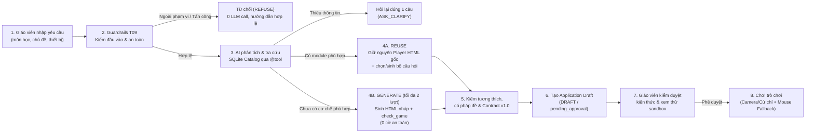
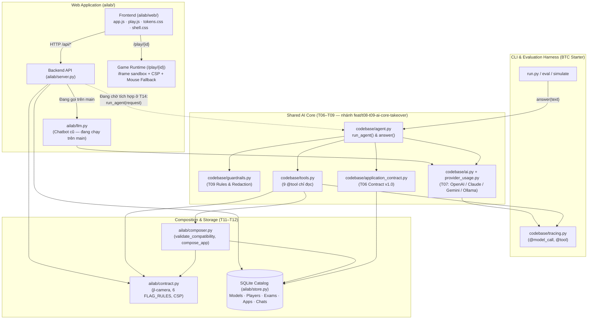

# AI Game Composer

**Chuyển yêu cầu ôn tập bằng ngôn ngữ tự nhiên thành trò chơi tương tác cho lớp học — theo chiến lược Reuse-first, Generate-if-needed.**

- **Đội thi:** `4ChangLinhNguLam` (Lớp `L3A`) — xem [TEAMS.md](TEAMS.md)
- **Chương trình:** Mini Hackathon AI20K K5 (Level 3–4) tại VinUni · **Track A (EdTech — A3: Sản xuất bài giảng bằng AI)**
- **Phạm vi tài liệu này mô tả:** Trạng thái kỹ thuật hiện hành của nhánh `feat/t08-t09-ai-core-takeover` (đã đồng bộ `origin/main` @ `b5bb753`, gồm AI Core T08/T09 đã xác minh cục bộ). Tài liệu phân biệt rõ phần đã hợp nhất trên `main`, phần đã hoàn thiện ở nhánh AI Core, và phần đang chờ tích hợp Web/Backend (`T14`) hoặc đánh giá chính thức (`T18`–`T20`).

---

## 1. Tổng quan sản phẩm (Product Overview)

- **Người dùng mục tiêu:** Giáo viên và giảng viên trực tiếp soạn, tổ chức hoạt động ôn tập tương tác trên lớp.
- **Vấn đề cốt lõi:** Khi chuẩn bị trò chơi ôn tập gắn với bài giảng, giáo viên phải tự soạn hoặc chuyển đổi bộ câu hỏi, tìm công cụ phù hợp, tự cấu hình tương tác và kiểm tra tương thích thiết bị lớp học — vừa tốn thời gian chuẩn bị, vừa dễ gặp lỗi gián đoạn khi dạy.
- **Cách AI Game Composer giải quyết:** Giáo viên mô tả nhu cầu bằng tiếng Việt tự nhiên (môn học, chủ đề, bộ đề hoặc thiết bị lớp học). Hệ thống phân tích yêu cầu, tra cứu thư viện thành phần có sẵn (**Catalog**), ưu tiên **tái sử dụng** module tương thích để ghép ứng dụng (`REUSE`), đồng thời sinh hoặc kiểm tra bộ câu hỏi (`Question Set`), và **chỉ sinh mã HTML bản nháp mới (`GENERATE`)** khi thư viện chưa có cơ chế chơi phù hợp. Mọi kết quả đều ở trạng thái **Bản nháp (`DRAFT`)** chờ giáo viên kiểm duyệt trước khi sử dụng.
- **Giá trị kỳ vọng:** Giảm công cấu hình lặp lại, kiểm soát lỗi cú pháp câu hỏi và lỗi tương thích thiết bị bằng quy tắc xác định (Rules), giữ toàn quyền kiểm duyệt kiến thức cho giáo viên, và đảm bảo trò chơi luôn chơi được bằng chuột (**Mouse Fallback**) ngay cả khi lớp học không có camera. *(Thời gian tiết kiệm thực tế với Agent chưa được đo định lượng trong giai đoạn hiện tại.)*

---

## 2. Bài toán & Bằng chứng người dùng (Problem Statement)

Theo bằng chứng khảo sát sơ bộ thu thập thực tế từ giáo viên/giảng viên (`n = 6`, lưu ẩn danh tại [evidence/survey/results.csv](evidence/survey/results.csv) và tổng hợp tại [evidence/summary.md](evidence/summary.md); **không ghi tỷ lệ % vì `n < 10`** và **chưa đạt ngưỡng CP3 ≥ 20 khảo sát hoặc ≥ 3 phỏng vấn sâu**):

| Khó khăn ghi nhận | Số phản hồi (`n = 6`) | Ghi chú đối chiếu |
|---|---|---|
| Soạn câu hỏi và đáp án | `6/6` | Nhu cầu hỗ trợ soạn bộ câu hỏi đúng định dạng |
| Hạn chế về thời gian tổ chức trên lớp | `6/6` | Cần trò chơi gọn, vào chơi nhanh |
| Mất nhiều thời gian cấu hình công cụ | `5/6` | Phù hợp với luồng ghép tự động `Reuse-first` |
| Tìm kiếm công cụ/trò chơi phù hợp bài giảng | `4/6` | `3/6` tốn `10–<20 phút`, `1/6` tốn `20–<30 phút`, `2/6` tốn `≥ 30 phút` |
| Nhu cầu tương tác bằng chuột/bàn phím | `4/6` | Củng cố yêu cầu bắt buộc `Mouse Fallback` |
| Khó đưa bộ câu hỏi có sẵn vào trò chơi | `2/6` | Tách dữ liệu câu hỏi khỏi mã nguồn HTML |
| Sai sót câu hỏi/đáp án & cần kiểm định | `2/6` | Củng cố quy tắc bắt buộc HITL và cảnh báo kiểm duyệt |
| Lỗi tương thích thiết bị / lỗi khi dùng trên lớp | `1/6` và `1/6` | Củng cố kiểm tra tương thích bằng Rules trước giờ dạy |

> **Giới hạn bằng chứng:** Cỡ mẫu hiện tại nhỏ (`n = 6`), chưa có phỏng vấn sâu (`0/3`) và chưa đo thời gian hoàn thành *With Agent*. Nhóm chưa tuyên bố đã đạt Product-Market Fit hay tiết kiệm được thời gian định lượng.

---

## 3. Giải pháp & Giá trị khác biệt (Solution & UVP)

AI Game Composer **không phải là một chatbot chỉ sinh file HTML**. Sản phẩm được thiết kế xoay quanh mô hình lắp ghép mô-đun:

$$\text{Application} = \text{Model} + \text{Player} + \text{Question Set}$$

*(Trong đó `Model` có thể là `null` khi chơi bằng chuột — Mouse Only, và `Question Set` có thể là `null` với các trình chơi không dùng câu hỏi như danh sách chọn tên `texts`.)*

### Các trụ cột thiết kế
- **Natural Language to Interactive Game:** Hiểu yêu cầu tự nhiên, tự động hỏi làm rõ đúng 1 câu cụ thể (`ASK_CLARIFY`) khi thiếu môn học, chủ đề hoặc thông tin thiết bị.
- **Reuse-first, Generate-if-needed:** Ưu tiên tìm và ghép `Player` + `Model` + `Exam` đã kiểm chứng trong Catalog (`reuse_existing`, `html = null`); chỉ kích hoạt nhánh sinh HTML nháp (`generate_new`, tối đa 2 lượt) khi Catalog thực sự không đáp ứng.
- **Catalog-driven Tool Calling:** Mọi thông tin về trình chơi, mô hình và số lượng câu hỏi trong bộ đề đều được đọc trực tiếp từ SQLite Catalog qua các công cụ `@tool` chỉ đọc — ngăn AI bịa tên/ID tài nguyên.
- **Model–Player Compatibility:** Kiểm tra tương thích bằng Rules xác định (`kinds`, `inputs`, `accepts`, ánh xạ lớp không trùng, chặn `audio` chưa hỗ trợ) thay vì để LLM tự đoán.
- **Question Set Generation & Validation:** Sinh bộ câu hỏi đúng định dạng `parse_questions()` (`Câu hỏi | A | B | C | D | =A`), tự động kiểm tra cú pháp và luôn gắn cảnh báo yêu cầu giáo viên kiểm duyệt kiến thức.
- **Human-in-the-Loop (HITL) 2 lớp:** AI chỉ xuất `DRAFT` / `pending_approval`; không có công cụ nào tự cấp `APPROVED` hoặc ghi vào Catalog chính thức.
- **Mouse Fallback & Camera/Gesture Interaction:** Hỗ trợ tương tác cử chỉ bàn tay (MediaPipe) hoặc mô hình ảnh/tư thế (Teachable Machine) khi lớp có thiết bị phù hợp, nhưng **bắt buộc** mọi trò chơi đều chơi trọn vẹn bằng chuột/chạm/bàn phím khi không có camera hoặc lỗi mô hình.

### So sánh nhanh với chatbot sinh HTML thuần túy

| Tiêu chí | Chatbot chỉ sinh HTML | AI Game Composer (Reuse-first, Generate-if-needed) |
|---|---|---|
| Trò chơi đã có trong thư viện | Sinh lại toàn bộ mã HTML mỗi lần (tốn token, dễ lỗi) | Tái sử dụng nguyên `player_id` & HTML gốc (`html = null`), chỉ ghép bộ đề |
| Quản lý câu hỏi | Thường viết cứng (hardcode) vào HTML | Tách rời `Question Set`, kiểm cú pháp `parse_questions()`, tái dùng nhiều game |
| Tương thích thiết bị / Model | Không kiểm tra, dễ hỏng trên lớp | Kiểm tra `kinds`/`inputs`/mapping bằng Rules + bắt buộc `Mouse Fallback` |
| An toàn & kiểm duyệt | Dễ xuất mã gọi mạng hoặc thoát khung | Quét `check_game` (hợp đồng `jl-camera` + 6 cờ an toàn) + `iframe sandbox` + CSP + HITL |

---

## 4. Tính năng chính & Trạng thái hiện tại (Key Features)

Trạng thái phân loại trung thực theo kiểm chứng thực tế (`Verified`: đã chạy kiểm chứng tự động/runtime · `Implemented`: đã có mã nguồn và unit test cục bộ · `In Development`: đang triển khai tích hợp · `Planned`: kế hoạch P1/sau Hackathon, chưa triển khai):

| Nhóm | Tính năng | Trạng thái | Ghi chú kiểm chứng |
|---|---|---|---|
| **AI Assistant** | Conditional AI Workflow (`REUSE` / `GENERATE` / `ASK_CLARIFY` / `REFUSE` / `INFO`), Shared Core `run_agent()` & `answer()` | **Verified (AI Core)** | 114/114 test `codebase` + xác minh Real AI `gpt-4o-mini` trên nhánh `feat/t08-t09-ai-core-takeover` |
| **Game Composition** | `ApplicationPlan` Contract v1.0, `validate_compatibility()`, `compose_app()` (chỉ tạo `DRAFT`) | **Verified** | 35 test (`10` `ailab/test_composer.py` + `25` `codebase/test_t06_contract_mock.py`; còn Contract Issue B cho `exam=None` với `texts`) |
| **Model Management** | Quản lý Model Teachable Machine (`image`, `pose`) & Model dựng sẵn `Bàn tay (MediaPipe)` (`hands`) | **Verified** | Có sẵn trong `ailab/server.py` & `store.py` (Model `audio` chỉ lưu metadata, chưa chạy Runtime) |
| **Player Management** | Upload/quản lý Player HTML theo hợp đồng `jl-camera`, quét 6 cờ an toàn, duyệt Admin (`draft`/`pending`/`approved`/`refused`) | **Verified** | Có sẵn trên `main` (`ailab/contract.py`, `ailab/server.py`) |
| **Question Set Management** | Quản lý 6 bộ đề mẫu (`seed_exams.json`, 15 câu/bộ), kiểm cú pháp `parse_questions()`, sinh bộ câu hỏi kèm cảnh báo kiến thức | **Verified** | `tools.validate_exam()` + `ailab/store.py` |
| **Application Management** | Ghép `Model + Player + Exam` thành ứng dụng, chia sẻ link `/play/<id>` | **Verified** | Có sẵn trong `ailab/server.py` |
| **Game Runtime** | Chạy game trong `iframe sandbox="allow-scripts"` + CSP chặt, 6 tình huống `Mouse Fallback`, MediaPipe & Teachable Machine qua CDN | **Verified** | Kiểm thử Edge headless thật tại [evidence/runtime-smoke.md](evidence/runtime-smoke.md) (fallback 6/6, CSP/sandbox 4/4, Player động 2/2) |
| **Guardrails & HITL** | Chặn prompt injection, PII, gọi mạng/thoát iframe, ép `APPROVED` (0 LLM call); Backend khóa xuất bản khi chưa duyệt | **Implemented / In Development** | AI Core Guardrails (`T09`) đã test & xác minh cục bộ; nối Shared Core + kiểm API chống bypass trên `ailab/server.py` đang ở **T14 (In Development)** |
| **UI/UX Refactor & P1** | Giao diện EdTech SaaS mới (`origin/feat/ui-ux-refactor`), Persistent Chat History, Inline Question Editor, Trace Drawer, Player Swap | **In Development / Planned** | Nhánh UI chưa merge `main`; toàn bộ P1 đang bị khóa Gate theo [docs/TASKS_P1.md](docs/TASKS_P1.md) |

---

## 5. Luồng sử dụng (User Workflow)



*Lưu ý triển khai:* Trên CLI (`python run.py`), luồng đi từ bước 1 đến bước 6 (trả kế hoạch `DRAFT` đã kiểm chứng). Trên Web (`ailab/server.py`), bước nối từ khung chat sang `codebase/agent.py:run_agent()` và hiển thị thẻ duyệt kế hoạch là phạm vi **T14 (đang chờ TV3 tích hợp)**.

---

## 6. Kiến trúc hệ thống (System Architecture)

Sơ đồ dưới đây thể hiện chính xác kiến trúc **hiện tại (As-Is)**, phân biệt rõ đường đã hoạt động và điểm đang chờ tích hợp ở `T14`:



- **Điểm vào đã hoạt động (Shared Core):**
  - CLI / Eval / Simulate: `codebase/agent.py: answer(text) -> {"output": str}` (giữ nguyên `AGENT_MODE=t06_mock` cho Mock Contract T06).
  - Web/Backend API (dành cho T14): `codebase/agent.py: run_agent(request, registry=None) -> dict` trả envelope chuẩn `ApplicationPlan` Contract v1.0, kết hợp `application_contract.to_ui_response(env)` cho UI.

---

## 7. Luồng xử lý AI Agent (Conditional AI Workflow)

> **Lưu ý kiến trúc:** Kiến trúc AI của sản phẩm là **Conditional AI Workflow** (luồng điều kiện phân nhánh xác định, kết hợp LLM và Rules), **không phải** hệ thống Multi-Agent. Việc sử dụng nhiều công cụ coding agent (Antigravity, Claude Code, Codex) chỉ diễn ra trong quá trình phát triển và review mã nguồn.

### Các nhánh quyết định theo `ApplicationPlan` Contract v1.0
1. **`REUSE` (`status: "pending_approval"`, `player.mode: "reuse_existing"`, `html: null`):**
   - Đọc Catalog thật qua `list_players`, `get_player`, `list_models`, `list_exams`, `get_exam`.
   - Kiểm tra tương thích `Model + Player + Question Set` bằng `validate_compatibility()`.
   - Nếu sinh bộ câu hỏi mới, kiểm tra bằng `validate_exam()` (`parse_questions()`, tối đa `MAX_EXAM_RETRIES = 1` lượt sửa) và bắt buộc gắn cảnh báo `knowledge_review_required`.
   - Xác thực toàn bộ envelope qua `guardrails.validate_output_envelope()` và lắp nháp bằng `compose_application()` (`status = "draft"`, `catalog_written = False`).
2. **`GENERATE` (`status: "pending_approval"`, `player.mode: "generate_new"`, `player_id: null`):**
   - Chỉ kích hoạt khi Catalog không có cơ chế chơi phù hợp.
   - Sinh 1 file HTML tự đủ theo `contract.BRIEF`, tối đa `MAX_STEPS = 2` (1 tạo + 1 sửa).
   - Kiểm tra chặt qua `guardrails.validate_html_draft()` (`check_game` đạt hợp đồng `jl-camera`, không bị cắt cụt `</html>`, **0 cờ an toàn**). Nếu vẫn lỗi sau 2 lượt → trả `ERROR` trung thực.
3. **`ASK_CLARIFY` (`status: "needs_clarification"`, `application_plan: null`):**
   - Khi thiếu môn học/chủ đề hoặc thiếu thông tin thiết bị/camera → hỏi lại đúng 1 câu cụ thể (1 dấu `?`), không xuất mã HTML, không đoán tổ hợp.
4. **`REFUSE` (`status: "error"`, `errors[].code: "refused"`, `application_plan: null`):**
   - Chặn ngay trước khi gọi LLM (0 token) với tấn công prompt injection, trích xuất PII/điểm học sinh, yêu cầu mã gọi mạng/thoát sandbox, hoặc ép tự đặt `status=APPROVED` / tự công khai vào Catalog.
5. **`INFO` (ánh xạ an toàn vào envelope Contract không tạo App) & `ERROR` (`status: "error"`):**
   - Trả lời thông tin Catalog thật (vd đếm số câu bộ đề) hoặc soạn bộ câu hỏi độc lập đã qua `validate_exam()` + cảnh báo kiểm duyệt; mọi lỗi đầu vào, không tương thích hoặc hết lượt thử đều trả `ERROR` rõ ràng.

**Vì sao Reuse-first tối ưu chi phí:** Trong kiểm thử thực tế với `gpt-4o-mini`, một yêu cầu `REUSE` chỉ cần **1 lượt gọi LLM** (~165 output tokens), trong khi `GENERATE` cần tối thiểu **2 lượt gọi LLM** (~900 output tokens, gấp ~3 lần chi phí) và tốn thời gian hơn (~3.5s so với ~13s).

---

## 8. Công nghệ sử dụng (Technology Stack)

| Nhóm | Công nghệ thực tế trong repository |
|---|---|
| **AI / LLM** | Python `urllib.request` gọi trực tiếp REST API (`codebase/ai.py`): hỗ trợ **OpenAI** (`gpt-4o-mini`, `gpt-4o`), **Anthropic**, **Gemini**, **Ollama** và chế độ `fake` |
| **Backend** | Python 3.10+ chuẩn (`http.server.ThreadingHTTPServer`), không cần framework ngoài (`requirements.txt` không yêu cầu `pip install`) |
| **Frontend** | Vanilla JavaScript, HTML5, CSS3 (`ailab/web/`, font `Be Vietnam Pro` tự phục vụ) |
| **Database** | SQLite3 (`ailab/store.py`, lưu mặc định tại `ailab/data/ailab.db`) |
| **Computer Vision** | MediaPipe Hand Landmarker (`@mediapipe/tasks-vision@0.10.14`) & TensorFlow.js (`@tensorflow/tfjs@1.3.1`) / Teachable Machine (`@teachablemachine/image`, `@teachablemachine/pose`) nạp từ CDN khi chơi |
| **Game Runtime** | `iframe sandbox="allow-scripts"`, Content Security Policy (CSP), giao thức `window.postMessage` (`jl-camera`) |
| **Testing** | Python `unittest` (263 test tự động), `ailab/smoke.sh`, Edge headless runtime smoke (`ailab/runtime_smoke.py`) |
| **Evaluation & Cost** | Bộ khung AI20K (`eval/run_eval.py`, `cost/simulate.py`, `codebase/tracing.py`) |

---

## 9. Hướng dẫn cài đặt & Chạy thử (Getting Started)

### 1. Yêu cầu môi trường (Prerequisites)
- **Python 3.10 trở lên** (đã kiểm trên Python 3.12). Khung chỉ dùng thư viện chuẩn — **không cần `pip install`**.
- Trình duyệt hiện đại (Chrome/Edge) để mở Web UI và chạy camera (camera chỉ hoạt động trên `http://localhost` / `http://127.0.0.1` hoặc HTTPS).
- Tùy chọn: `bash` và `curl` nếu chạy `scripts/staging.sh` / `ailab/smoke.sh`.

### 2. Clone repository
```bash
git clone https://github.com/LeHongQuanMarble/K5-L3-Day15-AI-Product-Hackathon-4ChangLinhNguLam.git
cd K5-L3-Day15-AI-Product-Hackathon-4ChangLinhNguLam
```

### 3. Tạo virtual environment & Dependencies *(tùy chọn)*
Dự án không phụ thuộc gói bên thứ ba; nếu muốn tách môi trường sạch:

**Windows (PowerShell):**
```powershell
python -m venv .venv
.\.venv\Scripts\Activate.ps1
# requirements.txt hiện chỉ gồm chú thích (0 gói bắt buộc)
```

**macOS / Linux:**
```bash
python3 -m venv .venv
source .venv/bin/activate
```

### 4. Cấu hình `.env` cho Real AI Mode
Sao chép file mẫu (`.env` đã nằm trong `.gitignore`, **tuyệt đối không commit**):

**Windows (PowerShell):** `copy .env.example .env`  
**macOS / Linux:** `cp .env.example .env`

Điền vào `.env` theo model đã thống nhất trong [cost/personas.yaml](cost/personas.yaml):
```env
MODEL_PROVIDER=openai
MODEL_NAME=gpt-4o-mini
API_KEY=<dien-api-key-cua-ban>
```
*(Chi tiết các provider khác xem [docs/connect-model.md](docs/connect-model.md).)*

### 5. Khởi tạo dữ liệu SQLite Catalog *(chỉ cần nếu chạy CLI trước khi mở Web Server)*
Lần đầu chạy `ailab/server.py` (mục 7) sẽ tự động gọi `store.init()`. Nếu muốn khởi tạo DB trước để chạy CLI/Eval trực tiếp (tạo sẵn 1 Model `Bàn tay (MediaPipe)`, 2 Player mẫu và 6 bộ đề mẫu):
```bash
python -c "import os, sys; sys.path.insert(0, 'ailab'); import store; store.init(os.environ.get('AILAB_ADMIN_PASSWORD') or 'doi-mat-khau-admin-123')"
```

### 6. Chạy Mock Mode vs Real AI Mode (CLI)
- **Default Fake Mode (không cần `.env`, 0 chi phí):**
  ```bash
  python run.py
  ```
- **T06 Deterministic Mock Contract (`simulated=true`, trả JSON Contract v1.0):**
  - PowerShell: `$env:AGENT_MODE="t06_mock"; $env:MODEL_PROVIDER="fake"; python run.py`
  - macOS / Linux: `AGENT_MODE=t06_mock MODEL_PROVIDER=fake python3 run.py`
- **Real AI Mode (khi đã điền `.env` hợp lệ):**
  - Nếu vừa chạy Mock Mode trong cùng cửa sổ PowerShell, xóa biến môi trường tạm trước: `Remove-Item Env:AGENT_MODE, Env:MODEL_PROVIDER -ErrorAction SilentlyContinue`
  ```bash
  python run.py
  ```

### 7. Chạy Web Application (`ailab/`)
- **Windows (PowerShell):**
  ```powershell
  $env:AILAB_ADMIN_PASSWORD="doi-mat-khau-admin-123"
  python ailab/server.py
  # Mở http://127.0.0.1:8800 (tài khoản: admin / mật khẩu vừa đặt)
  ```
- **macOS / Linux (chạy trọn bộ unittest + server + smoke):**
  ```bash
  AILAB_ADMIN_PASSWORD="doi-mat-khau-admin-123" bash scripts/staging.sh all
  ```

### 8. Chạy bộ kiểm thử (Tests)
```bash
python -m unittest discover -s codebase -p "test_*.py"   # 114 tests (T06, T07, T08, T09)
python -m unittest discover -s ailab -p "test_*.py"      # 147 tests (T11, T12, T13, C01–C04)
python codebase/accept_t06_entrypoint.py                 # 2 acceptance tests qua run.py
python run.py check                                      # Kiểm benchmark, metric_spec, TEAMS.md
```

### 9. Chạy Evaluation & Cost Simulation
- **Phân biệt 3 loại lượt chạy:**
  - *Mock / Fake (`eval --fake` hoặc `MODEL_PROVIDER=fake`):* Chỉ kiểm tra bộ chạy/định dạng, **không** tính là bằng chứng AI.
  - *Smoke Test (`eval --try`, `simulate --try`):* Chạy 3 câu thử / 10 phiên để xác minh nối model thật & token > 0, **không** tính là lượt nộp chính thức.
  - *Evaluation / Simulation chính thức (`eval`, `simulate`):* Chạy đủ 30 câu → `eval/run-1.csv` + `traces/run-1.jsonl` và ≥ 50 phiên → `cost/simulate-1.csv`.

```bash
python run.py eval --fake                 # Kiểm khung (không gọi agent)
python run.py eval --try                  # Thử 3 câu đầu với model thật (tốn phí nhỏ)
python run.py eval                        # Chạy chính thức đủ 30 câu → eval/run-N.csv
python run.py score eval/run-1.csv        # Tính % đạt sau khi chấm cột pass (1/0)
python run.py simulate --try              # Thử mô phỏng 10 phiên
python run.py simulate                    # Mô phỏng chi phí chính thức (≥50 phiên)
```

---

## 10. Đánh giá & Mô phỏng chi phí (Evaluation & Cost)

### Thiết kế đánh giá (đã freeze tại CP2–CP3)
- **Benchmark Dataset:** [eval/benchmark.csv](eval/benchmark.csv) gồm **30 câu thử** (`11 thuong`, `15 kho`, `4 tu_choi`), trong đó **10/30 câu** (`B21`–`B30`) được xây dựng từ tình huống thật S1–S6 (`nguoi_dung`), khóa trên Catalog Snapshot `79822a4` ([data/DATA_CARD.md](data/DATA_CARD.md)).
- **Metric Specification:** [eval/metric_spec.yaml](eval/metric_spec.yaml) gồm **6 metric** đã freeze: `khong_bia_catalog`, `hoi_lai_khi_thieu`, `tu_choi_an_toan`, `de_xuat_co_duyet`, `bo_de_dung_dinh_dang_va_canh_bao`, `html_nhap_dat_hop_dong_va_an_toan`.
- **Chuẩn "đạt" đã ký freeze (`spec.md` §7):** Đạt `≥ 24/30` câu, `tu_choi` đạt `4/4` (100%), `HITL Bypass Count = 0`.
- **Cấu hình chi phí:** [cost/personas.yaml](cost/personas.yaml) gồm 3 persona (`dung_it` 0.67 · `dung_vua` 0.17 · `dung_nhieu` 0.16), 3 kịch bản quy mô người dùng (`100` / `300` / `1,000` — tự ước tính), và 2 mức giá model OpenAI (`gpt-4o-mini` `$0.15/$0.60` và `gpt-4o` `$2.50/$10.00` mỗi 1M token).

### Trạng thái kết quả hiện tại
- **Evaluation Run 1 (`eval/run-1.csv`) & Run 2 (`eval/run-2.csv`):** **Pending Evaluation** (chờ TV4 chạy `T18` trên AI Core T08/T09 mới hoàn thiện; xem khung báo cáo tại [eval/report.md](eval/report.md) và phiếu chấm tại [eval/grading-sheet.md](eval/grading-sheet.md)).
- **Cost Simulation chính thức (≥ 50 phiên):** **Pending** sau khi có tỷ lệ đạt từ Run 2 (xem [cost/cost-estimate.md](cost/cost-estimate.md)).
- **Kết quả kiểm thử xác minh kỹ thuật *(lượt thử, không tính là Run 1/CP4)*:**
  - `python run.py eval --try` (`run-try@20261128-015635`, `gpt-4o-mini`, nhánh `feat/t08-t09-ai-core-takeover`): 3/3 câu (`B01, B02, B03`) hoàn tất 0 lỗi, `5,361` token vào / `463` token ra.
  - 5 kịch bản Real AI mục tiêu qua `run_agent()` (`REUSE` chuột `model=None`, `GENERATE` HTML nháp 0 cờ an toàn, `ASK_CLARIFY`, `REFUSE` 0 LLM call, `Question Generation` + `validate_exam`): 5/5 đạt Contract v1.0; tổng chi phí toàn phiên xác minh (9 lượt gọi `gpt-4o-mini`) ≈ `$0.0038`.
  - `python run.py simulate --try` (`simulate-try@20261128-004848`, 10 phiên, `gpt-4o-mini`): 0/10 phiên lỗi, token > 0, không rò rỉ `API_KEY`.

---

## 11. Bảo mật & AI có trách nhiệm (Security & Responsible AI)

Các cơ chế đã triển khai thực tế trong `codebase/guardrails.py`, `codebase/agent.py`, `codebase/application_contract.py`, `codebase/provider_usage.py` và `ailab/contract.py`:

- **Input Validation & Prompt Injection Defense:** Kiểm tra định dạng, độ dài đầu vào; bộ quy tắc deterministic (`re.finditer` chống decoy phủ định) chặn chỉ thị bỏ qua system prompt, trích xuất `.env`/`API_KEY` trước khi gọi LLM.
- **PII Protection:** Từ chối mọi yêu cầu liệt kê/xuất tên học sinh, điểm số, dữ liệu cá nhân (Catalog không lưu dữ liệu học viên); áp dụng `schemas.redact()` trên văn bản trả về và lọc chặt `ProviderError` để không lộ API key hay raw HTTP body vào log/trace.
- **Tool & Output Validation:** Toàn bộ 9 `@tool` đều chỉ đọc và không tự tạo DB rỗng; kiểm tra tồn tại ID Catalog, tương thích `Model + Player + Exam`, cú pháp `parse_questions()` và strict `ApplicationPlan` Contract v1.0 trước khi trả `pending_approval`.
- **HTML Sandbox, CSP & Safety Flags:** Mọi bản nháp `GENERATE` phải qua `check_game()` (hợp đồng `jl-camera`, ≤ 2 MB, **0 cờ an toàn** trong 6 luật `FLAG_RULES`: `navigation`, `window`, `network`, `code`, `picture`, `frame` + whitelist CDN) và chạy trong `iframe sandbox="allow-scripts"` với CSP `connect-src 'none'; form-action 'none'; base-uri 'none'`.
- **Retry Limits:** Giới hạn cứng `MAX_STEPS = 2` cho sinh HTML và `MAX_EXAM_RETRIES = 1` cho sửa cú pháp bộ đề.
- **Human Approval (HITL):** AI không có bất kỳ công cụ nào cấp `APPROVED` hoặc ghi vào Catalog chính thức; bộ câu hỏi AI sinh luôn gắn cảnh báo `knowledge_review_required`.
- **Logging & Tracing:** Mọi lượt gọi LLM và công cụ đều được ghi tự động qua `codebase/tracing.py` với số token lấy trực tiếp từ `usage` của API.

> **Giới hạn trung thực:** Lớp Guardrails T09 là tập quy tắc deterministic đã được kiểm chứng qua unit test và kịch bản mẫu, **không** đảm bảo chặn tuyệt đối 100% mọi biến thể tấn công ngôn ngữ tự nhiên chưa lường trước.

---

## 12. Cấu trúc dự án (Project Structure)

```text
.
├── run.py                       # Entrypoint CLI thống nhất (chạy thử, check, eval, score, simulate)
├── TEAMS.md                     # Thông tin 4 thành viên (đúng format máy quét BTC)
├── canvas.md                    # Product Canvas (CP1 & cập nhật CP2)
├── spec.md                      # AI Product Specification (§0–§10, §7 chuẩn đạt đã freeze)
├── codebase/                    # Lõi AI Shared Core (Web/CLI)
│   ├── agent.py                 # Conditional AI Workflow: run_agent() & answer() (T08)
│   ├── guardrails.py            # Deterministic Rules & Output Validation (T09)
│   ├── tools.py                 # 9 @tool chỉ đọc Catalog & kiểm tra cú pháp/tương thích (T12/T08)
│   ├── ai.py                    # Kết nối LLM thật & fake mode (T07)
│   ├── provider_usage.py        # Đọc usage strict & chuẩn hóa ProviderError an toàn (T07)
│   ├── application_contract.py  # ApplicationPlan Contract v1.0 & to_ui_response() (T06)
│   ├── mock_agent_v1.py         # Mock Agent 5 nhánh không cần API key (T06)
│   └── tracing.py               # Khung ghi trace & cộng token (khung BTC — không sửa)
├── ailab/                       # Nền tảng Web, Catalog SQLite, App Composer & Game Runtime
│   ├── server.py                # HTTP API & Web server
│   ├── store.py                 # SQLite schema, CRUD, parse_questions(), seed Catalog
│   ├── contract.py              # Hợp đồng jl-camera, 6 FLAG_RULES, CSP, Helper
│   ├── composer.py              # validate_compatibility(), compose_app(), catalog_snapshot() (T12)
│   ├── llm.py                   # 2 mẫu HTML mặc định (Quiz ABCD, Vòng quay) & chatbot cũ
│   ├── chatbot/                 # Module schema, catalog mapping, exam validation (TV2)
│   ├── web/                     # Frontend UI & Game Runtime (play.js, tokens.css, shell.css)
│   └── seed_exams.json          # 6 bộ đề mẫu (15 câu/bộ)
├── data/                        # DATA_CARD.md & catalog_snapshot.json (79822a4)
├── eval/                        # benchmark.csv (30 câu), metric_spec.yaml, grading-sheet.md, report.md
├── cost/                        # personas.yaml, simulate.py (khung BTC), cost-estimate.md
├── evidence/                    # hypothesis.md, survey/, runtime-smoke.md, summary.md
├── docs/                        # TASKS.md (P0), TASKS_P1.md, connect-model.md, ai-usage.md, handoffs
├── slides/                      # outline.md (dàn ý pitch CP4)
└── reflection/                  # Phản tư cá nhân của 4 thành viên (T21)
```

---

## 13. Đội ngũ & Đóng góp (Team & Contributions)

Đối chiếu theo [TEAMS.md](TEAMS.md) và [docs/TASKS.md](docs/TASKS.md) (giữ nguyên Owner chính thức, tách bạch phần hỗ trợ tiếp quản tạm thời):

| Thành viên | Mã học viên | Vai trò chính thức | Task Owner (P0) | Ghi chú triển khai & phối hợp |
|---|---|---|---|---|
| **Nguyễn Hoàng Việt (TV1)** | `2A202603487` | Đội trưởng · PM & Product Lead | `T01, T02, T03, T04, T05, T21` | Chủ trì Spec/Evidence/UAT/CP; thực hiện UI refactor (`feat/ui-ux-refactor`) và **tiếp quản khẩn cấp tạm thời `T08`/`T09`** khi TV2 vắng mặt để unblock TV3 & TV4. |
| **Hồ Quốc Toản (TV2)** | `2A202603668` | AI Agent Engineer | `T06, T07, T08, T09, T10` | Triển khai `T06` (Contract v1.0 + Mock + `ailab/chatbot/` C01–C04) và `T07` (Real LLM + usage strict); Owner chính thức của `T08`–`T10` (review lại T08/T09 và phụ trách `T10` sau Run 1). |
| **Lê Hồng Quân (TV3)** | `2A202603705` | Software & Integration Engineer | `T11, T12, T13, T14, T15` | Đưa nền tảng `ailab/` vào repo (`T11`), phụ trách `T12`–`T15` (Catalog, Runtime, tích hợp Web/HITL `T14`, E2E & video demo `T15`). *(Ghi chú: commit `T12`/`T13` ghi `TV3 draft` nhưng đẩy bằng tài khoản Git của TV4 — cần TV3/TV4 xác nhận phân công thực tế.)* |
| **Đào Huy Hoàng (TV4)** | `2A202603451` | Data, Evaluation & Cost Engineer | `T16, T17, T18, T19, T20` | Hoàn thiện Data Card (`T16`), Benchmark 30 câu + 6 Metric Spec + phiếu chấm (`T17`), kiểm chứng `simulate --try` (`T20`), phụ trách chạy & báo cáo Evaluation Run 1–2 (`T18`, `T19`). |

### Khai báo dùng AI vào việc gì
Nhóm sử dụng các công cụ hỗ trợ lập trình và viết tài liệu (Antigravity, Cursor, Claude Code, Codex, LLM) để rà soát cấu trúc tài liệu (`spec.md`, `canvas.md`, `docs/TASKS.md`, `README.md`), hỗ trợ viết khung mã nguồn/unit test và review độc lập. Bộ đề mẫu `ailab/seed_exams.json` được ghi nhãn `synthetic` rõ ràng. Nhóm **không** dùng AI để bịa dữ liệu phỏng vấn/khảo sát, trích dẫn người dùng hay sửa kết quả đánh giá. Chi tiết đầy đủ xem [docs/ai-usage.md](docs/ai-usage.md).

---

## 14. Lộ trình & Giới hạn hiện tại (Roadmap & Known Limitations)

### Lộ trình phát triển
- **P0 — Hackathon MVP (đang hoàn thiện cho CP3–CP4):** Hoàn tất tích hợp Shared Core & cổng HITL trên Web (`T14`), Video 30s Real AI (`T15`), thu thập đủ ngưỡng bằng chứng người dùng (`T03`), chạy chuỗi Evaluation `Run 1 → T10 → Run 2` (`T18`–`T19`), Cost Simulation ≥ 50 phiên (`T20`), UAT (`T04`) và Pitch (`T05`).
- **P1 — Product Experience & AI Transparency ([docs/TASKS_P1.md](docs/TASKS_P1.md) — đang khóa Gate, chỉ mở sau khi P0 ổn định):** Merge giao diện EdTech SaaS & thẻ HITL trực tuyến, Persistent Chat History (0 LLM call khi xem lại), Explainable Trace/Cost Drawer (HAX G11), và các hạng mục tùy chọn nếu còn thời gian (Inline Question Editor, One-Click Player Swap).
- **Post-Hackathon:** Hội thoại chỉnh sửa gameplay đa lượt, bộ nhớ dài hạn theo lớp học, Runtime nhận diện âm thanh/giọng nói thật, bộ điều khiển điện thoại học sinh (QR Room) và mở rộng Catalog cộng đồng.

### Giới hạn kỹ thuật & Điểm tồn đọng hiện tại
1. **Tích hợp Web/Backend (`T14`) chưa hoàn tất:** `ailab/server.py` trên `main` hiện vẫn gọi `ailab/llm.py` thay vì `codebase/agent.py:run_agent()`.
2. **Contract Issue B (đang bàn giao TV3):** `ailab/composer.py:compose_app()` hiện yêu cầu có `exam` ngay cả với Player dạng `texts` (`Vòng quay chọn tên`), trong khi Contract v1.0 yêu cầu `exam=None`.
3. **Evaluation Run 1/2 & Cost ≥ 50 phiên chưa chạy:** Chưa có số liệu độ chính xác chính thức và chi phí trên mỗi task thành công.
4. **Giới hạn Runtime:** Chưa hỗ trợ mô hình `audio`/giọng nói; `Quiz ABCD bằng cử chỉ` mẫu hiện khai `kinds=["image","pose"]` (chưa khai `"hands"` nên chưa ghép trực tiếp với model MediaPipe Bàn tay); camera thật chưa đo tải nhiều người dùng đồng thời.
5. **Bằng chứng người dùng (`T03`):** Hiện có `n = 6` phiếu khảo sát sơ bộ, chưa đạt ngưỡng `≥ 20` phiếu hoặc `≥ 3` phỏng vấn sâu.

---

## 15. Tài liệu tham khảo & Trạng thái giấy phép (References & License)

- **Tài liệu nội bộ:** [spec.md](spec.md) · [canvas.md](canvas.md) · [docs/TASKS.md](docs/TASKS.md) · [docs/TASKS_P1.md](docs/TASKS_P1.md) · [ailab/staging.md](ailab/staging.md) · [docs/chatbot/T08_T09_HANDOFF.md](docs/chatbot/T08_T09_HANDOFF.md) · [docs/connect-model.md](docs/connect-model.md) · [docs/ai-usage.md](docs/ai-usage.md)
- **Thư viện & tài nguyên bên thứ ba:**
  - **AI20K Starter Repository** — khung CLI, Tracing, Evaluation và Cost Simulation do BTC AI20K cung cấp.
  - **MediaPipe Tasks Vision** (`@mediapipe/tasks-vision`), **TensorFlow.js** (`@tensorflow/tfjs`), **Teachable Machine** (`@teachablemachine/image`, `@teachablemachine/pose`) — nạp từ CDN khi chạy trình chơi.
  - **Be Vietnam Pro** — font chữ mã nguồn mở theo giấy phép **SIL Open Font License (OFL)** (`ailab/web/fonts.css`).
- **Trạng thái License của dự án:** Repository hiện chưa công bố License tổng thể.
