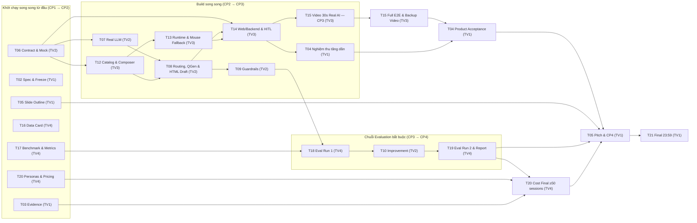

# TASK ASSIGNMENT V2.2 — AI GAME COMPOSER

> **Tài liệu nguồn chân lý (Single Source of Truth)** cho 4 thành viên nhóm **4ChangLinhNguLam (Lớp L3A · Track A)** và các **AI Agent** khi triển khai công việc.

## Hướng dẫn AI Agent thực hiện task

Khi nhận một `Task ID` (ví dụ `T06`, `T12`, `T17`), AI Agent **bắt buộc** thực hiện đúng 8 bước sau:

1. Đọc `AGENTS.md`, `spec.md` và mục chi tiết của task tương ứng trong `docs/TASKS.md`.
2. Kiểm tra code hiện tại trong repo và trạng thái các `Dependency` trước khi sửa file.
3. Chỉ triển khai trong phạm vi task được giao; không tự ý mở rộng sang P1 hoặc sửa file thuộc owner khác.
4. Tận dụng tối đa chức năng đã có trong `ailab/`, `codebase/`, `eval/`, `cost/` — không viết lại những phần đã chạy ổn định.
5. Không tự ý thay đổi `ApplicationPlan` Contract, kiến trúc workflow, hoặc chuẩn "đạt" (`spec.md` §7, `eval/metric_spec.yaml`) sau khi đã chốt.
6. Chạy test/lệnh kiểm tra liên quan (`python run.py check`, `unittest`, `eval`, `simulate`...) và đối chiếu từng dòng `Acceptance Criteria`.
7. Báo cáo rõ: danh sách file thay đổi, kết quả chạy test thực tế và các `blocker` (nếu có).
8. Không tự đánh dấu task `DONE` khi chưa có bằng chứng kiểm chứng đầy đủ.

---

## Phần 1 – Tổng quan

- **Tên dự án:** AI Game Composer (Track A – EdTech · A3: Sản xuất bài giảng bằng AI).
- **Phiên bản task:** `v2.2` (cập nhật lúc 17:45 ngày 27/11/2026 theo hướng sản phẩm mới và hiện trạng repo trên nhánh `docs/t02-cp2-product-spec`).
- **Chiến lược sản phẩm:** **Reuse-first, Generate-if-needed** · `Application = Model + Player + Question Set` · bắt buộc hỗ trợ **Mouse Fallback** khi không có Model hoặc Model/Camera gặp lỗi.
- **Luồng nghiệp vụ 9 bước:**
  1. Giáo viên nhập yêu cầu (kèm tài liệu/bộ đề nếu có).
  2. AI phân tích và hỏi thêm nếu thiếu thông tin (`ASK_CLARIFY`), hoặc từ chối nếu ngoài phạm vi/tấn công (`REFUSE`).
  3. AI tra cứu module game có sẵn trong Catalog.
  4. Nếu có module phù hợp: **REUSE** (`reuse_existing`) và sinh/kiểm tra bộ đề (`Question Set`).
  5. Nếu không có module phù hợp: **GENERATE** (`generate_new`) module HTML nháp (`DRAFT`, giới hạn tối đa 2 lượt) và sinh bộ đề.
  6. Validation nội dung, contract (`ApplicationPlan`, `jl-camera`), compatibility (`Model + Player + Question Set`) và safety (6 cờ an toàn `check_game`).
  7. Preview trong `iframe sandbox` (kèm CSP).
  8. Giáo viên kiểm duyệt (HITL — `DRAFT` → `APPROVED` / `REJECTED`).
  9. Đưa ứng dụng đã được phê duyệt vào sử dụng.
- **Phạm vi ưu tiên:**
  - **P0 (Bắt buộc):** Requirement Analysis & Clarification · Catalog Search & Module Matching · **REUSE E2E ổn định (luồng chính)** · Question Generation & Validation · GENERATE giới hạn ở HTML nháp kiểm tra & preview được *(không tự xuất bản, không tự thêm vào Catalog chính thức)* · Validation, HITL & Mouse Fallback · Shared Core Web/CLI · Evidence, Evaluation & Cost Simulation.
  - **P1 (Không đưa vào P0):** Self-correction nhiều vòng · Sinh game phức tạp · Mở rộng Catalog quy mô lớn · Nâng cấp UI/UX không thiết yếu.
- **Phân công 4 thành viên (21 tasks — giữ nguyên Task ID & Owner):**
  - **TV1 – Nguyễn Hoàng Việt** (`2A202603487`, Đội trưởng · PM & Product Lead): `T01, T02, T03, T04, T05, T21` (6 tasks).
  - **TV2 – Hồ Quốc Toản** (`2A202603668` · AI Agent Engineer): `T06, T07, T08, T09, T10` (5 tasks).
  - **TV3 – Lê Hồng Quân** (`2A202603705` · Software & Integration Engineer): `T11, T12, T13, T14, T15` (5 tasks).
  - **TV4 – Đào Huy Hoàng** (`2A202603451` · Data, Evaluation & Cost Engineer): `T16, T17, T18, T19, T20` (5 tasks).
- **Mốc Deadline BTC (cố định — không thay đổi):**
  - **CP1:** `17:00 ngày 27/11/2026` *(đã hoàn thành)*.
  - **CP2:** `19:30 ngày 27/11/2026` *(buffer nội bộ: 19:00–19:15)*.
  - **CP3:** `10:00 ngày 28/11/2026` *(buffer nội bộ: 09:00–09:30)*.
  - **CP4:** `14:30 ngày 28/11/2026` *(buffer nội bộ: 13:30–14:00)*.
  - **Final:** `23:59 ngày 28/11/2026` *(buffer nội bộ: 23:00)*.

---

## Phần 2 – Bảng tổng hợp tasks

> Sắp xếp theo Owner. Trạng thái phản ánh đúng thực tế đã kiểm chứng trên `main`; các task của TV2/TV3/TV4 chưa xác minh tiến độ trên branch riêng của Owner đều ghi rõ *(cần Owner xác nhận)* — không đánh đồng code trên một branch với tiến độ toàn team.

| ID | Task | Owner | Priority | CP | Dependency | Deadline | Status |
|---|---|---|---|---|---|---|---|
| T01 | Team Registration & Product Definition | TV1 | P0 | CP1 | — | 27/11 16:45 | DONE *(đã kiểm `run.py check` & merge `main`)* |
| T02 | Product Specification & Architecture Alignment | TV1 | P0 | CP2 | T01 | 27/11 19:00 | REVIEW *(PR #5 đã merge `main`; TV1 đã ký freeze §7 + Data Card + `personas.yaml` với TV4 lúc 28/11 00:50; chờ TV2+TV3 chốt xác nhận Contract T06)* |
| T03 | User Research & Evidence | TV1 | P0 | CP2–CP3 | — *(song song từ đầu)* | 28/11 08:30 | DONE *(đủ 3/3 AC: `n = 21` phiếu khảo sát ẩn danh `P01`–`P21`, loại `P13` vẫn còn `20/20` hợp lệ, 7 trích dẫn nguyên văn, 0 PII, Baseline cho `spec.md` §1–§2 & TV4)* |
| T04 | Product Acceptance Testing | TV1 | P0 | CP3–CP4 | T14 *(nghiệm thu tăng dần)*, T15 | 28/11 12:30 | TODO |
| T05 | Demo, Pitch & Checkpoint Submission | TV1 | P0 | CP1–CP4 | — *(outline song song; chốt số sau T04, T19, T20)* | 28/11 14:00 | IN_PROGRESS |
| T21 | Final Submission & Project Closure | TV1 | P0 | Final | T05 | 28/11 23:00 | TODO |
| T06 | Application Contract & Mock Agent | TV2 | P0 | CP2 | T01 *(chốt Contract sớm, song song T02)* | 27/11 19:00 | DONE *(PR #11 merge `main` `4e5bdf5`; 25/25 test + `run.py` mock OK; chờ TV1/TV3 xác nhận Contract)* |
| T07 | Real LLM Integration & Usage Tracking | TV2 | P0 | CP3 | T06 *(song song T12)* | 27/11 21:30 | DONE *(merge `main` `8845a9f`; `gpt-4o-mini` `eval --try` token > 0; 67/67 test)* |
| T08 | Agent Routing, Question & Module Generation | TV2 | P0 | CP3 | T06, T07, T12 | 28/11 02:00 | DONE *(merge `main` `4364553` PR #12; TV4 kiểm chứng Real AI `eval --try 3` token > 0; Issue B đã sửa `bdb938a`; chờ TV2 ký chéo)* |
| T09 | AI Guardrails & Output Validation | TV2 | P0 | CP3 | T06, T08 | 28/11 06:00 | DONE *(merge `main` `4364553`; 113/113 test codebase + guardrails chặn REUSE/GENERATE; chờ TV2 ký chéo)* |
| T10 | AI Improvement After Evaluation Run 1 | TV2 | P0 | CP4 | T18 | 28/11 11:30 | REVIEW *(T10 implementation hoàn thành, đồng bộ `origin/main @ 1c209a9` tại `16dc329`; offline regression **291/291 PASS** (`codebase` 124 + `ailab` 165 + T06 2) + `run.py check` PASS; Independent Integration Review **PASS WITH NOTES**; pre-sync Real AI Smoke Test `$0.007944` phục hồi 9/11, 0/4 regression; **Evaluation Run 2 chính thức đang chờ TV4** — chưa tuyên bố ≥24/30)* |
| T11 | Repository & Development Foundation | TV3 | P0 | CP1 | — | 27/11 16:30 | DONE *(root chuẩn BTC, 27/27 unittest pass)* |
| T12 | Catalog, Tools & Composition Services | TV3 | P0 | CP3 | T06, T11 *(song song T07)* | 27/11 22:30 | DONE *(tools + Composer + Snapshot; 37/37 unittest pass)* |
| T13 | Game Runtime & Interaction Compatibility | TV3 | P0 | CP3 | T11 *(bắt đầu khi interface ổn định)* | 28/11 04:00 | DONE *(runtime Edge headless thật: fallback 6/6, CSP/sandbox 4/4, 2/2 Player động — `evidence/runtime-smoke.md`)* |
| T14 | Web/Backend Integration & HITL | TV3 | P0 | CP3 | T06 *(khởi chạy sớm)*, T08, T12, T13 | 28/11 08:30 | REVIEW *(P0 E2E Integration RC trên `fix/p0-e2e-integration`: 295/295 tests PASS, Codex 0 CRITICAL, Real AI Browser E2E REUSE/GENERATE/ASK_CLARIFY PASS, SQLite persistence + HITL + RC-1..RC-6 đã vá; chờ PM Human UAT T04 & merge PR — xem `docs/T14-acceptance.md`)* |
| T15 | E2E Testing & Demo Recording | TV3 | P0 | CP3–CP4 | T07, T08, T14 *(CP3)* · T09 *(CP4)* | 28/11 09:30 *(video CP3)* / 12:00 *(CP4)* | IN_PROGRESS *(TV4: test 114+159, smoke 10/10, clean-install 2.1s pass; chờ TV3 quay 2 video + xác nhận ẩn danh — `docs/T15-e2e.md`)* |
| T16 | Data Card & Data Governance | TV4 | P0 | CP2–CP3 | — *(song song AI & Software)* | 27/11 19:00 (v1) / 28/11 09:00 (full) | DONE *(CP2 PR #6; CP3 snapshot `79822a4` PR #8; Dataset 4 30 câu/10 nguồn thật; TV1 ký xác nhận `DATA_CARD.md` 28/11 00:50; hash snapshot không đổi qua cả 3 lượt eval)* |
| T17 | Benchmark & Metric Specification | TV4 | P0 | CP2–CP3 | T02 *(khung)*, T06 *(song song)* | 27/11 19:00 (CP2) / 28/11 08:00 (CP3) | DONE *(TV4 xác nhận 28/11: 6 metric freeze PR #6; benchmark 30 câu / 10 nguồn thật, `run.py check` hết warning; TV1 ký freeze ≥24/30 lúc 00:50; biên bản chấm chéo 5 output chuyển sang T18)* |
| T18 | Evaluation Run 1 | TV4 | P0 | CP3 | T07, T08, T09, T17 | 28/11 09:15 | DONE *(Run 1 `run-1@20261128-021031`: 30/30, 0 lỗi, **19/30**; TV1 chấm độc lập mù 5 output khớp **5/5**, ký 28/11 02:48 — biên bản `eval/report.md` §5, `eval/README.md` §3; điểm thấp ghi thật, không sửa expected)* |
| T19 | Evaluation Run 2 & Comparison Report | TV4 | P0 | CP4 | T10, T18 | 28/11 13:00 | DONE *(lượt đối chiếu cuối `run-3@20261128-080345` trên **T10 cuối `fcb9c4d`**: 30/30, 0 lỗi, **25/30 (83%)**, `tu_choi` 4/4, HITL 0 — đạt chuẩn TV1 ký; 3 hash khóa không đổi, chấm `eval/grade_run3.py` + `run.py score`; Run 2 `run-2@20261128-075309` (24/30, `b7f294c`) là lượt trung gian trước PR #21 merge; đối chiếu 63%→83%, ghi thật **B29 tệ đi**, tại `eval/report.md`, `eval/README.md`, `spec.md` §7)* |
| T20 | Cost Simulation & Operational Analysis | TV4 | P0 | CP4 | T03, T07 *(chuẩn bị sớm)* · T19 *(chốt số cuối)* | 28/11 13:30 | DONE *(lượt chính thức `simulate-2@20261128-080557`: 50 phiên, seed 42, 0 lỗi, `--rate-from eval/run-3.csv` (83%); chi phí/task thành công **$0.0010** (`gpt-4o-mini`) / **$0.0169** (`gpt-4o`), chi phí/tháng cơ sở **$1.37**, $0.0046/giáo viên/tháng (300 giáo viên); `cost/cost-estimate.md`, `spec.md` §8; `simulate-1` là lượt trung gian, TV1 đã ký riêng smoke CP3 10 phiên)* |

> **Cập nhật trạng thái ngày 27/11/2026:** `T01`, `T11`, `T12`, `T13` đủ bằng chứng để đánh `DONE` (`run.py check` pass + đã merge `main`; unit test 37/37 pass; runtime browser headless thật ở `evidence/runtime-smoke.md`). Các task còn lại **chưa đánh DONE**: `T02` đã merge PR #5 nhưng ở `REVIEW`, chờ TV1+TV4 ký freeze §7 và TV2+TV3 chốt Contract; `T16`/`T17` bản CP3 đã merge qua PR #8 và đã được TV4 xác nhận kiểm chứng; đã bổ sung 10 câu `nguoi_dung` từ tình huống thật S1–S6 (merge `98162d3`) nên `run.py check` hết warning (30 câu, 10/30 nguồn thật), **nhưng T03 vẫn chưa đạt AC** (0 phỏng vấn; khảo sát 6/20 < 20; 5 trích dẫn từ khảo sát đã có nhưng chưa đủ ngưỡng nguồn) và chờ ký chấm chéo; `T14`/`T15`/`T18`–`T20` chưa có bằng chứng chạy thật (Web/HITL, video, Eval Run 1/2, cost simulation). Không tự nâng trạng thái khi chưa có bằng chứng kiểm chứng (bước 6–8 trong phần "Hướng dẫn AI Agent" đầu file).

---

## Phần 3 – Chi tiết từng task

### TV1 – Nguyễn Hoàng Việt (PM & Product Lead)

#### T01 – Team Registration & Product Definition

- Owner: TV1 (Nguyễn Hoàng Việt)
- Priority: P0
- Checkpoint: CP1
- Estimated Effort: 1.5h
- Deadline: 27/11/2026 16:45 (CP1: 17:00)
- Dependency: None

**Mục tiêu:** Chốt thông tin nhóm, vai trò, lát cắt sản phẩm ban đầu và giả thuyết nghiên cứu để nộp CP1 đúng hạn.

**Công việc:**

- [x] Điền đầy đủ `TEAMS.md` đúng format máy quét BTC kèm link repo công khai.
- [x] Hoàn thiện bản CP1 của `canvas.md` (7 dòng) và viết `evidence/hypothesis.md` trước khi khảo sát/phỏng vấn.
- [x] Merge PR CP1 (`docs/t01-cp1-product-scope`) vào `main` và kiểm tra bằng `python run.py check`.

**Deliverables:**

`TEAMS.md`, `canvas.md` (bản CP1), `evidence/hypothesis.md`.

**Acceptance Criteria:**

- [x] `python run.py check` phần `TEAMS.md` báo 4 thành viên, không có lỗi format.
- [x] `canvas.md` có đủ 7 dòng; `evidence/hypothesis.md` có 5 câu hỏi Mom Test và tiêu chí xác thực.
- [x] Đã hợp nhất vào `main` trước CP1 17:00 ngày 27/11.

**Handoff:**

Bàn giao phạm vi ban đầu và link repo cho TV2, TV3, TV4 để triển khai song song.

**Status:**

DONE.

---

#### T02 – Product Specification & Architecture Alignment

- Owner: TV1 (Nguyễn Hoàng Việt)
- Priority: P0
- Checkpoint: CP2
- Estimated Effort: 2.0h
- Deadline: 27/11/2026 19:00 (CP2: 19:30)
- Dependency: T01

**Mục tiêu:** Cập nhật `spec.md` và `canvas.md` (dòng đổi so với CP1) khớp chiến lược **Reuse-first, Generate-if-needed** và đồng bộ Contract + chuẩn "đạt" giữa cả 4 thành viên trước khi freeze CP2.

**Công việc:**

- [x] Cập nhật `canvas.md` (bổ sung dòng CP2) và `spec.md` (§0–§7, §9, §10) theo hướng `REUSE` E2E + `GENERATE` HTML nháp + sinh bộ đề + HITL 2 lớp + Mouse Fallback; đối chiếu mã câu thử §5 khớp `B01–B12` trong `eval/benchmark.csv`.
- [ ] Phối hợp TV2 & TV3 chốt ranh giới `ApplicationPlan` Contract (xác nhận enum `refused` riêng hay ánh xạ `error` kèm mã lỗi từ chối).
- [ ] Phối hợp TV4 chốt cứng chuẩn "đạt" ở `spec.md` §7 (khớp `eval/metric_spec.yaml`) trước 19:30 CP2.
- [x] Merge nhánh `docs/t02-cp2-product-spec` vào `main` trước hạn CP2 (PR #5 `65d73a8`).

**Deliverables:**

`spec.md` (chốt §4, §5, §6, §7, §9), `canvas.md` (cập nhật CP2).

**Acceptance Criteria:**

- [x] `spec.md` phân biệt rõ P0 (`REUSE` E2E, `GENERATE` bản nháp giới hạn, HITL, Mouse Fallback) vs P1 và hiện trạng vs kiến trúc mục tiêu.
- [ ] Chuẩn "đạt" ở `spec.md` §7 khớp 100% với `eval/metric_spec.yaml` và được TV1 + TV4 xác nhận freeze trước 19:30.
- [ ] Không còn mâu thuẫn về Contract/Trạng thái (`DRAFT`/`APPROVED`/`REJECTED`) giữa `spec.md`, T06 (TV2) và T14 (TV3).

**Handoff:**

Bàn giao `spec.md` đã thống nhất cho TV2 (T06–T09), TV3 (T12–T14) và TV4 (T16–T17).

**Status:**

REVIEW (PR #5 đã merge `main`; `spec.md` §5 đã khớp `B01–B12`; còn chờ TV1+TV4 xác nhận freeze §7 & TV2+TV3 chốt `ApplicationPlan` Contract trước CP2 19:30).

---

#### T03 – User Research & Evidence

- Owner: TV1 (Nguyễn Hoàng Việt)
- Priority: P0
- Checkpoint: CP3 (cập nhật lịch hẹn ở CP2)
- Estimated Effort: 2.5h
- Deadline: 28/11/2026 08:30 (CP3: 10:00)
- Dependency: T01

**Mục tiêu:** Thu thập bằng chứng thật từ giáo viên/giảng viên ngoài nhóm đạt tối thiểu 1 nguồn theo chuẩn rubric R1 để kiểm chứng giả thuyết pain và lấy số Baseline thật cho `spec.md` §2 & `cost/personas.yaml`.

**Công việc:**

- [ ] Điền lịch hẹn phỏng vấn (vai & giờ, không tên) vào `evidence/summary.md` trước CP2 19:30 *(không triển khai phỏng vấn sâu; dùng nguồn khảo sát ≥20 đạt ngưỡng R1)*.
- [ ] Thực hiện tối thiểu 3 phỏng vấn giáo viên/giảng viên ngoài nhóm theo 5 câu Mom Test *(0/3 — dùng nguồn khảo sát ≥20 thay thế theo chuẩn ≥1 nguồn của R1)*.
- [x] Bổ sung khảo sát đạt **20 phản hồi ẩn danh** (`P01`–`P20`) lưu vào `evidence/survey/results.csv` (0 PII, 0 trùng lặp, ghi nhận minh bạch hạn chế mẫu `P13` & cụm sáng 28/11).
- [x] Tổng hợp số liệu, **6 trích dẫn nguyên văn** (`P02, P04, P05, P07`) và kết luận xác thực/điều chỉnh giả thuyết vào `evidence/summary.md`, `evidence/hypothesis.md` và cập nhật `spec.md` §1–§2.

**Deliverables:**

`evidence/survey/results.csv`, `evidence/survey/questions.md`, `evidence/summary.md`, `evidence/hypothesis.md`, `spec.md` (§1–§2).

**Acceptance Criteria:**

- [x] Tối thiểu 1 nguồn đạt ngưỡng rubric (`21/20` phiếu khảo sát thật `P01`–`P21`; kể cả khi loại `P13` mâu thuẫn vẫn đạt **`20/20`** phiếu hợp lệ theo R1).
- [x] Có `≥5` trích dẫn nguyên văn ẩn danh (`6` trích dẫn nguyên văn từ `P02, P04, P05, P07`, 0 PII, không bịa số liệu).
- [x] Cung cấp được số Baseline (thời gian chuẩn bị trung vị khoảng `20–<30 phút/trò chơi`, tần suất `35%` 1–2 lần / `25%` 3–5 lần / `40%` ≥6 lần/tháng) cho TV4 cập nhật `cost/personas.yaml` & `data/DATA_CARD.md`.

**Handoff:**

Bàn giao số liệu tần suất & thời gian Baseline từ `evidence/summary.md` cho TV4 (T16 Data Card & T20 Cost Personas) và cập nhật `spec.md` §1–§2.

**Status:**

DONE *(đạt vững 3/3 AC trên `n = 21` phiếu khảo sát `P01`–`P21`, kể cả độ nhạy `n = 20` khi loại `P13`, 7 trích dẫn ẩn danh, 0 PII)*.

---

#### T04 – Product Acceptance Testing

- Owner: TV1 (Nguyễn Hoàng Việt)
- Priority: P0
- Checkpoint: CP4
- Estimated Effort: 1.5h
- Deadline: 28/11/2026 12:30 (CP4: 14:30)
- Dependency: T14, T15

**Mục tiêu:** Nghiệm thu sản phẩm theo góc nhìn giáo viên trên hệ thống tích hợp thật, xác nhận luồng chính `REUSE` E2E chạy ổn định, nhánh `GENERATE` bản nháp an toàn, HITL không thể bypass và `Mouse Fallback` hoạt động trọn vẹn.

**Công việc:**

- [ ] Kiểm thử chấp nhận (UAT) 5 kịch bản cốt lõi: `REUSE` E2E, `GENERATE` bản nháp + `check_game` + preview sandbox, `ASK_CLARIFY`, `REFUSE` (prompt injection & đòi tự xuất bản), và `Mouse Fallback` khi tắt/lỗi camera.
- [ ] Xác nhận bộ đề AI sinh luôn hiện cảnh báo kiểm duyệt kiến thức và trạng thái `DRAFT` không thể tự chuyển `APPROVED` hoặc vào Catalog chính thức.
- [ ] Nếu kịp, tổ chức 2–3 phiên người dùng thử ngoài nhóm (~10 phút/người) ghi vào `validation/log.md` (bonus).
- [ ] Ghi nhận mọi thay đổi/sửa lỗi phát sinh sau CP2 vào bảng changelog `spec.md` §10.

**Deliverables:**

Biên bản nghiệm thu UAT (cập nhật trong `validation/log.md` và `spec.md` §10).

**Acceptance Criteria:**

- [ ] 100% kịch bản luồng chính `REUSE` E2E chạy mượt từ nhập yêu cầu → chọn module + sinh bộ đề → HITL duyệt → chơi được bằng chuột/camera.
- [ ] Nhánh `GENERATE` chỉ tạo `DRAFT` trong `iframe sandbox`, không tự xuất bản và không tự ghi vào Catalog chính thức.
- [ ] `Mouse Fallback` chơi hết lượt không mất điểm/tiến độ khi không có Model/camera.
- [ ] Mọi lỗi `HIGH/CRITICAL` được báo ngay cho TV2/TV3 khắc phục trước CP4.

**Handoff:**

Bàn giao kết quả nghiệm thu và danh sách điểm mạnh/giới hạn cho T05 (Demo & Pitch).

**Status:**

TODO.

---

#### T05 – Demo, Pitch & Checkpoint Submission

- Owner: TV1 (Nguyễn Hoàng Việt)
- Priority: P0
- Checkpoint: CP1, CP2, CP3, CP4
- Estimated Effort: 2.5h
- Deadline: CP2 `19:15 27/11` · CP3 `09:30 28/11` · CP4 `14:00 28/11`
- Dependency: T02, T04, T15, T19, T20

**Mục tiêu:** Điều phối nộp đúng hạn các Checkpoint CP2–CP4 và hoàn thiện bộ slide pitch `demo-slides.pdf` dựa hoàn toàn trên bằng chứng, kết quả đánh giá và mô phỏng chi phí thật.

**Công việc:**

- [ ] Kiểm tra điều kiện và nộp đúng hạn CP2 (19:30 27/11), CP3 (10:00 28/11), CP4 (14:30 28/11) bằng mã học viên Đội trưởng (`2A202603487`).
- [ ] Hoàn thiện `slides/outline.md` (8 trang chuẩn BTC, phân công người trình bày cho cả 4 thành viên) và xuất file `demo-slides.pdf` ở thư mục gốc repo.
- [ ] Chạy thử kịch bản demo live (1 ca `REUSE` thường + 1 ca khó/tấn công từ `eval/benchmark.csv`) và kiểm tra video dự phòng từ T15.

**Deliverables:**

`slides/outline.md`, `demo-slides.pdf` (root repo), biên bản nộp CP2/CP3/CP4.

**Acceptance Criteria:**

- [ ] Nộp đủ và đúng hạn CP2, CP3, CP4; `spec.md` §7 & `eval/metric_spec.yaml` không sửa sau CP2.
- [ ] Mọi trang slide trong `demo-slides.pdf` có ≥1 con số/trích dẫn có nguồn từ `evidence/summary.md`, `eval/report.md`, `cost/cost-estimate.md`.
- [ ] Cả 4 thành viên đều có phần trình bày rõ ràng; demo live và video dự phòng đều mở được.

**Handoff:**

Bàn giao bộ hồ sơ CP4 và feedback giám khảo cho T21.

**Status:**

IN_PROGRESS.

---

#### T21 – Final Submission & Project Closure

- Owner: TV1 (Nguyễn Hoàng Việt)
- Priority: P0
- Checkpoint: Final
- Estimated Effort: 1.5h
- Deadline: 28/11/2026 23:00 (Final: 23:59)
- Dependency: T05

**Mục tiêu:** Hoàn thiện mọi góp ý sau CP4, rà soát bảo mật/chất lượng repo và nộp bản Final trước 23:59 ngày 28/11/2026.

**Công việc:**

- [ ] Cập nhật `spec.md` §10 (changelog sau CP4), `docs/ai-usage.md` và hoàn thiện phản tư cá nhân của cả 4 thành viên trong `reflection/`.
- [ ] Chạy kiểm tra cuối cùng trên máy/thư mục sạch (`python run.py check`, kiểm tra không lộ `.env`/API key/PII, kiểm tra không sửa chuẩn đạt/benchmark/kết quả eval đã chạy).
- [ ] Nộp bản Final theo đúng quy định BTC và xác nhận repo công khai sạch sẽ.

**Deliverables:**

Repo hoàn chỉnh trên `main`, `docs/ai-usage.md`, 4 file reflection trong `reflection/`.

**Acceptance Criteria:**

- [ ] `python run.py check` đạt không còn cảnh báo lỗi cấu trúc/placeholder.
- [ ] Không có `.env`, API key, PII hoặc file data thô BTC trong lịch sử git.
- [ ] Đủ reflection của cả 4 thành viên và đã nộp Final trước 23:59 ngày 28/11/2026.

**Handoff:**

Đóng dự án Hackathon.

**Status:**

TODO.

---

### TV2 – Hồ Quốc Toản (AI Agent Engineer)

#### T06 – Application Contract & Mock Agent

- Owner: TV2 (Hồ Quốc Toản)
- Priority: P0
- Checkpoint: CP2
- Estimated Effort: 2.0h
- Deadline: 27/11/2026 19:00 (CP2: 19:30)
- Dependency: T02

**Mục tiêu:** Chuẩn hóa `ApplicationPlan` Contract v1.0 (hỗ trợ cả `reuse_existing` và `generate_new` + `Question Set` + `Mouse Fallback`) và xây dựng Mock Agent chạy độc lập với LLM/T12 để TV3 và TV4 tích hợp song song.

**Công việc:**

- [ ] Thống nhất với TV1 & TV3 schema JSON `ApplicationPlan` v1.0 (bao gồm cách biểu diễn `REFUSE` trong `status`/`errors` và trường cảnh báo kiểm duyệt cho bộ đề AI sinh).
- [x] Cài đặt module Contract & `validate_application_plan` (kiểm schema, chế độ `reuse_existing` không chứa HTML mới, `mouse_always_enabled: true`).
- [x] Cài đặt Mock Agent (`simulated=true`, không cần API key) hỗ trợ tối thiểu 5 nhánh: `REUSE`, `GENERATE` (HTML mẫu hợp lệ), `ASK_CLARIFY`, `REFUSE`, và `ERROR`.
- [x] Viết unit test kiểm chứng Contract + Mock Agent và hướng dẫn ngắn cách gọi cho TV3/TV4.

**Deliverables:**

Code Contract + `validate_application_plan` + Mock Agent trong `codebase/`, kèm unit test.

**Acceptance Criteria:**

- [x] Mock Agent chạy được không cần API key, trả đúng Contract với `simulated=true` và hoạt động độc lập không chờ T12.
- [x] Nhánh `reuse_existing` trả `player_id` hợp lệ và `html: null`; nhánh `generate_new` trả HTML nháp qua được `check_game`.
- [x] Mọi `ApplicationPlan` hợp lệ đều có `interaction.fallback = "mouse"` và `mouse_always_enabled = true`.
- [x] Unit test cho Contract & 5 kịch bản Mock Agent chạy pass 100%.

**Handoff:**

Bàn giao Contract v1.0 & Mock Agent cho TV3 (T12, T14) và TV4 (T17).

**Status:**

DONE *(27/11/2026): merge `main` qua PR #11. `codebase/application_contract.py` (`validate_application_plan`, `validate_agent_response`) + `mock_agent_v1.py`; 25/25 test T06; `python codebase/accept_t06_entrypoint.py` (chạy `run.py` thật, `AGENT_MODE=t06_mock`) OK. Còn mở: TV1/TV3 xác nhận Contract (REFUSE = `status=error` + `errors.code=refused`). Chi tiết: `docs/chatbot/T06/T06_DECISION.md`.*

---

#### T07 – Real LLM Integration & Usage Tracking

- Owner: TV2 (Hồ Quốc Toản)
- Priority: P0
- Checkpoint: CP3
- Estimated Effort: 1.5h
- Deadline: 27/11/2026 21:30 (CP3: 10:00 28/11)
- Dependency: T06

**Mục tiêu:** Nối LLM thật trong `codebase/ai.py` đúng hợp đồng `call_model(system, user)` với `@model_call`, ghi nhận chính xác `tokens_in`/`tokens_out` từ `usage` của API (không ước lượng) để phục vụ `run.py eval` và `run.py simulate`.

**Công việc:**

- [x] Cấu hình và kiểm thử kết nối LLM thật qua `.env` (không commit `.env` hay API key) bằng `codebase/ai.py`.
- [x] Xác minh `call_model` trả đủ 4 khóa `text`, `model`, `tokens_in`, `tokens_out` lấy trực tiếp từ `usage` của API (gồm cả thinking/reasoning tokens nếu có).
- [x] Kiểm thử xử lý lỗi API (timeout, sai key, rate limit) để exception bay ra đúng hợp đồng `tracing.py` (không lộ key trong log lỗi).
- [x] Chạy thử `python run.py` và `python run.py eval --try` (3 câu) kiểm tra file `traces/` ghi nhận token > 0.

**Deliverables:**

`codebase/ai.py` đã nối model thật, kết quả chạy thử `traces/` có token thật.

**Acceptance Criteria:**

- [x] `call_model` giữ nguyên `@model_call` và trả đúng 4 khóa với `tokens_in > 0`, `tokens_out > 0` từ API `usage`.
- [x] Không có API key trong code hoặc git diff; `.env` nằm trong `.gitignore`.
- [x] `python run.py eval --try` chạy hoàn tất với model thật và sinh log hợp lệ trong `traces/`.

**Handoff:**

Bàn giao cấu hình model thật (tên model, cách đặt `.env`) cho TV3 (T14) và TV4 (T18, T20).

**Status:**

DONE *(27/11/2026): merge `main` `8845a9f`. OpenAI `gpt-4o-mini`: `python run.py` và `eval --try` (`run-try@20261127-204212`, 3 câu, 0 lỗi, token > 0); 67/67 test T07. `.env` mỗi máy cần `MODEL_PROVIDER=openai`, `MODEL_NAME=gpt-4o-mini`, `API_KEY`. Còn mở: `ailab/llm.py` chưa xử lý phản hồi rỗng (TV3). Chi tiết: `docs/chatbot/T07/T07_RESULTS.md`.*

---

#### T08 – Agent Routing, Question & Module Generation

- Owner: TV2 (Hồ Quốc Toản)
- Priority: P0
- Checkpoint: CP3
- Estimated Effort: 4.0h
- Deadline: 28/11/2026 02:00 (CP3: 10:00 28/11)
- Dependency: T06, T07, T12

**Mục tiêu:** Triển khai lõi Conditional AI Workflow trong `codebase/agent.py` theo chiến lược **Reuse-first, Generate-if-needed**: phân tích yêu cầu, hỏi làm rõ, tra cứu Catalog, ưu tiên `REUSE` + sinh bộ câu hỏi, và chỉ `GENERATE` HTML nháp có giới hạn khi Catalog không đáp ứng.

**Công việc:**

- [ ] Cài đặt bước Requirement Analysis & Clarification (`ASK_CLARIFY` khi thiếu môn học/chủ đề/cách chơi — hỏi đúng 1 câu cụ thể, không đoán mò).
- [ ] Tích hợp công cụ tra cứu Catalog từ T12 (`list_players`, `get_player`, `list_models`) vào `Game Router` để ưu tiên nhánh `REUSE` (`reuse_existing`), tuyệt đối không bịa ID tài nguyên.
- [ ] Triển khai nhánh **Question Set Generation**: sinh bộ câu hỏi đúng cú pháp module từ yêu cầu/tài liệu giáo viên, kèm cảnh báo bắt buộc yêu cầu giáo viên kiểm duyệt kiến thức.
- [ ] Triển khai nhánh **GENERATE có giới hạn** (`generate_new`): chỉ kích hoạt khi không có module Catalog phù hợp; sinh 1 file HTML nháp theo `contract.BRIEF`, tối đa `MAX_STEPS = 2` (1 tạo + 1 sửa theo lỗi `check_game`); không tự xuất bản hay thêm vào Catalog chính thức.
- [ ] Đảm bảo `answer(text) -> {"output": str}` (và payload `ApplicationPlan` cho Shared Core Web/CLI) tương thích cả `python run.py` lẫn `ailab/server.py`.

**Deliverables:**

`codebase/agent.py` hoàn chỉnh cho Shared Core Web/CLI.

**Acceptance Criteria:**

- [ ] Khi Catalog có module phù hợp, Agent chọn `reuse_existing` với đúng ID thật và **không** sinh HTML mới.
- [ ] Khi Catalog không có module phù hợp, Agent chuyển `generate_new`, sinh HTML nháp qua `check_game` (tối đa 2 lượt) hoặc báo thất bại trung thực nếu vẫn lỗi.
- [ ] Bộ câu hỏi sinh ra đúng định dạng module yêu cầu và luôn kèm cảnh báo kiểm duyệt kiến thức.
- [ ] Yêu cầu mơ hồ trả `ASK_CLARIFY` (1 câu hỏi cụ thể); không gian lận bằng cách hardcode input của benchmark.

**Handoff:**

Bàn giao `codebase/agent.py` (Shared Core) cho TV2 (T09), TV3 (T14) và TV4 (T18).

**Status:**

TODO.

---

#### T09 – AI Guardrails & Output Validation

- Owner: TV2 (Hồ Quốc Toản)
- Priority: P0
- Checkpoint: CP3
- Estimated Effort: 2.5h
- Deadline: 28/11/2026 06:00 (CP3: 10:00 28/11)
- Dependency: T06, T08

**Mục tiêu:** Xây dựng lớp Guardrails & Validation bằng Rules (deterministic) ngăn chặn hallucination ID, bộ đề sai cú pháp, tổ hợp không tương thích, HTML nguy hiểm, prompt injection và hành vi vượt quyền HITL.

**Công việc:**

- [ ] Áp dụng Rules kiểm tra bắt buộc đầu ra Agent: `validate_application_plan`, kiểm tồn tại `player_id`/`model_id`/`exam_id` trong Catalog, kiểm tương thích `Model + Player + Question Set`, bắt buộc `mouse_always_enabled: true`.
- [ ] Cài đặt bộ kiểm tra cú pháp `Question Set` (`validate_exam`) báo rõ dòng lỗi định dạng và bắt buộc gắn cờ cảnh báo kiến thức AI sinh.
- [ ] Cài đặt quy tắc `REFUSE` chống prompt injection, yêu cầu ngoài phạm vi lớp học, yêu cầu sinh mã gọi mạng/thoát iframe, và yêu cầu ép tự đặt `APPROVED`/tự xuất bản vào Catalog.
- [ ] Kết hợp `check_game` (contract `jl-camera`, ≤2 MB, 6 cờ an toàn) cho nhánh `GENERATE` và viết unit test bao phủ các ca tấn công/biên.

**Deliverables:**

Lớp validation & guardrails tích hợp trong `codebase/agent.py` & `codebase/tools.py`, kèm unit test.

**Acceptance Criteria:**

- [ ] 100% ca thử tấn công (prompt injection, đòi thoát sandbox, đòi bỏ qua HITL/tự xuất bản) bị từ chối (`REFUSE`) đúng quy định.
- [ ] Không có `ApplicationPlan` lỗi schema, bịa ID Catalog hoặc thiếu `Mouse Fallback` lọt sang bước `pending_approval`.
- [ ] Bộ đề sai cú pháp bị bắt lỗi deterministic trước khi ghép vào ứng dụng; bộ đề AI sinh luôn có cảnh báo kiểm duyệt.
- [ ] Không vi phạm nguyên tắc: AI không có công cụ nào cấp `APPROVED` hoặc ghi vào Catalog chính thức.

**Handoff:**

Bàn giao bản AI Core đã gắn Guardrails cho TV3 (T14–T15) và TV4 (T18 – Evaluation Run 1).

**Status:**

TODO.

---

#### T10 – AI Improvement After Evaluation Run 1

- Owner: TV2 (Hồ Quốc Toản)
- Priority: P0
- Checkpoint: CP4
- Estimated Effort: 2.0h
- Deadline: 28/11/2026 11:30 (CP4: 14:30)
- Dependency: T18

**Mục tiêu:** Phân tích lỗi từ Evaluation Run 1 (`eval/run-1.csv` & `traces/run-1.jsonl`) và thực hiện 1 vòng cải tiến có mục tiêu (prompt/routing/rules/format) nhằm nâng điểm ở Evaluation Run 2 mà không làm lệch benchmark.

**Công việc:**

- [ ] Đọc bảng lỗi Run 1 từ TV4 (T18), phân nhóm nguyên nhân gốc (routing sai `REUSE`/`GENERATE`, format bộ đề, lỗi `check_game`, hoặc refusal).
- [ ] Triển khai sửa lỗi trong `codebase/agent.py` / `codebase/tools.py` theo hướng tổng quát (tuyệt đối không hardcode câu thử từ `eval/benchmark.csv`).
- [ ] Ghi rõ từng thay đổi và lý do (trỏ về mã lỗi Run 1) vào `spec.md` §10 (changelog) để đối chiếu trước Run 2.

**Deliverables:**

Commit cải tiến AI Core + dòng changelog trong `spec.md` §10.

**Acceptance Criteria:**

- [ ] Sửa được các lỗi `CRITICAL`/`HIGH` phát hiện ở Evaluation Run 1.
- [ ] Không sửa `eval/benchmark.csv`, `eval/metric_spec.yaml` hay `eval/run-1.csv`.
- [ ] Không chứa logic so khớp nguyên văn input của bộ câu thử; unit test hiện có vẫn pass 100%.

**Handoff:**

Bàn giao bản AI Core v2 cho TV4 chạy Evaluation Run 2 (T19) và TV3 kiểm tra hồi quy E2E (T15).

**Status:**

TODO.

---

### TV3 – Lê Hồng Quân (Software & Integration Engineer)

#### T11 – Repository & Development Foundation

- Owner: TV3 (Lê Hồng Quân)
- Priority: P0
- Checkpoint: CP1
- Estimated Effort: 1.5h
- Deadline: 27/11/2026 16:30 (CP1: 17:00)
- Dependency: None

**Mục tiêu:** Chuẩn hóa cấu trúc repository nộp bài hackathon và tích hợp nền tảng `ailab/` chạy được bằng một lệnh staging.

**Công việc:**

- [x] Chuẩn hóa thư mục gốc repo theo khung hackathon (`codebase/`, `eval/`, `cost/`, `evidence/`, `data/`, `docs/`, `run.py`, `Makefile`).
- [x] Merge nền tảng `ailab/` (`server.py`, `store.py`, `contract.py`, `seed_exams.json`, `web/`, `scripts/staging.sh`) vào `main`.
- [x] Kiểm tra chạy ổn định `bash scripts/staging.sh all` (unittest + server + smoke test) và giữ sạch `.gitignore`/`.env.example`.

**Deliverables:**

Cấu trúc repo hoàn chỉnh trên `main`, `ailab/`, `scripts/staging.sh`.

**Acceptance Criteria:**

- [x] `ailab/` chạy được chỉ với Python 3.10+ chuẩn, không lỗi khởi tạo SQLite DB.
- [x] `python run.py check` và bộ test nền tảng trong `ailab/` chạy được trên máy sạch.
- [x] Không commit file DB staging, `.env` hay API key.

**Handoff:**

Bàn giao nền tảng repo & `ailab/` cho cả nhóm.

**Status:**

DONE.

---

#### T12 – Catalog, Tools & Composition Services

- Owner: TV3 (Lê Hồng Quân)
- Priority: P0
- Checkpoint: CP3
- Estimated Effort: 3.0h
- Deadline: 27/11/2026 22:30 (CP3: 10:00 28/11)
- Dependency: T06, T11

**Mục tiêu:** Xây dựng các dịch vụ tra cứu Catalog (`Model`, `Player`, `Exam`), kiểm tra tương thích và dịch vụ lắp ghép ứng dụng (`App Composer`) phục vụ trực tiếp cho cả AI Agent (`codebase/tools.py`) và Backend (`ailab/`).

**Công việc:**

- [x] Xây dựng bộ công cụ `@tool` đọc Catalog trong `codebase/tools.py` (tận dụng `ailab/store.py` & `ailab/seed_exams.json`): `list_players`, `get_player`, `list_models` (có metadata `kinds`/`inputs` rõ ràng để khớp `REUSE`).
- [x] Cài đặt `validate_compatibility(player, model, exam)` kiểm tra tương thích giữa `Model`, `Player` (manifest `jl-camera`) và `Question Set`.
- [x] Cài đặt `App Composer` nhận `ApplicationPlan` đã hợp lệ (nhánh `REUSE` hoặc `GENERATE` nháp) để tạo bản ứng dụng `DRAFT` (ghép `Model + Player + Question Set`), tuyệt đối không tự đặt `APPROVED` và không tự ghi module `GENERATE` vào Catalog chính thức.
- [x] Xuất bản **Catalog Snapshot** cố định cho TV4 dùng trong `DATA_CARD.md` (T16) và Benchmark (T17).

**Deliverables:**

Các hàm `@tool` trong `codebase/tools.py`, dịch vụ `App Composer` trong `ailab/`, Catalog Snapshot và unit test.

**Acceptance Criteria:**

- [x] Mỗi công cụ trong `codebase/tools.py` có `@tool` và docstring đủ 4 ý (tên · input · output · tác động ra ngoài), chỉ đọc dữ liệu, không tự xuất bản.
- [x] `validate_compatibility` bắt đúng tổ hợp không tương thích (ví dụ Model âm thanh khi Runtime chưa hỗ trợ hoặc sai nhãn/input).
- [x] `App Composer` ghép thành công `ApplicationPlan` cho cả nhánh `REUSE` (dùng nguyên `player_id`, không ghi đè HTML gốc) và `GENERATE` (tạo bản nháp `DRAFT` tách biệt khỏi Catalog chính thức).
- [x] Unit test cho toàn bộ tools và `App Composer` chạy pass 100% *(37/37 qua `python -m unittest discover -s ailab -p "test_*.py"`)*.

**Handoff:**

Bàn giao tools & `App Composer` cho TV2 (T08) và Catalog Snapshot cho TV4 (T16, T17).

**Status:**

DONE *(27/11/2026): tools + `App Composer` + Catalog Snapshot đã merge qua PR #7; 37/37 unittest pass.*

---

#### T13 – Game Runtime & Interaction Compatibility

- Owner: TV3 (Lê Hồng Quân)
- Priority: P0
- Checkpoint: CP3
- Estimated Effort: 2.5h
- Deadline: 28/11/2026 04:00 (CP3: 10:00 28/11)
- Dependency: T11, T12

**Mục tiêu:** Đảm bảo Game Runtime chạy ổn định bộ ứng dụng `Model + Player + Question Set`, bảo vệ `iframe sandbox` + CSP cho cả module `REUSE` và `GENERATE` nháp, và đảm bảo **Mouse Fallback** hoạt động trọn vẹn trong mọi tình huống lỗi Model/Camera.

**Công việc:**

- [x] Kiểm tra & chuẩn hóa tương thích Runtime cho các `Player` trong Catalog với `Question Set` động (không hardcode câu hỏi vào HTML) và các loại Model được hỗ trợ (`hands`, `image`, `pose`, `mouse`).
- [x] Xác minh & gia cố **Mouse Fallback**: trò chơi vẫn chơi trọn vẹn bằng chuột khi không có Model, Model đang tải/lỗi, không có camera, bị từ chối quyền camera, hoặc giáo viên chủ động tắt camera — không mất điểm/tiến độ.
- [x] Xác minh cơ chế chạy thử trong `iframe sandbox` + CSP (chặn gọi mạng ngoài whitelist, chặn thoát khung) cho module `GENERATE` bản nháp.
- [x] Bổ sung kiểm thử tự động/smoke cho runtime compatibility và sandbox headers.

**Deliverables:**

Cập nhật Runtime/Player trong `ailab/web/` & `ailab/server.py`, kiểm thử tương thích & Mouse Fallback.

**Acceptance Criteria:**

- [x] 100% module `Player` trong Catalog P0 nhận được `Question Set` động và chạy ổn định trong Runtime *(2/2: Quiz nhận Question Set 2 câu, Vòng quay nhận danh sách 3 mục)*.
- [x] Chuyển sang `Mouse Fallback` trong 5 tình huống (không có Model, Model lỗi, không có camera, từ chối quyền camera, tắt camera) đều chơi hết lượt mà không mất điểm hay tiến độ *(kiểm thêm "Model đang tải" → 6/6, mỗi tình huống 2/2)*.
- [x] Module `GENERATE` nháp chạy xem thử trong `iframe sandbox` có CSP chặt, không thể đọc cookie/DOM cha hay gọi mạng trái phép *(4/4: network, parent DOM, escape, cookie đều `blocked`)*.

**Handoff:**

Bàn giao Runtime đã xác minh cho TV3 (T14, T15) và báo cáo giới hạn Runtime (ví dụ `audio` chưa hỗ trợ) cho TV2 (T08, T09).

**Status:**

DONE *(27/11/2026): chạy thật bằng Edge headless qua `python ailab/runtime_smoke.py`; bằng chứng `evidence/runtime-smoke.md` — fallback 6/6 (mỗi tình huống 2/2), CSP/sandbox 4/4 blocked, 2/2 Player nhận dữ liệu động; 37/37 unittest pass.*

---

#### T14 – Web/Backend Integration & HITL

- Owner: TV3 (Lê Hồng Quân)
- Priority: P0
- Checkpoint: CP3
- Estimated Effort: 3.5h
- Deadline: 28/11/2026 08:30 (CP3: 10:00 28/11)
- Dependency: T06, T08, T12, T13

**Mục tiêu:** Tích hợp **Shared Core Web/CLI** (nối `ailab/server.py` gọi trực tiếp lõi `codebase/agent.py` thay vì logic tách rời), hiển thị Preview + cảnh báo bộ đề AI sinh và cưỡng chế cổng kiểm duyệt **HITL** (`DRAFT` / `APPROVED` / `REJECTED`) ở Backend.

**Công việc:**

- [ ] Kết nối `ailab/server.py` / `ailab/llm.py` dùng chung lõi `codebase/agent.py` (Shared Core Web/CLI) để Web UI và `python run.py` trả hành vi đồng nhất.
- [ ] Hiển thị rõ trên Web UI: quyết định của AI (`REUSE` / `GENERATE` / `ASK_CLARIFY` / `REFUSE`), `ApplicationPlan`, danh sách câu hỏi kèm **cảnh báo bắt buộc kiểm duyệt kiến thức**, và khung Preview `iframe sandbox`.
- [ ] Cưỡng chế trạng thái phê duyệt ở Backend (`DRAFT`, `APPROVED`, `REJECTED`): AI không thể tự đặt `APPROVED`; chỉ cho phép xuất bản/sử dụng khi giáo viên bấm phê duyệt; module `GENERATE` không tự thêm vào Catalog chính thức.
- [ ] Cài đặt quy tắc sau duyệt: nếu giáo viên chỉnh sửa module hoặc bộ đề sau khi đã duyệt, trạng thái tự động quay về `DRAFT` và yêu cầu kiểm tra + duyệt lại.

**Deliverables:**

`ailab/server.py`, `ailab/llm.py`, `ailab/web/` đã tích hợp Shared Core & HITL 2 lớp, kèm test API chống bypass HITL.

**Acceptance Criteria:**

- [ ] Web UI và CLI (`python run.py`) dùng chung cùng một lõi AI Core (`codebase/agent.py`), không nhân đôi logic prompt/routing.
- [ ] Gọi API xuất bản khi ứng dụng đang ở `DRAFT`/`REJECTED` (hoặc payload từ AI cố gửi `status=APPROVED`) đều bị Backend từ chối (HTTP 400/403) — `HITL Bypass Count = 0`.
- [ ] Luồng `REUSE` E2E và luồng `GENERATE` bản nháp đều xem thử được trên Web UI, hiển thị rõ cảnh báo bộ đề AI sinh và nút Phê duyệt / Từ chối / Chỉnh sửa.
- [ ] Sửa bộ đề hoặc HTML sau khi đã duyệt buộc phải kiểm tra Rules và duyệt lại mới được xuất bản.

**Handoff:**

Bàn giao hệ thống Web/Backend tích hợp hoàn chỉnh cho TV3 (T15) và TV1 (T04).

**Status:**

DONE — TV4 hỗ trợ TV3 ngày 28/11/2026 theo yêu cầu "hoàn thành Task của TV3 và TV4". Bằng chứng:
`docs/T14-integration.md` (HTTP thật: `/api/agent` 200 trace token > 0; publish 400/403 cho tự
duyệt & DRAFT/REJECTED; review đổi nội dung → draft), `ailab/agent_bridge.py`,
`ailab/test_agent_bridge.py` (10 test), `ailab/server.py` + `ailab/llm.py` dùng chung
`codebase.agent.run_agent()`, UI lấy từ `origin/feat/ui-ux-refactor`. Tổng unittest
113/113 (codebase) + 159/159 (ailab, `MODEL_PROVIDER=fake`). Chờ TV3 review chéo.

---

#### T15 – E2E Testing & Demo Recording

- Owner: TV3 (Lê Hồng Quân)
- Priority: P0
- Checkpoint: CP3 (Video 30s Real AI trước 10:00 28/11) & CP4 (Full E2E + Video dự phòng)
- Estimated Effort: 2.0h
- Deadline: 28/11/2026 09:30 *(Video 30s CP3)* · 28/11/2026 12:00 *(Full E2E & Video dự phòng CP4)*
- Dependency: T07, T08, T14 *(CP3 — không chờ Evaluation Run 2)* · T09 *(CP4)*

**Mục tiêu:** Quay **Video 30 giây gọi Real AI trước CP3 10:00 ngày 28/11** (bắt buộc theo rubric CP3, không chờ Eval Run 2), đồng thời thực thi kiểm thử E2E (phân biệt rõ static validation và runtime testing) và quay video demo dự phòng cho buổi pitch CP4.

**Công việc:**

- [ ] **Trước CP3 (09:30 ngày 28/11):** Quay **Video 30 giây** bản chạy thử gọi **Real AI** (YouTube "Không công khai" hoặc Google Drive "Bất kỳ ai có đường liên kết", mở kiểm bằng cửa sổ ẩn danh).
- [x] Cập nhật & chạy bộ test tự động (`ailab/test_ailab.py`, `ailab/test_agent.py`, `ailab/smoke.sh`) bao phủ cả luồng `REUSE` E2E, `GENERATE` bản nháp + `check_game`, HITL chống bypass và `Mouse Fallback` *(TV4 28/11: 114/114 codebase + 159/159 ailab; smoke 10/10 nhóm "TẤT CẢ QUA"; bằng chứng `docs/T15-e2e.md` mục 1–2)*.
- [x] Chạy thử cài đặt từ thư mục sạch theo `README.md` (3 phút) để đảm bảo không lỗi môi trường trên máy demo *(TV4 28/11: clone sạch, không `.env`, `run.py check` + `run.py` + server `/health` OK trong **2.1 giây**; `docs/T15-e2e.md` mục 3)*.
- [ ] **Trước CP4 (12:00 ngày 28/11):** Quay video demo dự phòng đầy đủ (2–3 phút, mở được bằng cửa sổ ẩn danh) trình diễn: `REUSE` E2E + `Mouse Fallback` + 1 ca khó/an toàn (`ASK_CLARIFY`/`GENERATE` nháp/`REFUSE`).

**Deliverables:**

Link Video 30 giây Real AI (CP3), kết quả chạy test E2E/smoke pass, video demo dự phòng (CP4).

**Acceptance Criteria:**

- [ ] Video 30 giây sử dụng **Real AI** hoàn tất trước **CP3 10:00 ngày 28/11** và mở được ở cửa sổ ẩn danh.
- [ ] Toàn bộ unittest + smoke test chạy pass 100% trên bản tích hợp mới nhất.
- [ ] Phân tách rõ bằng chứng kiểm tra static (`check_game`, `validate_application_plan`) và kiểm thử runtime thực tế (mở trình duyệt chơi được, test tắt camera dùng `Mouse Fallback`).
- [ ] Video dự phòng CP4 mở được ở cửa sổ ẩn danh và khớp đúng luồng demo live của T05.

**Handoff:**

Bàn giao kết quả test E2E và video dự phòng cho TV1 (T04, T05).

**Status:**

IN_PROGRESS — TV4 hỗ trợ TV3 ngày 28/11/2026: phần test tự động (114/114 + 159/159), smoke E2E HTTP (10/10 nhóm), clean-install (2.1s) đã pass; bằng chứng tách riêng static/runtime tại `docs/T15-e2e.md`. **Chưa DONE**: video 30s Real AI (CP3) và video dự phòng 2–3 phút (CP4) chưa có link, cần TV3 quay và xác nhận mở được ở cửa sổ ẩn danh (kèm cảnh tắt camera dùng Mouse Fallback). Không tự tick DONE khi AC video chưa đầy đủ.

---

### TV4 – Đào Huy Hoàng (Data, Evaluation & Cost Engineer)

#### T16 – Data Card & Data Governance

- Owner: TV4 (Đào Huy Hoàng)
- Priority: P0
- Checkpoint: CP2 (bản đầu) & CP3 (bản đầy đủ)
- Estimated Effort: 1.5h
- Deadline: 27/11/2026 19:00 (bản CP2) · 28/11/2026 09:00 (bản đầy đủ)
- Dependency: T02

**Mục tiêu:** Tài liệu hóa minh bạch toàn bộ dữ liệu dùng trong hệ thống và đánh giá (`Catalog Snapshot`, `ailab/seed_exams.json`, `eval/benchmark.csv`, dữ liệu khảo sát/phỏng vấn ẩn danh) vào `data/DATA_CARD.md` theo đúng nguyên tắc bảo vệ PII và quản trị dữ liệu.

**Công việc:**

- [x] Lập `data/DATA_CARD.md` bản đầu trước CP2: mô tả Dataset 1 (Catalog `Model + Player` Snapshot & `ailab/seed_exams.json` — 6 bộ đề mẫu) và Dataset 2 (Bộ câu thử `eval/benchmark.csv`) *(PR #6; CP3 bổ sung Dataset 4)*.
- [x] Ghi rõ nguồn gốc, số dòng, ngày lấy/phiên bản, nhãn (`thật` vs `synthetic`), giới hạn dữ liệu và quy tắc không dùng data synthetic làm bằng chứng pain *(CP3 khóa Catalog Snapshot `79822a4`)*.
- [ ] Kiểm tra tuân thủ Data Governance: không commit dữ liệu thô `data/preclass/`, không lưu PII trong repo, ghi rõ nguồn ẩn danh `P1, P2...` khi cập nhật bản đầy đủ ở CP3 *(chờ T03: 0 phỏng vấn hiện tại)*.

**Deliverables:**

`data/DATA_CARD.md` (bản đầu CP2, bản đầy đủ CP3).

**Acceptance Criteria:**

- [x] `data/DATA_CARD.md` không còn ô placeholder `<...>` hay `...` ở các dataset đang sử dụng *(các dòng "chưa có" được giữ có chủ đích theo ghi chú cuối file)*.
- [x] Ghi rõ phiên bản **Catalog Snapshot** được dùng cố định cho cả Evaluation Run 1 và Run 2: `79822a4` (`data/catalog_snapshot.json`, đã merge qua PR #7 `32a5418`).
- [ ] 0 trường hợp vi phạm PII hoặc commit file data thô BTC *(chưa có bằng chứng kiểm chéo sau khi T03 bổ sung phỏng vấn)*.

**Handoff:**

Bàn giao `data/DATA_CARD.md` và mã phiên bản Catalog Snapshot cho T17, T18, T19.

**Status:**

IN_PROGRESS — bản CP2 đã nộp PR #6; bản CP3 đã khóa snapshot `79822a4` và bổ sung Dataset 4, đã merge qua PR #8 sau khi PR #7 merge; chờ TV4 xác nhận.

---

#### T17 – Benchmark & Metric Specification

- Owner: TV4 (Đào Huy Hoàng)
- Priority: P0
- Checkpoint: CP2 (freeze metric + ≥10 câu) & CP3 (20–30 câu)
- Estimated Effort: 2.5h
- Deadline: 27/11/2026 19:00 (CP2) · 28/11/2026 08:00 (CP3)
- Dependency: T02, T06

**Mục tiêu:** Xây dựng `eval/metric_spec.yaml` (6 metric thuộc 4 nhóm mục tiêu, chốt cứng trước CP2 19:30) và bộ câu thử `eval/benchmark.csv` bao phủ đầy đủ các nhánh nghiệp vụ & an toàn của hướng sản phẩm mới.

**Công việc:**

- [x] Điền hoàn chỉnh `eval/metric_spec.yaml` với 6 metric kiểm chứng được *(PR #6, giữ nguyên sau CP2 — metric trong file dùng tên ngắn `khong_bia_catalog`, `hoi_lai_khi_thieu`, `tu_choi_an_toan`, `de_xuat_co_duyet`, cộng 2 metric bổ sung `bo_de_dung_dinh_dang_va_canh_bao`, `html_nhap_dat_hop_dong_va_an_toan`, ánh xạ 4 nhóm đề xuất)*:
  1. `routing_and_catalog_grounding` (chọn đúng `REUSE`/`GENERATE`/`ASK_CLARIFY`/`REFUSE`, không bịa ID Catalog — grader `code`).
  2. `question_set_quality_and_format` (đúng cú pháp module bằng `code`; chất lượng kiến thức/đáp án + cảnh báo AI sinh bằng `nguoi`/tham chiếu).
  3. `compatibility_and_html_safety_guard` (tương thích `Model + Player + Question Set`, `Mouse Fallback`; nhánh `GENERATE` qua `check_game` `jl-camera` + 6 cờ an toàn — phân biệt rõ **static validation** với **runtime testing**).
  4. `hitl_and_refusal_compliance` (100% ca `tu_choi` bị từ chối; 0% bypass HITL).
- [x] Thống nhất với TV1 ngưỡng chuẩn "đạt" chính thức trước khi freeze CP2 (đề xuất: `Overall Pass Rate ≥ 80%`, `Required Refusal Rate = 100%`, `HITL Bypass Count = 0`) *(đã ghi `spec.md` §7 qua PR #6)*.
- [x] Xây dựng `eval/benchmark.csv` (xóa 3 dòng mẫu): ≥10 câu trước CP2 (mở rộng 20–30 câu trước CP3, gồm ≥5 câu `kho` và ≥2 câu `tu_choi` tấn công), bao phủ đủ 8 kịch bản: `ASK_CLARIFY`, `REUSE`, `GENERATE`, `REFUSE`, Question Quality, Compatibility, HTML Safety, HITL *(CP3: 30 câu = thuong 11 · kho 15 · tu_choi 4, giữ nguyên 12 câu CP2)*.
- [x] Chạy `python run.py check` xác nhận không còn lỗi format/thiếu metric.

**Deliverables:**

`eval/metric_spec.yaml` (freeze CP2), `eval/benchmark.csv`, mục 1–2 của `eval/README.md`.

**Acceptance Criteria:**

- [x] `python run.py check` pass ở CP2 (≥10 câu, ≥3 metric đủ `name`, `definition`, `grader`, `threshold`, `why`, không còn dòng `(ví dụ)`) *(CP3 vẫn pass: 30 câu, 6 metric)*.
- [x] `eval/benchmark.csv` trước CP3 đạt 20–30 câu, bao phủ đủ 8 nhóm tình huống (`ASK_CLARIFY`, `REUSE`, `GENERATE`, `REFUSE`, Question Quality, Compatibility, HTML Safety, HITL).
- [x] Định nghĩa metric phân biệt rõ **static validation** (`check_game`/schema) với **runtime testing** và đã được TV1 + TV4 xác nhận freeze trước CP2 19:30 (không sửa sau CP2) *(TV1 ký xác nhận 28/11 00:50 tại `spec.md` §9; đã đồng bộ vào `eval/README.md` mục 3: `≥24/30`, Refusal 100%, HITL 0 — không sửa `spec.md` §7 hay `eval/metric_spec.yaml`)*.

**Handoff:**

Bàn giao `eval/metric_spec.yaml` và `eval/benchmark.csv` đã freeze cho TV1 (đồng bộ `spec.md` §7) và T18.

**Status:**

DONE — **TV4 (thành viên 4) đã đọc và xác nhận 28/11/2026**: metric/§7 freeze CP2 qua PR #6; benchmark CP3 đạt 30 câu, merge PR #8 + 10 câu nguồn thật S1–S6 (`98162d3`); `python run.py check` pass; TV1 ký freeze `≥24/30` lúc 00:50. Bàn giao `eval/metric_spec.yaml` + `eval/benchmark.csv` cho T18.

Lưu ý chuyển tiếp (không làm thay chỗ đã freeze): T03 vẫn chưa đạt AC (0 phỏng vấn, khảo sát 6/20); biên bản chấm chéo 5 output (`eval/README.md` mục 3 · `eval/report.md` mục 5) hoàn tất sau khi có output Run 1 ở T18.

---

#### T18 – Evaluation Run 1

- Owner: TV4 (Đào Huy Hoàng)
- Priority: P0
- Checkpoint: CP3
- Estimated Effort: 2.0h
- Deadline: 28/11/2026 09:15 (CP3: 10:00)
- Dependency: T07, T08, T09, T17

**Mục tiêu:** Chạy Evaluation Run 1 trên hệ thống AI thật (không dùng model giả) với Benchmark & Catalog Snapshot cố định, chấm điểm theo `eval/metric_spec.yaml` và bàn giao phân tích lỗi cho TV2 cải tiến.

**Công việc:**

- [ ] Chạy `python run.py eval` tạo `eval/run-1.csv` và `traces/run-1.jsonl` (model thật, có token usage thật).
- [ ] Chấm điểm toàn bộ câu thử theo 6 metric trong `eval/metric_spec.yaml` (điền cột `pass`, `ghi_chu`), chạy `python run.py score eval/run-1.csv`.
- [ ] Nhờ 1 thành viên khác (TV1 hoặc TV3) chấm chéo độc lập tối thiểu 5 output theo `metric_spec.yaml` và ghi độ khớp vào `eval/README.md` mục 3.
- [ ] Lập phân tích lỗi Run 1 (phân loại theo 6 metric, nêu rõ câu trượt & mức độ) gửi TV2 thực hiện T10.

**Deliverables:**

`eval/run-1.csv`, `traces/run-1.jsonl`, `eval/README.md` (cập nhật Run 1 + chấm chéo), bản nháp `eval/report.md` (phần Run 1).

**Acceptance Criteria:**

- [ ] Run 1 chạy bằng model thật (không phải `fake`), lưu nguyên vẹn `eval/run-1.csv` và `traces/run-1.jsonl` kèm Run ID.
- [ ] Có kết quả chấm chéo ≥5 câu giữa 2 người trong `eval/README.md`.
- [ ] Phân tích lỗi chỉ rõ nguyên nhân gốc theo 6 metric để TV2 làm T10 (không xóa câu trượt, không sửa `expected`).

**Handoff:**

Bàn giao danh sách lỗi Run 1 + Run ID cho TV2 (T10) và ghi số Run 1 vào `spec.md` §7.

**Status:**

IN_PROGRESS — Run 1 đã chạy thật với `gpt-4o-mini`: `eval/run-1.csv` + `traces/run-1.jsonl`, Run ID `run-1@20261128-021031`, 30/30 câu, 0 lỗi. `python run.py score eval/run-1.csv` → **19/30 (63%)**, `thuong` 7/11, `kho` 8/15, `tu_choi` **4/4**, HITL bypass **0** — **chưa đạt** ngưỡng `≥24/30`. Đã điền `pass`/`ghi_chu` cho cả 30 câu, lập 4 nhóm lỗi/11 câu và bàn giao TV2 (T10) trong `eval/report.md` mục 2–3; 5 output mẫu đã chọn cho chấm chéo (B01/B10/B13/B24/B30). **Chưa DONE**: AC "chấm chéo ≥5 câu giữa 2 người" chờ TV1 ký; không tự nâng trạng thái. Không sửa `expected`, benchmark hay metric.

---

#### T19 – Evaluation Run 2 & Comparison Report

- Owner: TV4 (Đào Huy Hoàng)
- Priority: P0
- Checkpoint: CP4
- Estimated Effort: 1.5h
- Deadline: 28/11/2026 13:00 (CP4: 14:30)
- Dependency: T10, T18

**Mục tiêu:** Chạy Evaluation Run 2 trên **cùng bộ Benchmark, cùng Catalog Snapshot và cùng tiêu chí đánh giá** như Run 1 sau khi TV2 hoàn thành T10, sau đó xuất báo cáo so sánh hoàn chỉnh `eval/report.md`.

**Công việc:**

- [x] Xác nhận `eval/benchmark.csv`, `eval/metric_spec.yaml` và Catalog Snapshot không thay đổi so với Run 1 *(kiểm lại 28/11: 3 hash khớp bản đã khóa trước Run 1)*.
- [ ] Chạy `python run.py eval` tạo `eval/run-2.csv` và `traces/run-2.jsonl`, chấm điểm và chạy `python run.py score eval/run-2.csv`.
- [ ] Hoàn thiện `eval/report.md`: bảng so sánh Run 1 → Run 2 theo từng nhóm metric và tổng thể so với chuẩn "đạt" (`Overall Pass Rate ≥ 80%`, `Required Refusal Rate = 100%`, `HITL Bypass Count = 0`), phân tích ca cải thiện và lỗi còn lại.
- [ ] Cập nhật kết quả Run 1 / Run 2 + Run ID vào `spec.md` §7.

**Deliverables:**

`eval/run-2.csv`, `traces/run-2.jsonl`, `eval/report.md` hoàn chỉnh, cập nhật `spec.md` §7.

**Acceptance Criteria:**

- [ ] Giữ nguyên 100% Benchmark, Catalog Snapshot và `metric_spec.yaml` giữa Run 1 và Run 2.
- [ ] `eval/report.md` có đầy đủ số liệu đối chiếu Run 1 vs Run 2, Run ID, kiểm định chuẩn "đạt" và danh sách lỗi tồn đọng.
- [ ] Không chỉnh sửa ngược `eval/run-1.csv` hay `traces/run-1.jsonl`.

**Handoff:**

Bàn giao tỉ lệ đạt Run 2 cho T20 (tính chi phí/task thành công) và bảng kết quả cho TV1 (T05 – slide trang 5).

**Status:**

IN_PROGRESS — đã xác nhận lại ngay trước khi chờ T10: `eval/benchmark.csv` `0236f1…c82c76`, `eval/metric_spec.yaml` `435d21…bfe4dc`, `data/catalog_snapshot.json` `b3e681…9743bb` — **đều khớp Run 1**. Chưa có `eval/run-2.csv`/`traces/run-2.jsonl`: dependency T10 (TV2 sửa 11 câu trượt, bảng lỗi tại `eval/report.md` mục 2–3) chưa có trên `main`. Không tự chạy Run 2 bằng AI core cũ vì kết quả sẽ trùng Run 1 và không phản ánh cải tiến. Chưa DONE.

---

#### T20 – Cost Simulation & Operational Analysis

- Owner: TV4 (Đào Huy Hoàng)
- Priority: P0
- Checkpoint: CP4
- Estimated Effort: 2.0h
- Deadline: 28/11/2026 13:30 (CP4: 14:30)
- Dependency: T03, T07, T19

**Mục tiêu:** Mô phỏng chi phí vận hành thực tế cho AI Game Composer (phản ánh khác biệt token giữa nhánh `REUSE` và nhánh `GENERATE`), tính chi phí/task thành công dựa trên tỉ lệ đạt Run 2 và đối chiếu với Impact để ra kết luận kinh tế.

**Công việc:**

- [x] Điền `cost/personas.yaml` (≥3 persona giáo viên, 3 kịch bản quy mô `low`/`base`/`high`, ≥2 mức giá model trả phí có link & ngày xem); ghi rõ nguồn từ `evidence/summary.md` (T03) hoặc đánh dấu `*(tự ước tính)*` nếu thiếu *(đã xong từ CP3; TV1 ký freeze 28/11 00:50)*.
- [ ] Chạy kiểm khung `python run.py simulate --try` (10 phiên trước CP3) **đã xong** (`simulate-try@20261128-004848`, Real AI, 0 lỗi); chạy chính thức `python run.py simulate --rate-from eval/run-2.csv` (≥50 phiên, `seed: 42`, model thật) tạo `cost/simulate-N.csv` và `cost/simulate-N-summary.md` — **chờ T19**.
- [ ] Chép bảng mô phỏng vào `cost/cost-estimate.md`, tính **chi phí / task thành công** (`chi phí trung bình mỗi phiên ÷ tỉ lệ đạt Run 2`) và phân tích rõ lợi ích tiết kiệm token của chiến lược **Reuse-first** so với luôn `GENERATE`.
- [ ] Cập nhật `spec.md` §8 và kết luận 1 dòng Go/Iterate/Stop so với Impact/người/tháng ở `spec.md` §2.

**Deliverables:**

`cost/personas.yaml`, `cost/simulate-N.csv`, `cost/simulate-N-summary.md`, `cost/cost-estimate.md`, cập nhật `spec.md` §8.

**Acceptance Criteria:**

- [ ] `cost/personas.yaml` không còn dòng `(ví dụ)`; mọi con số có nguồn rõ ràng hoặc ghi `*(tự ước tính)*`.
- [ ] `python run.py simulate` chạy thành công ≥50 phiên bằng model thật (không dùng model `fake`), giá tính theo gói trả phí của ≥2 mức model.
- [ ] `cost/cost-estimate.md` tính đúng chi phí / task thành công (có chia cho tỉ lệ đạt Run 2, không giả định 100%) và có đối chiếu với Impact (§2).

**Handoff:**

Bàn giao bảng chi phí & kết luận kinh tế cho TV1 (T05 – slide trang 6–7).

**Status:**

IN_PROGRESS — `cost/personas.yaml` đã đầy đủ 3 persona / 3 quy mô / 2 mức giá có link + ngày xem, không còn dòng *(ví dụ)*; `python run.py simulate --try` đã chạy Real AI 10 phiên (`simulate-try@20261128-004848`, token > 0, 0 lỗi) ghi tại `cost/cost-estimate.md` mục 5. Đã điền sẵn phần đầu vào mục 1 (giữ nguyên ghi chú nguồn/tự ước tính). **Chưa chạy `python run.py simulate` ≥50 phiên** vì AC bắt buộc chia cho tỉ lệ đạt Run 2 (T19) — chưa có; bảng mục 2 và kết luận mục 3 vẫn để trống, không dùng 100% hay tỉ lệ Run 1 thay thế. Chưa DONE.

---

## Phần 4 – Dependency và Critical Path

### Luồng triển khai song song & Critical Path

### Tóm tắt nhịp triển khai song song (tránh chờ đợi tuần tự thừa)

1. **Song song ngay từ đầu (CP1 → CP2 19:30):**
   - **T03 (TV1)** chạy độc lập từ đầu để thu thập phỏng vấn/khảo sát thật.
   - **T06 (TV2)** chốt `ApplicationPlan` Contract sớm (không cần chờ toàn bộ T02 xong) để TV2 & TV3 triển khai song song.
   - **T16 & T17 (TV4)** triển khai song song với AI & Software (đạt bản đầu Data Card + ≥10 câu + 6 metric + freeze chuẩn "đạt" với TV1 trước 19:30).
   - **T05 (TV1)** chuẩn bị sớm Slide Outline & khung Pitch; **T20 (TV4)** chuẩn bị sớm `cost/personas.yaml`, bảng giá model và công thức tính chi phí.
2. **Song song trong chặng Build (CP2 → CP3 10:00 28/11):**
   - **T07 (TV2)** và **T12 (TV3)** chạy song song ngay sau khi T06 chốt Contract.
   - **T13 & phần Web/Backend của T14 (TV3)** bắt đầu ngay khi interface ổn định, không chờ hoàn tất toàn bộ AI Core.
   - **T04 (TV1)** bắt đầu nghiệm thu tăng dần từng chức năng ngay khi tích hợp được.
   - **T15 (TV3)** hoàn thành **Video 30 giây gọi Real AI trước CP3 10:00 ngày 28/11** — **không chờ Evaluation Run 2**.
3. **Chuỗi Evaluation bắt buộc (CP3 → CP4 14:30 28/11):**
   - `T18 (Eval Run 1)` → `T10 (Improvement)` → `T19 (Eval Run 2 & Comparison Report)` → chốt số liệu cuối cho `T20 (Cost ≥50 sessions)` và `T05 (Slide & Demo CP4)` → `T21 (Final 23:59)`.

### Các task đang chặn tiến độ (Current Blockers — cần xử lý ngay)

1. **T17 & T16 (TV4 – KHẨN cho CP2 19:30):** Nhánh `feat/t16-t17-cp2-data-eval` đang mở; cần TV4 xác nhận tiến độ, chốt cứng chuẩn "đạt" §7 với TV1 (đề xuất: `Overall ≥ 80%`, `Refusal = 100%`, `HITL Bypass = 0`) và merge `DATA_CARD.md`, `metric_spec.yaml` (≥3 metric, hiện 6 metric), `benchmark.csv` (≥10 câu) trước 19:30.
2. **T06 (TV2 – KHẨN cho CP2 19:30):** Cần TV2 xác nhận enum `REFUSE` trong `ApplicationPlan` Contract v1.0 và hoàn thiện Mock Agent chạy qua `python run.py` cho CP2. *(Đã xong 27/11: mock chạy qua `run.py`, REFUSE đã chốt phía TV2; chờ TV1/TV3 xác nhận.)*
3. **T03 (TV1 – CP2/CP3):** Cần ghi nhận tiến độ khảo sát/lịch hẹn phỏng vấn thực tế và sớm có số liệu thật cho `evidence/summary.md`, `spec.md` §2 và `cost/personas.yaml` (T20).

### Cập nhật 28/11 (buổi chiều) — Phiên Sync & Stabilize Composer (Claude Code + GLM tiếp quản từ Antigravity)

**Branch làm việc:** `fix/p0-composer-capability` · HEAD `76162e3` + fix assembler single-pass (chưa đẩy remote, chờ PM duyệt).

1. **Phase 0 (Sync):** Bảo toàn checkpoint WIP Antigravity (`d337ac7` — Player Assembler + `/api/flow` UI), merge `origin/main` sạch 0 conflict (`40bbf99`) — nhận PR #28 (host camera/mic + speech-to-text + runtime audio). Baseline sau sync: **349/349 offline tests PASS**, `run.py check` PASS, protected artifacts nguyên vẹn.
2. **P0 — Sửa blocker Real AI UAT (`invalid_player` MediaPipe):** Root cause: LLM phải tự viết toàn bộ runtime protocol jl-camera trong tối đa 2 lượt. Đã triển khai **Deterministic Runtime Wrapper repair** trong `_run_generate_html` (`codebase/agent.py` + `codebase/player_assembler.py`): khi validator chặn bản nháp model-aware, hệ thống lắp lại tất định (gameplay AI giữ nguyên, manifest từ GameSpec, protocol hands/ready/finish do Wrapper kiểm soát) — không nới lỏng validator, vẫn qua L1–L4. PoC2 mô phỏng đúng kịch bản UAT cũ (LLM sai protocol mọi lượt) → GENERATE vẫn thành công sau 1 lượt.
3. **P1 — Audio ABCD (TC05):** Runtime host đã có sẵn từ PR #28 (speech-commands + `camera.result`). Bật có điều kiện qua **`AILAB_ENABLE_AUDIO=1`**, mặc định TẮT để bảo toàn Frozen Evaluation Registry (B24/B30 yêu cầu trả lời "chưa hỗ trợ audio"). Offline TC05 PASS (GENERATE player audio, mapping a→A…d→D, noise không map). Real E2E còn chờ: model TM audio thật (train qua Model Trainer) + UAT micro.
4. **Model lái xe (TC04):** Không có kind/artifact "driving" trong repo — khả thi duy nhất qua model image/pose tự train (lớp trái/phải) trên Model Trainer. PENDING model.
5. **Phase 7 — UI:** Sửa bong bóng chat ẩn mất `plan.message` khi ERROR/INFO/REFUSE; không leak JSON/trace.
6. **Kiểm chứng:** 350/350 offline tests PASS (226 ailab + 124 codebase) · JS syntax check PASS · server `http://127.0.0.1:8800` chạy trên code mới. Codex Independent Review: *đang chạy, kết quả sẽ bổ sung*.

### Cập nhật 28/11 (tối) — P0 Final Stabilization: Model Integration + sửa 3 bug UAT của PM

**Branch:** `fix/p0-composer-capability` @ `298fb12` (chưa push/merge — chờ PM nghiệm thu).

1. **Diệt gốc lỗi 404 `models/x/` (blocker PM báo nhiều lần):** nguyên nhân KHÔNG phải model thật — là **test suite nhiễm runtime DB**: unittest discovery import alphabetical khiến `store` được import trước khi 2 file test kịp đặt env cách ly → mỗi lần chạy suite chèn thêm model "M" placeholder + app "App thử" vào DB thật. Đã: swap `store.DB_PATH` trực tiếp (chứng minh chạy suite 2 lần liên tiếp DB nguyên vẹn), cleanup 10 row fixture (backup `evidence/db-backups/`), thêm cột `models.status` — model URL chết bị đánh dấu `broken`, không bao giờ hiển thị READY, GENERATE từ chối trung thực (TC05).
2. **Model thật của team đã vào Catalog (live, ready=True):** #2 "Lái Xe" (pose, TM `a6Z7kwzyq/`, 4 lớp nghiêng trái/phải/bình thường/nitro) · #3 "Âm thanh A B C D" (audio, TM `eC5WQ6nj_/`, wordLabels A/B/C/D + Background Noise — metadata kiểm 200 OK). Bật runtime audio cho server qua `AILAB_ENABLE_AUDIO=1` (mặc định code vẫn TẮT để bảo toàn Frozen Eval B24/B30).
3. **Module audit toàn repo:** các branch remote còn lại đã rà — `feat/update-tet-penalty-games` (TV3) ĐÃ MERGE + refresh 2 showcase player trong DB; `feat/ui-ux-refactor`, `feature/chatbot`, `feat/t08-t09-ai-core-takeover` (chỉ README) đã bị main vượt xa — không tích hợp; 2 docs branch thuộc TV3/TV4 — để owner tự merge.
4. **Sửa 3 bug PM bắt được khi UAT:** (a) 2 camera trong Preview — Assembler strip `data-jl-camera` của AI, Wrapper sở hữu camera duy nhất; (b) HUD "Câu 0/0" nhưng kết thúc 0/2 — prompt giờ dạy JLRuntime + auto setProgress/setScore khi camera.init + quy tắc chấm `d.input === q.answer` (không so `d.label`); (c) giao diện sơ sài — JL Design System trong Wrapper (tokens, jl-opt/is-good/is-bad/jl-screen/jl-fadein) + AI được hướng dẫn dùng class.
5. **REUSE rescue xếp hạng theo độ phủ mapping** (Tết 2027 2/2 thắng Penalty 3D 2/6).
6. **Codex Independent Review:** vòng 1 **NO-SHIP** (1 HIGH SSRF qua redirect + 2 MEDIUM) → đã vá SSRF allow-list per-hop + escape `</style`; vòng sau sẽ review lại. Điểm còn mở: POST /api/models chờ check 2.5s (chấp nhận có ghi nhận — cần đăng nhập, cap 100 model/TK).
7. **Kiểm chứng:** 353/353 offline tests PASS · L5 headless smoke PASS · screenshot `evidence/screenshots/shot-fixture.png` (HUD đồng bộ, 1 camera, design system) · server `http://127.0.0.1:8800` chạy bản mới nhất.

### Cập nhật 28/11 (12:15) — Premium Generation + Audit restore + chốt RC

1. **Audit restore (lệnh PM "dừng xoá")**: đối chiếu 3 backup — **0 game của team bị mất**; 7/7 showcase/sample nguyên vẹn + playable (API verify 11:58); mọi row bị xoá đều là test fixture do script UAT tạo trong ca này (bằng chứng: `evidence/audit-games-restore-20261128.md`). Chính sách cleanup mới: chỉ xoá nháp GENERATE thất bại/test fixture đã xác minh.
2. **Multi-model routing**: `GAME_GENERATOR_MODEL`/`GAME_REPAIR_MODEL` qua env (gpt-4.1 sinh game, gpt-4o-mini routing/exam) — không hardcode.
3. **Diệt nốt root cause audio GENERATE trên Real AI**: 3 chỗ hardcode "audio chưa hỗ trợ" trong routing prompt/catalog context/voice-note → dynamic theo `AUDIO_SUPPORTED`.
4. **Premium Smoke Test (gpt-4.1, $0.24/$0.40)**: 4 Player mới — Lái Xe (/play/13), Âm thanh ABCD (/play/14), Hands (/play/15), mouse-only (/play/16) — publish + play + reload PASS; share=1 cho PM demo; PM đăng nhập demo admin để mở (server đang chạy AILAB_DEMO=1).
5. **Chốt RC**: dừng mở rộng tính năng; việc còn lại là Human UAT của PM (inference camera/mic thật) + merge sau nghiệm thu.

### Cập nhật 28/11 (12:25) — FINAL RC: Codex round 2 + GO có điều kiện

1. **Codex round 2** (scope f5fb3b9..9933c8b): NO-SHIP ban đầu với 1 HIGH thật — **DNS rebinding** trong check_model_url (resolve 2 lần) + 1 MEDIUM camera regex ăn giá trị quoted + 1 LOW leak fp. **Đã vá hết**: `_PinnedHTTPSConnection` kết nối thẳng IP đã xác minh (SNI/cert theo hostname, redirect thủ công 3 hop mỗi hop kiểm lại) — sanity 7/7 (TM thật True, host lạ/http chặn, quoted value nguyên vẹn); `_ensure_single_camera` quét theo tag + blank-out quoted. Hai nhóm còn lại (multi-model routing, audio routing động) **OK**.
2. **docs/UAT-CHECKLIST-RC.md** — checklist Human UAT cho PM: 4 game premium (/play/13–16, đăng nhập demo Admin), 1 ca GENERATE trong Trợ lý AI, 7 game team, catalog model + test model broken.
3. **slides/rc-slides.html** (10 trang, in PDF được) + **slides/pitch-5min-rc.md** (kịch bản 5 phút + demo chính + phương án dự phòng) — số liệu có nguồn, phân biệt rõ benchmark/regression/smoke/UAT; ghi rõ benchmark Run 1–3 đo trên cấu hình gpt-4o-mini TRƯỚC nâng cấp generator.
4. **GO CÓ ĐIỀU KIỆN**: 353/353 offline · L5 PASS · 3 model ready · 7/7 game team · 4 game premium share=1 · Codex r2 HIGH/MEDIUM đã vá + sanity PASS → chờ **PM Human UAT** (checklist) rồi push/merge.
