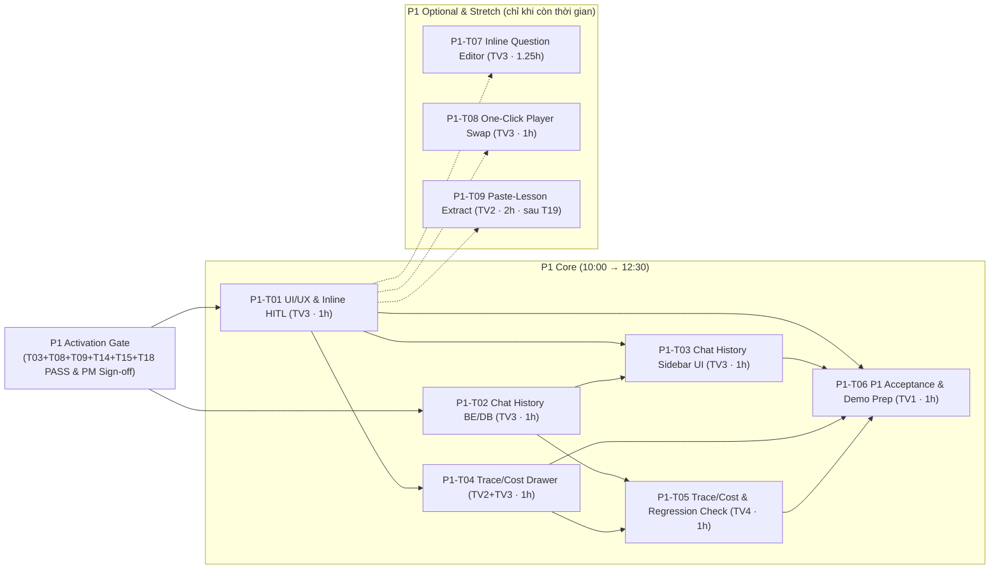

# PHASE 1 (P1) TASK PLAN — PRODUCT EXPERIENCE & AI TRANSPARENCY

> **Tài liệu lập kế hoạch & phân công Phase 1 (P1)** cho nhóm **4ChangLinhNguLam (Lớp L3A · Track A · AI Game Composer)**.  
> **Single Source of Truth cho P0:** `docs/TASKS.md` (T01–T21, không thay đổi hay đánh lại mã).  
> **Cơ sở lập kế hoạch:** Hiện trạng codebase ngày `28/11/2026 01:05` (`main` @ `8be7d5f`, `origin/main` @ `b4b288b`, nhánh `origin/feat/ui-ux-refactor` @ `e399a66`, nhánh `origin/feature/chatbot` @ `225a589`, `evidence/summary.md` S1–S6).  
> **Trạng thái Gate hiện tại:** **CHƯA ĐẠT (LOCKED)** — toàn bộ task P1 đang ở trạng thái `BLOCKED` / `PLANNED`, **không được tự triển khai** cho đến khi P0 ổn định và PM (TV1) xác nhận mở khóa.

---

## 1. Phase Overview

- **Tên giai đoạn:** **Phase 1 (P1) – Product Experience & AI Transparency**.
- **Định vị:** Nâng cấp trải nghiệm giáo viên, tính liên tục khi làm việc (**Persistent Chat History**), khả năng giải thích quyết định AI (**Trace/Cost Drawer**), công cụ chỉnh sửa/kiểm duyệt câu hỏi (**Question Set Editor**) và tái sử dụng trò chơi (**One-Click Player Swap**) **trên nền P0 đã ổn định**, không làm vỡ luồng Evaluation (`T18 → T10 → T19`).
- **Tái sử dụng tài sản sẵn có trong repo (không xây dựng lại từ đầu):**
  - Bảng SQLite `chats(id, user_id, title, messages, created)` trong `ailab/store.py` (dòng 86) và các endpoint `GET /api/chats`, `GET /api/chats/<id>`, `POST /api/chat`, `POST /api/chats/<id>/proposals/<idx>/(try|accept|reject)` trong `ailab/server.py` (dòng 432–498) **đã tồn tại trên `main`**.
  - Giao diện EdTech SaaS, Inline HITL Card và Sidebar lịch sử `<aside class="ail-chat-history">` **đã có sẵn phần lớn trên nhánh `origin/feat/ui-ux-refactor`** (`ailab/web/js/views-assistant.js`).
  - `codebase/tracing.py`, `ailab/composer.py` và `ailab/store.py: parse_questions()` **đã pass 239/239 unit tests trên `main`**.
  - *Quyết định kiến trúc:* Không sử dụng server tách riêng `ailab/chatbot_server.py` trên nhánh `origin/feature/chatbot` để tránh phân mảnh kiến trúc; chỉ tham khảo ý tưởng state/idempotency cho giai đoạn Post-Hackathon nếu cần.

### Phân biệt 3 khái niệm hội thoại (làm rõ phạm vi P1)

| Khái niệm | Định nghĩa | Thuộc P1? |
|---|---|---|
| **Persistent Chat History** *(Lịch sử hội thoại bền vững)* | Lưu trữ tin nhắn User/Assistant, `ApplicationPlan` snapshot và liên kết App/Exam vào SQLite (`chats`); hiển thị Sidebar, mở lại sau reload/đăng nhập, đổi tên, xóa an toàn — **0 LLM call khi xem lại**. | **CÓ (P1 Core)** |
| **Multi-turn Conversation** *(Hội thoại đa lượt chỉnh sửa sâu)* | Gửi toàn bộ ngữ cảnh nhiều lượt cho LLM để chỉnh sửa lặp đi lặp lại gameplay/HTML phức tạp qua nhiều vòng chat. | **KHÔNG (Deferred)** *(P0 chỉ giữ 1 lượt `ASK_CLARIFY`)* |
| **Long-term Memory** *(Bộ nhớ dài hạn xuyên phiên)* | Tự động trích xuất và ghi nhớ sở thích, phong cách dạy, hồ sơ lớp học của giáo viên xuyên suốt nhiều tuần/nhiều phiên khác nhau. | **KHÔNG (Deferred)** |

---

## 2. Phase Objectives

1. **Giảm ma sát cho giáo viên:** Biến trải nghiệm tạo, xem lại và duyệt trò chơi thành 1 luồng liền mạch ngay trong Workspace (tận dụng `feat/ui-ux-refactor` + Persistent Chat History).
2. **Minh bạch hóa AI (HAX G11):** Cho phép giáo viên và giám khảo xem trực tiếp quyết định `REUSE`/`GENERATE`, tool calls thật, kết quả Rules và ước tính token/chi phí mà không lộ secret hay system prompt.
3. **Nâng cao chất lượng kiểm duyệt nội dung:** Khớp trực tiếp pain mạnh nhất từ `evidence/summary.md` (`6/6` khó soạn câu hỏi, `2/6` sai sót đáp án, `S5` phản ánh quiz lặp gây nhàm chán).
4. **Bảo toàn tuyệt đối P0 & chuỗi Evaluation:** Không đụng Benchmark/Metric Spec đã freeze (`24/30`, 6 metric), không làm lệch so sánh Run 1 → Run 2, mọi tính năng P1 đều có cơ chế rollback gọn.

---

## 3. Scope & Out of Scope (Chuẩn hóa ranh giới P0 vs P1)

> **Lưu ý chuẩn hóa ID:** Đã gộp và đánh mã thống nhất `P1-T01` → `P1-T09` (khắc phục sự lệch đánh số `P1-2`/`P1-3` giữa bảng và mục phân tích trong báo cáo Audit trước).

| Phân loại | Hạng mục cụ thể | Ghi chú ranh giới |
|---|---|---|
| **P0 chưa hoàn thành (Bắt buộc trước CP3/CP4 — KHÔNG chuyển sang P1)** | `T03` (đạt ≥3 phỏng vấn sâu hoặc ≥20 khảo sát), `T08`+`T09` (Real AI Routing/QGen/Guardrails trong `codebase/agent.py`), `T14` (tích hợp Web/Backend với Real Agent, Shared Core & HITL bắt buộc), `T15` (Video 30s Real AI trước CP3 & E2E CP4), `T18`→`T10`→`T19` (Eval Run 1→2), `T20` (Cost ≥50 phiên), `T04` (UAT), `T05` (Slides/Demo), `T21` (Final). | Giữ nguyên trong `docs/TASKS.md`. **Việc nối Real Agent + HITL bắt buộc thuộc `T14`, không thuộc P1.** |
| **P0 cần tích hợp / kiểm chứng** | Thống nhất 1 đường tích hợp duy nhất qua `ailab/server.py` + `codebase/agent.py` (không chạy song song `chatbot_server.py`); hoàn tất biên bản chấm chéo 5 output cho `T17`. | Xử lý trong `T14` và `T17`. |
| **P1 Core (Ưu tiên khi Gate đạt)** | `P1-T01` (UI/UX Enhancement & Inline HITL Card vượt ngoài AC T14), `P1-T02` (Chat History Backend/Schema), `P1-T03` (Chat History Sidebar UI & Plan/App Recovery), `P1-T04` (Explainable Decision & Trace/Cost Drawer), `P1-T05` (P1 Trace/Cost Verification & Regression Guard), `P1-T06` (P1 Acceptance & Demo Integration). | Tận dụng code sẵn, rủi ro thấp, không chạm prompt chấm Benchmark. |
| **P1 Optional (Làm nếu xong P1 Core trước 12:00)** | `P1-T07` (Inline Question Set Editor & Real-time Format Validation), `P1-T08` (One-Click Anti-Boredom Player Swap — zero-token). | Rất mạnh cho Demo & pain S1–S6 nhưng cắt giảm trước nếu sát giờ Cutoff. |
| **Stretch Goal (Chỉ làm sau khi Run 2 chốt & TV2 rảnh)** | `P1-T09` (Paste-Lesson / Document-to-Exam Extraction). | Đụng prompt AI Core nên **chỉ bật sau `T19`** qua feature flag riêng. |
| **Deferred (Post-Hackathon)** | Multi-turn Conversation chỉnh sửa gameplay nhiều vòng; Long-term Memory; Multi-turn HTML Tweaker; Student Phone QR Controller; Audio/Voice Interaction Runtime thật; Tự huấn luyện Model mới; Mở rộng Catalog quy mô lớn. | Không triển khai trong Hackathon. |

---

## 4. P1 Activation Gate (Điều kiện bắt buộc để mở khóa P1)

> **Nguyên tắc:** Không xem việc đã nộp form CP3 là bằng chứng duy nhất cho thấy P0 đã ổn định. Mọi task P1 giữ trạng thái `BLOCKED` / `PLANNED` cho đến khi **toàn bộ 9 điều kiện** dưới đây được xác nhận:

- [ ] **G1 — Real AI REUSE E2E:** Luồng P0 `REUSE` (cùng nhánh `GENERATE` bản nháp có giới hạn) chạy ổn định với Real LLM qua `codebase/agent.py` (`T08` xong).
- [ ] **G2 — Shared Core Web/CLI:** `ailab/server.py` và `python run.py` dùng chung lõi xử lý `ApplicationPlan` Contract, không phụ thuộc mock (`T14` xong).
- [ ] **G3 — HITL & Guardrails verified:** Kiểm chứng được 0% bypass HITL (`DRAFT`/`APPROVED`/`REJECTED`) và `check_game` + `parse_questions()` hoạt động (`T09`, `T14` xong).
- [ ] **G4 — CP3 đáp ứng đủ điều kiện BTC:** Đã có đủ bài nộp CP3 hợp lệ trước 10:00 ngày 28/11 (gồm Video 30s Real AI của `T15`).
- [ ] **G5 — Evidence đạt ngưỡng R1:** `T03` đạt tối thiểu **≥3 phỏng vấn sâu (`P1–P3.md`)** hoặc **≥20 phiếu khảo sát** + ≥5 trích dẫn nguyên văn (vượt điều kiện cứng xét giải).
- [ ] **G6 — Evaluation Run 1 hoàn tất:** `eval/run-1.csv` đã chạy đủ 30 câu bằng Real AI, chấm `pass` và lưu kết quả (`T18` xong).
- [ ] **G7 — Không còn Critical Path Blocker:** Không có lỗi nghiêm trọng chặn `T10`, `T19`, `T20` hoặc luồng demo live.
- [ ] **G8 — Bảo toàn nguồn lực CP4:** TV2/TV4 đã chốt đủ thời gian cho `T10 → T19` (Run 2 & Report), `T20` (Cost ≥50 phiên), TV1/TV3 đủ thời gian cho `T04` (UAT), `T15` (Backup Video) và `T05` (Slides/Pitch).
- [ ] **G9 — PM Sign-off:** TV1 xác nhận chính thức mở khóa P1 Core (và quyết định có mở P1 Optional hay không) trên nhóm team.

---

## 5. Task Overview

| Task ID | Task Name | Owner | Priority | Dependency | Effort | Deadline | Status |
|---|---|---|---|---|---|---|---|
| `P1-T01` | UI/UX Enhancement & Inline HITL Plan Card | TV3 | P1 Core | `T14`, `P1 Gate` | 1.0h | 28/11 11:00 | BLOCKED |
| `P1-T02` | Persistent Chat History — Backend & Schema Extension | TV3 | P1 Core | `T14`, `P1 Gate` | 1.0h | 28/11 11:15 | BLOCKED |
| `P1-T03` | Persistent Chat History — Sidebar UI & Plan/App Recovery | TV3 | P1 Core | `P1-T01`, `P1-T02` | 1.0h | 28/11 12:00 | BLOCKED |
| `P1-T04` | Explainable AI Decision Metadata & Trace/Cost Drawer | TV2 | P1 Core | `T08`, `T09`, `T14`, `P1-T01` | 1.0h | 28/11 12:00 | BLOCKED |
| `P1-T05` | P1 Trace/Cost Verification & Regression Guard | TV4 | P1 Core | `T18`, `T19`, `P1-T02`, `P1-T04` | 1.0h | 28/11 12:30 | BLOCKED |
| `P1-T06` | P1 Product Acceptance, UAT & Demo Integration | TV1 | P1 Core | `P1-T01`, `P1-T03`, `P1-T04`, `P1-T05` | 1.0h | 28/11 13:15 | PLANNED |
| `P1-T07` | Inline Question Set Editor & Real-time Format Validation | TV3 | P1 Optional | `P1-T01` | 1.25h | 28/11 12:30 | PLANNED |
| `P1-T08` | One-Click Anti-Boredom Player Swap (Zero-Token) | TV3 | P1 Optional | `T12`, `T13`, `P1-T01` | 1.0h | 28/11 12:30 | PLANNED |
| `P1-T09` | Paste-Lesson / Document-to-Exam Extraction | TV2 | Stretch Goal | `T10`, `T19`, `P1-T01` | 2.0h | 28/11 13:00 | PLANNED |

---

## 6. Detailed Tasks

### `P1-T01` — UI/UX Enhancement & Inline HITL Plan Card
- **Mục tiêu:** Nâng cấp giao diện Trợ lý game từ mức tối thiểu đạt AC của `T14` lên trải nghiệm EdTech SaaS trực quan, hiển thị Inline `ApplicationPlan` Card và 1-Click Sandbox Preview.
- **Mô tả công việc:**
  - Merge chọn lọc phần giao diện từ nhánh `origin/feat/ui-ux-refactor` (`ailab/web/js/views-assistant.js`, `views-core.js`, `dom.js`, `list-page.js`, `style.css`).
  - Vô hiệu hóa/ẩn hoàn toàn `mock-adapter.js` trong Real Mode để tuyệt đối không hiển thị dữ liệu giả như dữ liệu thật.
  - Render rõ trên Inline Card: nhánh quyết định (`REUSE` / `GENERATE`), tên Model + Player + Badge `Mouse Fallback ON`, cảnh báo kiểm duyệt kiến thức bộ đề AI sinh, nút **Xem thử Sandbox** và nút **Phê duyệt** gọi thật API Backend.
- **Owner chính:** TV3 · **Collaborator:** TV1 (review UX).
- **Priority:** `P1 Core` · **Dependency:** `T14`, `P1 Gate` · **Effort:** `1.0h` · **Deadline:** `28/11 11:00`.
- **Deliverables:** Giao diện mới tích hợp sạch vào `ailab/web/`, không dùng mock trong Real Mode.
- **Acceptance Criteria:**
  - [ ] 100% thao tác gửi prompt, xem thử và phê duyệt sử dụng dữ liệu & API thật từ `ailab/server.py`.
  - [ ] Không có badge/dữ liệu mock xuất hiện khi chạy Real Mode.
  - [ ] Không làm hỏng luồng P0 (đăng nhập, quản lý Model/Player/Exam/App, `REUSE` E2E, `GENERATE` nháp, `Mouse Fallback`).
  - [ ] Trải nghiệm preview và phê duyệt rõ ràng (≤2 thao tác sau khi nhận kế hoạch).
- **Test/Verification:** Chạy `python -m unittest discover -s ailab -p "test_*.py"`, `bash ailab/smoke.sh` và kiểm tay 1 ca `REUSE` + 1 ca `GENERATE` trên trình duyệt.
- **Risk:** Trung bình (có thể lệch CSS/event cũ ở tab khác nếu merge vội) · **Status:** `BLOCKED`.

---

### `P1-T02` — Persistent Chat History: Backend & Schema Extension
- **Mục tiêu:** Mở rộng cơ chế lưu hội thoại sẵn có trong `ailab/store.py` (`chats`) và `ailab/server.py` để hỗ trợ đầy đủ lưu/khôi phục `ApplicationPlan`, liên kết trò chơi/bộ đề, đổi tên và xóa hội thoại an toàn.
- **Thiết kế kỹ thuật gọn (tái sử dụng 100% bảng `chats` sẵn có — không tạo bảng thừa):**
  - **Database Schema (`ailab/store.py`):** Giữ bảng `chats(id, user_id, title, messages, created)` và thêm migration an toàn `ALTER TABLE chats ADD COLUMN updated REAL NOT NULL DEFAULT 0` (tự động back-fill `updated = created` cho DB cũ).
  - **Cấu trúc phần tử Assistant trong `chats.messages` (JSON):**
    ```json
    {
      "role": "assistant",
      "text": "...",
      "ts": 1764290000,
      "plan_snapshot": { "...ApplicationPlan v1.0..." },
      "linked_refs": { "app_id": 12, "exam_id": 7, "player_id": 1 },
      "trace_summary": { "decision": "REUSE", "tool_calls": [], "tokens_in": 0, "tokens_out": 0 }
    }
    ```
    *Lưu ý HITL:* Khi `GET /api/chats/<id>` trả về, Backend đọc **trạng thái duyệt hiện hành** của `app_id` / `player_id` từ bảng `apps` / `players` (không tin cứng trạng thái cũ trong JSON) để tránh lệch trạng thái HITL.
  - **API Contract (`ailab/server.py`, yêu cầu session cookie & kiểm tra `user_id = user["id"]`):**
    - `GET /api/chats` *(đã có — cập nhật `ORDER BY updated DESC, id DESC`)* → trả `{chats: [{id, title, created, updated}]}`.
    - `GET /api/chats/<id>` *(đã có — bổ sung đồng bộ `live_status` cho `linked_refs`)* → **chỉ đọc DB, 0 LLM call**.
    - `POST /api/chat` *(đã có — lưu kèm `plan_snapshot`, `linked_refs`, cập nhật `updated`)*.
    - `PATCH /api/chats/<id>` *(mới)* `{title: str}` (1–80 ký tự) → đổi tên hội thoại của chính chủ (`404` nếu không thuộc `user_id`).
    - `DELETE /api/chats/<id>` *(mới)* → chỉ thực hiện `DELETE FROM chats WHERE id=? AND user_id=?`, **tuyệt đối không xóa `apps`, `players` hay `exams` liên kết**.
- **Owner chính:** TV3 · **Collaborator:** TV2 (đồng bộ field `plan_snapshot`).
- **Priority:** `P1 Core` · **Dependency:** `T14`, `P1 Gate` · **Effort:** `1.0h` · **Deadline:** `28/11 11:15`.
- **Deliverables:** Migration cột `updated` trong `ailab/store.py`, endpoint `PATCH`/`DELETE /api/chats/<id>` & đồng bộ `linked_refs` trong `ailab/server.py`, unit tests trong `ailab/test_ailab.py`.
- **Acceptance Criteria:**
  - [ ] Tạo chat mới và tự động lưu tin nhắn User/Assistant kèm `plan_snapshot` & `linked_refs` vào SQLite.
  - [ ] `GET /api/chats` và `GET /api/chats/<id>` chỉ trả dữ liệu của `user_id` đang đăng nhập (User A truy cập chat của User B nhận `404`/`403`).
  - [ ] Mở lại hội thoại qua `GET /api/chats/<id>` phát sinh **0 LLM call** và phản ánh đúng trạng thái HITL thật trong DB (`DRAFT`/`APPROVED`/`REJECTED`).
  - [ ] `PATCH /api/chats/<id>` đổi tên thành công; `DELETE /api/chats/<id>` xóa hội thoại nhưng `GET /api/apps/<id>` và `GET /api/exams/<id>` liên kết vẫn còn nguyên vẹn (`200 OK`).
- **Test/Verification:** Unit test ownership, rename, delete-without-cascade, reload recovery và kiểm tra log trace `model_calls == 0` khi mở lại chat.
- **Risk:** Thấp (chỉ mở rộng bảng `chats` hiện có, tương thích ngược DB cũ) · **Status:** `BLOCKED`.

---

### `P1-T03` — Persistent Chat History: Sidebar UI, Rename/Delete & Plan/App Recovery
- **Mục tiêu:** Hoàn thiện giao diện Sidebar lịch sử hội thoại giúp giáo viên tạo mới, tìm lại sau reload/đăng nhập, đổi tên, xóa và mở lại ngay trò chơi/bộ đề đã tạo.
- **Mô tả công việc:**
  - Mở rộng `<aside class="ail-chat-history">` đã có trong `ailab/web/js/views-assistant.js` (từ `P1-T01`): thêm nút **Hội thoại mới**, nút **Đổi tên** (`PATCH /api/chats/:id`) và nút **Xóa** có hộp thoại xác nhận nêu rõ *"Chỉ xóa lịch sử chat, trò chơi và bộ đề đã lưu vẫn được giữ nguyên"*.
  - Khi reload trang hoặc đăng nhập lại và chọn 1 mục trên Sidebar → gọi `GET /api/chats/:id`, render lại toàn bộ tin nhắn, thẻ `ApplicationPlan` đã lưu, trạng thái duyệt thực tế và nút mở thẳng App/Exam tương ứng.
  - Xử lý rõ trạng thái rỗng, trạng thái lỗi mạng (nút Thử lại) và không cho gửi trùng khi đang loading.
- **Owner chính:** TV3 · **Collaborator:** TV1 (review UX).
- **Priority:** `P1 Core` · **Dependency:** `P1-T01`, `P1-T02` · **Effort:** `1.0h` · **Deadline:** `28/11 12:00`.
- **Deliverables:** Hoàn thiện Sidebar lịch sử & khôi phục kế hoạch/liên kết trong `ailab/web/js/views-assistant.js`.
- **Acceptance Criteria:**
  - [ ] Tạo hội thoại → F5 reload hoặc đăng xuất rồi đăng nhập lại → hội thoại vẫn hiện trên Sidebar đúng thứ tự mới nhất.
  - [ ] Bấm vào hội thoại cũ khôi phục đúng tin nhắn, `ApplicationPlan`, trạng thái HITL và link mở trò chơi đã tạo mà không gọi lại LLM.
  - [ ] Đổi tên cập nhật ngay trên Sidebar; xóa hội thoại biến mất khỏi Sidebar nhưng trò chơi ở tab **Ứng dụng** và bộ đề ở tab **Bộ đề** vẫn mở chơi bình thường.
- **Test/Verification:** Kiểm thử trên trình duyệt thật (tạo → reload → đăng xuất/đăng nhập lại → đổi tên → xóa → kiểm tab Ứng dụng & Bộ đề).
- **Risk:** Thấp · **Status:** `BLOCKED`.

---

### `P1-T04` — Explainable AI Decision Metadata & Trace/Cost Drawer (HAX G11)
- **Mục tiêu:** Cung cấp panel gập/mở giải thích quyết định AI minh bạch (nhánh `REUSE`/`GENERATE`, tool calls thật, kết quả Rules, token & chi phí ước tính) ngay dưới thẻ kế hoạch.
- **Mô tả công việc:**
  - **Phần AI/Backend (TV2 — 0.5h):** Bổ sung helper read-only xuất `trace_summary` từ `codebase/tracing.py` (gồm: `decision`, `reason_short`, `tool_calls` [tên tool + kết quả pass/fail tóm tắt], `rules_summary`, `model`, `tokens_in`, `tokens_out`, `est_cost_usd` tính từ `cost/personas.yaml`) gắn vào response Web API mà **không thay đổi hợp đồng `answer(text) -> {"output": str}`** cho CLI/Eval.
  - **Phần UI (TV3 — 0.5h):** Thêm Drawer gập/mở **"Chi tiết quyết định AI"** dưới mỗi thẻ kế hoạch; nếu thiếu dữ liệu (vd chế độ giả hoặc trường trống) hiển thị rõ *"Chưa có dữ liệu"*, tuyệt đối không tự điền số giả.
- **Owner chính:** TV2 · **Collaborator:** TV3 (UI Drawer), TV4 (xác nhận công thức giá).
- **Priority:** `P1 Core` · **Dependency:** `T08`, `T09`, `T14`, `P1-T01` · **Effort:** `1.0h` (TV2: 0.5h · TV3: 0.5h) · **Deadline:** `28/11 12:00`.
- **Deliverables:** Helper xuất `trace_summary` an toàn + Trace Drawer UI trên `views-assistant.js`.
- **Acceptance Criteria:**
  - [ ] Hiển thị quyết định & lý do dựa trên metadata thực tế từ hệ thống; `tool_calls` khớp 100% với file log `traces/`.
  - [ ] `tokens_in`, `tokens_out` và `est_cost_usd` truy được về API usage (`T07`) và bảng giá `cost/personas.yaml`.
  - [ ] **An toàn tuyệt đối:** Không hiển thị API key, system prompt, dữ liệu nhạy cảm hay chain-of-thought nội bộ của model.
  - [ ] Không bịa lý do, token hoặc tool calls khi thiếu dữ liệu.
- **Test/Verification:** Kiểm tra payload JSON response API + đối chiếu số token/tool calls với `traces/` và test trường hợp thiếu metadata.
- **Risk:** Rất thấp (chỉ đọc trace, không đổi luồng suy luận AI) · **Status:** `BLOCKED`.

---

### `P1-T05` — P1 Trace/Cost Verification & Regression Guard
- **Mục tiêu:** Đảm bảo mọi nâng cấp P1 Core không gây regression cho chuỗi Evaluation (`Run 1 → Run 2`), Benchmark đã freeze, Cost Simulation và Chat History không phát sinh chi phí ẩn.
- **Mô tả công việc:**
  - Đối chiếu số liệu trên Trace Drawer (`P1-T04`) với log thật từ `codebase/tracing.py` và bảng giá `cost/personas.yaml`.
  - Xác minh thao tác mở lại hội thoại cũ (`P1-T02`/`P1-T03`) phát sinh `0` lượt gọi model và `0` token.
  - Chạy `python run.py check`, kiểm tra `eval/benchmark.csv`, `eval/metric_spec.yaml`, `eval/run-1.csv`, `eval/run-2.csv` không bị chỉnh sửa ngoài quy định.
  - Ghi ngắn gọn kết quả xác minh P1 (không trộn vào kết quả Run 1/Run 2 của P0).
- **Owner chính:** TV4 · **Collaborator:** TV2.
- **Priority:** `P1 Core` · **Dependency:** `T18`, `T19`, `P1-T02`, `P1-T04` · **Effort:** `1.0h` · **Deadline:** `28/11 12:30`.
- **Deliverables:** Biên bản kiểm tra ngắn (regression + đối chiếu token/cost + zero-LLM history check) để TV1 nghiệm thu.
- **Acceptance Criteria:**
  - [ ] `python run.py check` giữ nguyên 0 cảnh báo; `eval/benchmark.csv` & `eval/metric_spec.yaml` không bị sửa sau freeze.
  - [ ] Token/cost hiển thị trên Drawer lệch `0%` so với trace & bảng giá `cost/personas.yaml`.
  - [ ] Xác minh `0` LLM call khi mở lại lịch sử hội thoại.
- **Test/Verification:** Chạy `python run.py check`, đối chiếu file log trace và test API `GET /api/chats/<id>`.
- **Risk:** Rất thấp · **Status:** `BLOCKED`.

---

### `P1-T06` — P1 Product Acceptance, UAT & Demo Integration
- **Mục tiêu:** Nghiệm thu toàn bộ tính năng P1 đã hoàn thành dưới góc độ giáo viên, xác nhận sẵn sàng cho Demo Zone/Phòng (CP4) và cập nhật kịch bản demo/slide nếu kịp Cutoff.
- **Mô tả công việc:**
  - Thực hiện checklist nghiệm thu P1 theo đúng AC của `P1-T01` → `P1-T05` (và `P1-T07`/`P1-T08` nếu có triển khai).
  - Kiểm tra rõ kịch bản demo 2 phút: tạo game `REUSE` → mở Trace Drawer giải thích công cụ & chi phí → F5 reload mở lại từ Sidebar Chat History → chơi bằng chuột (`Mouse Fallback`).
  - Chốt quyết định **Go / Rollback** cho từng tính năng P1 tại mốc **12:30 (Feature Cutoff)**; cập nhật ghi chú vào `spec.md` §10 (changelog) nếu có thay đổi sau CP2.
- **Owner chính:** TV1 · **Collaborator:** TV3.
- **Priority:** `P1 Core` · **Dependency:** `P1-T01`, `P1-T03`, `P1-T04`, `P1-T05` · **Effort:** `1.0h` · **Deadline:** `28/11 13:15`.
- **Deliverables:** Biên bản nghiệm thu P1 (Pass/Rollback theo từng tính năng) + kịch bản demo cập nhật cho `T05`.
- **Acceptance Criteria:**
  - [ ] Mọi tính năng P1 được giữ lại cho Demo đều đã chạy thử thành công trên môi trường thật (không dùng mock).
  - [ ] Không có lỗi P1 nào làm gián đoạn kịch bản demo P0 chính.
- **Test/Verification:** Chạy diễn tập toàn bộ kịch bản demo 2 phút trước 13:30.
- **Risk:** Thấp · **Status:** `PLANNED`.

---

### `P1-T07` — Inline Question Set Editor & Real-time Format Validation *(P1 Optional)*
- **Mục tiêu:** Cho phép giáo viên chỉnh sửa trực tiếp câu hỏi/đáp án AI sinh ngay trong bước HITL, xác thực định dạng tự động bằng Backend và buộc duyệt lại nếu sửa sau khi đã duyệt.
- **Mô tả công việc:**
  - Hiển thị bộ câu hỏi dạng danh sách có thể sửa trực tiếp trên Inline HITL Card.
  - Thêm endpoint nhẹ `POST /api/exams/validate` gọi trực tiếp `ailab/store.py: parse_questions()` để báo lỗi từng dòng sai cú pháp/thiếu đáp án chuẩn (`=A`).
  - Chặn nút **Phê duyệt** khi bộ đề chưa qua `parse_questions()`; nếu sửa nội dung đã `APPROVED`, Backend đặt lại trạng thái cần phê duyệt lại.
  - Giữ nguyên nhãn cảnh báo phân biệt rõ: *kiểm tra định dạng bằng Rules ≠ kiểm chứng tính chính xác kiến thức (do giáo viên chịu trách nhiệm)*.
- **Owner chính:** TV3 · **Collaborator:** TV2, TV4.
- **Priority:** `P1 Optional` *(chỉ làm nếu P1 Core xong trước 12:00)* · **Dependency:** `P1-T01` · **Effort:** `1.25h` · **Deadline:** `28/11 12:30`.
- **Deliverables:** Editor UI trên `views-assistant.js`, endpoint `POST /api/exams/validate` trong `ailab/server.py`, unit tests.
- **Acceptance Criteria:**
  - [ ] Sửa câu hỏi/đáp án sai định dạng → Backend trả lỗi rõ dòng và chặn không cho phê duyệt.
  - [ ] Sửa nội dung hợp lệ → lưu đúng và hiển thị chính xác câu hỏi vừa sửa trong gameplay thực tế.
  - [ ] Chỉnh sửa nội dung sau khi đã `APPROVED` buộc phải phê duyệt lại trước khi xuất bản.
  - [ ] Giao diện phân biệt rõ *Hợp lệ định dạng (Rules)* với *Cần giáo viên kiểm duyệt kiến thức*.
- **Test/Verification:** Unit test `POST /api/exams/validate` + test E2E sửa 1 đáp án rồi mở game kiểm tra hiển thị.
- **Risk:** Trung bình (tăng tải cho TV3 sát giờ Cutoff) · **Status:** `PLANNED`.

---

### `P1-T08` — One-Click Anti-Boredom Player Swap (Zero-Token Reuse) *(P1 Optional)*
- **Mục tiêu:** Giải quyết nỗi đau nhàm chán quiz lặp lại (`S5` trong `evidence/summary.md`) bằng nút đổi vỏ Player giữ nguyên `Question Set` chỉ bằng Rules — **0 token LLM**.
- **Mô tả công việc:**
  - Từ một App/Plan đã có `Question Set`, cung cấp nút **"Đổi trò chơi khác"** chỉ liệt kê các Player tương thích lọc qua `ailab/composer.py: validate_compatibility()`.
  - Khi giáo viên chọn Player mới: giữ nguyên `exam_id`/`content`, kiểm tra lại Model–Player Compatibility, giữ `Mouse Fallback` hoạt động, tạo bản nháp mới yêu cầu giáo viên xác nhận lại (tuân thủ HITL) — **không gọi `call_model()`**.
- **Owner chính:** TV3 · **Collaborator:** TV4 (xác minh 0 LLM call).
- **Priority:** `P1 Optional` *(chỉ làm nếu còn dư thời gian trước 12:30)* · **Dependency:** `T12`, `T13`, `P1-T01` · **Effort:** `1.0h` · **Deadline:** `28/11 12:30`.
- **Deliverables:** Endpoint/UI đổi Player giữ nguyên bộ đề trên `ailab/server.py` & `ailab/web/js/`.
- **Acceptance Criteria:**
  - [ ] Giữ nguyên 100% nội dung `Question Set` khi đổi Player; chỉ hiển thị Player tương thích từ Catalog.
  - [ ] Kiểm tra lại Model–Player Compatibility và xác minh `Mouse Fallback` vẫn chơi được trên Player mới.
  - [ ] Thay đổi Player tuân thủ bước xác nhận HITL; xác minh `0` LLM call phát sinh.
- **Test/Verification:** Test đổi Quiz ABCD ↔ Vòng quay / Cầu Lông 3D giữ nguyên bộ đề và kiểm tra `model_calls == 0`.
- **Risk:** Thấp–Trung bình (chỉ lo quá tải thời gian của TV3) · **Status:** `PLANNED`.

---

### `P1-T09` — Paste-Lesson / Document-to-Exam Extraction *(Stretch Goal)*
- **Mục tiêu:** Cho phép giáo viên dán một đoạn văn bản bài giảng ngắn để AI trích xuất thành bộ câu hỏi bám nguồn (`[nguồn: đoạn X]`), giảm rủi ro AI bịa kiến thức.
- **Mô tả công việc:**
  - Thêm trường tùy chọn `source_text` (giới hạn cứng ≤3.000 ký tự để kiểm soát token & chi phí) sau một feature flag `ENABLE_DOC_EXTRACT=0` (mặc định tắt).
  - Prompt trích xuất chỉ sinh câu hỏi từ đoạn dán kèm tham chiếu đoạn nguồn, qua `parse_questions()` và vẫn giữ cảnh báo yêu cầu giáo viên kiểm duyệt.
  - **Không trộn vào chuỗi Improvement Run 2 (`T10 → T19`):** chỉ bật thử nghiệm sau khi `eval/run-2.csv` đã chốt.
- **Owner chính:** TV2 · **Collaborator:** TV3 (ô nhập text nhỏ), TV4 (đo thêm token vào).
- **Priority:** `Stretch Goal` · **Dependency:** `T10`, `T19`, `P1-T01` · **Effort:** `2.0h` · **Deadline:** `28/11 13:00` *(chỉ làm nếu TV2 hoàn toàn rảnh sau T10/T19)*.
- **Deliverables:** Nhánh trích xuất câu hỏi sau feature flag + unit test kiểm giới hạn kích thước đầu vào.
- **Acceptance Criteria:**
  - [ ] Từ chối hoặc cắt cảnh báo đầu vào vượt quá giới hạn ký tự quy định.
  - [ ] Mỗi câu hỏi sinh ra có đối chiếu đoạn nguồn trong ngữ liệu dán, qua `parse_questions()`, giữ nguyên cảnh báo chưa xác minh.
  - [ ] Khi `ENABLE_DOC_EXTRACT=0`, hành vi của `codebase/agent.py` giữ nguyên 100% so với bản đã chạy Run 2.
- **Test/Verification:** Unit test giới hạn độ dài + chạy thử 2 đoạn bài giảng mẫu + xác minh tắt flag không ảnh hưởng Benchmark.
- **Risk:** Cao (đụng prompt AI Core & tăng token đầu vào) · **Status:** `PLANNED`.

---

## 7. Dependency & Execution Order



- **Critical Path của P1 Core:** `P1 Gate` → `P1-T01` + `P1-T02` *(TV3 làm liên tiếp, tận dụng code sẵn)* → `P1-T03` ∥ `P1-T04` *(TV2 làm metadata song song với TV3 làm Sidebar UI)* → `P1-T05` *(TV4 kiểm chứng)* → `P1-T06` *(TV1 nghiệm thu & đưa vào demo)*.
- **Khả năng tận dụng code sẵn:** `P1-T01` và `P1-T03` tận dụng trực tiếp `origin/feat/ui-ux-refactor`; `P1-T02` tận dụng trực tiếp bảng `chats` trong `ailab/store.py` và `/api/chats` trong `ailab/server.py`; `P1-T04` tận dụng trực tiếp `codebase/tracing.py`.

---

## 8. Workload by Owner

| Thành viên | Tasks P1 (Core / Optional / Stretch) | Tổng effort P1 Core | Tổng effort nếu thêm Optional/Stretch | Dependency chính từ P0 | Rủi ro quá tải |
|---|---|---:|---:|---|---|
| **TV1 (PM & Product Lead)** | Core: `P1-T06` (1.0h) | **1.0h** | 1.0h | `T03` (Evidence R1), `T04` (UAT), `T05` (Slides/CP4) | **Thấp** (giữ quỹ thời gian cho Slides & tập Pitch). |
| **TV2 (AI Agent Engineer)** | Core: `P1-T04` (0.5h BE) · Stretch: `P1-T09` (2.0h) | **0.5h** | 2.5h | `T08`, `T09` (trước CP3), `T10` (Improvement sau Run 1) | **Thấp ở P1 Core** (dồn lực cho `T10` trước; chỉ xem xét `P1-T09` sau `T19`). |
| **TV3 (Software Engineer)** | Core: `P1-T01` (1.0h), `P1-T02` (1.0h), `P1-T03` (1.0h), `P1-T04` (0.5h UI) · Optional: `P1-T07` (1.25h), `P1-T08` (1.0h) | **3.5h** | **5.75h** | `T14` (Web/HITL), `T15` (Video 30s CP3 & Backup Video CP4) | **CAO nếu ôm cả Optional** → bắt buộc chốt **chỉ làm P1 Core (3.5h)**; chỉ chọn tối đa 1 trong 2 Optional nếu xong `T14` sớm trước 08:30. |
| **TV4 (Data & Eval Engineer)** | Core: `P1-T05` (1.0h) | **1.0h** | 1.0h | `T18` (Run 1), `T19` (Run 2 & Report), `T20` (Cost ≥50 phiên) | **Trung bình** (bận `T19`+`T20` lúc 11:00–13:30 → `P1-T05` chỉ làm kiểm chứng nhẹ 1h). |
| **Toàn đội** | **6 Core · 2 Optional · 1 Stretch (9 tasks)** | **6.0h** | **10.25h** | P1 Activation Gate | Được kiểm soát nếu giữ chặt Feature Cutoff 12:30. |

---

## 9. Timeline & Feature Cutoff (Ngày 28/11/2026)

| Khung giờ | Mục tiêu chính | Quy tắc kỷ luật |
|---|---|---|
| **01:05 – 09:30** | **100% dồn lực P0 cho CP3:** `T03` (≥3 phỏng vấn sâu), `T08`+`T09` (Real AI), `T14` (Web/HITL), `T18` (Eval Run 1), `T15` (Video 30s Real AI). | **Cấm làm P1.** Không đổi scope P0. |
| **09:30 – 10:00** | Nộp **CP3** & rà soát **P1 Activation Gate (9 điều kiện)**. | Nếu Gate chưa đạt → giữ P1 đóng, tiếp tục fix P0. |
| **10:00 – 12:30** | **Cửa sổ triển khai P1 Core** (song song TV2 làm `T10`, TV4 làm `T19`+`T20`): TV3 làm `P1-T01 → P1-T02 → P1-T03`; TV2+TV3 làm `P1-T04`; TV4 làm `P1-T05`. | Nếu xong sớm trước 12:00 mới xem xét 1 task Optional (`P1-T07` hoặc `P1-T08`). |
| **12:30 (HARD CUTOFF)** | **DỪNG PHÁT TRIỂN TÍNH NĂNG (Feature Freeze).** | Mọi tính năng P1 chưa pass kiểm thử → **Rollback / tắt ngay**, không cố sửa sát giờ CP4. |
| **12:30 – 14:00** | `P1-T06` + `T04` (UAT), `T15` (Backup Video CP4), `T05` (hoàn thiện `demo-slides.pdf` & tập demo 2 phút). | Ưu tiên tuyệt đối bản demo ổn định và đủ 7 hạng mục bắt buộc. |
| **14:30** | Nộp **CP4** → Demo Zone (14:30–16:00) → Demo Phòng (16:00–18:00) → **Final 23:59 (`T21`)**. | Mọi sửa lỗi sau 14:30 ghi vào `spec.md` §10; không sửa chuẩn đạt / benchmark / kết quả Run 1–2. |

---

## 10. Phase Acceptance Criteria

Phase 1 được coi là hoàn thành khi đạt đủ các điều kiện sau:
1. Toàn bộ **P1 Core (`P1-T01` → `P1-T06`)** pass Acceptance Criteria tương ứng và chạy hoàn toàn bằng dữ liệu/API thật (0 dữ liệu mock trong Real Mode).
2. **Persistent Chat History** hoạt động bền vững qua reload & đăng nhập lại, bảo đảm quyền sở hữu `user_id`, **0 LLM call** khi mở lại lịch sử, và xóa hội thoại không làm mất `App`/`Exam`/`Player`.
3. **Trace/Cost Drawer** hiển thị đúng `tool_calls` và token/cost thật, không lộ secret/system prompt.
4. **Zero Regression đối với P0 & Evaluation:** 100% unit tests pass, `python run.py check` 0 cảnh báo, không thay đổi `eval/benchmark.csv`, `eval/metric_spec.yaml`, `eval/run-1.csv` hay `eval/run-2.csv`.

---

## 11. Risks & Rollback

| Rủi ro | Mức độ | Biện pháp phòng ngừa | Phương án Rollback nhanh |
|---|---|---|---|
| **TV3 quá tải** giữa `T14`/`T15` (P0) và `P1-T01..T03` | **Cao** | Tận dụng code sẵn ở `feat/ui-ux-refactor` & bảng `chats`; cắt ngay `P1-T07`/`P1-T08` nếu trễ mốc 11:30. | Dừng ở `P1-T01` + `P1-T02`, bỏ các task Optional trước Cutoff 12:30. |
| **Xung đột nhánh `feat/ui-ux-refactor`** với `T14` | **Trung bình** | Merge `T14` vào `main` trước, sau đó tạo nhánh P1 riêng từ `main` và chỉ lấy phần view/CSS cần thiết. | Revert 1 PR P1 duy nhất trên Git, quay về UI P0 của `T14`. |
| **Lệch kết quả Eval Run 1 → Run 2** do sửa AI Core | **Cao** | `P1-T01..P1-T08` không sửa prompt chấm Benchmark; `P1-T09` bị khóa sau `T19` bằng flag `ENABLE_DOC_EXTRACT=0`. | Tắt flag `ENABLE_DOC_EXTRACT=0` hoặc revert commit `P1-T09`. |
| **Lộ thông tin nhạy cảm** trên Trace Drawer (`P1-T04`) | **Trung bình** | Whitelist cứng các trường được phép trả ra UI (`decision`, `tool_calls`, `tokens_in`, `tokens_out`, `est_cost_usd`). | Ẩn nút mở Drawer bằng 1 cờ cấu hình UI. |
| **Xóa hội thoại làm hỏng App/Exam** (`P1-T02`) | **Thấp** | SQL `DELETE` chỉ chạy trên bảng `chats`, không có `ON DELETE CASCADE` sang `apps`/`exams`/`players`; có unit test bắt buộc. | Tắt nút Xóa trên UI nếu phát hiện lỗi phút chót. |

---

## 12. Deferred Features (Post-Hackathon)

Các tính năng có tiềm năng nhưng **chính thức hoãn sang sau Hackathon** để bảo vệ CP4 và Final Submission:
1. **Multi-turn Conversation đầy đủ** (chỉnh sửa gameplay/luật chơi lặp nhiều vòng qua chat) và **Long-term Memory** (ghi nhớ hồ sơ lớp học/giáo viên xuyên nhiều phiên).
2. **Multi-turn HTML Gameplay Tweaker** (tự sửa logic/đồ họa game HTML mới sinh nhiều vòng).
3. **Multi-device Student Phone Controller / QR Room** (đòi hỏi hạ tầng WebSocket/mạng lớp học thực tế).
4. **Audio/Voice Interaction Runtime thật** (Runtime hiện tại chưa hỗ trợ mô hình âm thanh).
5. **Tự huấn luyện Model nhận diện mới** và **mở rộng Catalog quy mô lớn** (cộng đồng chia sẻ công khai, phân trang/tìm kiếm nâng cao).
