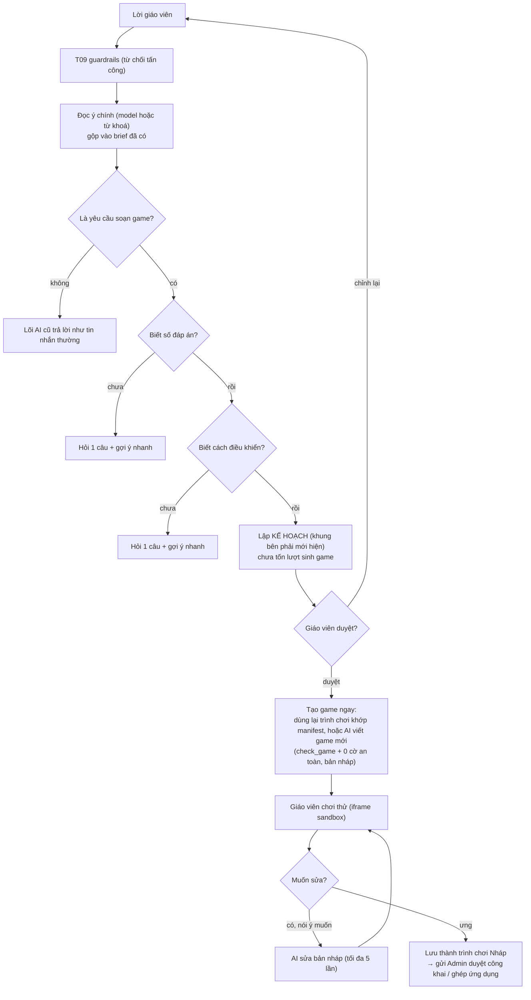
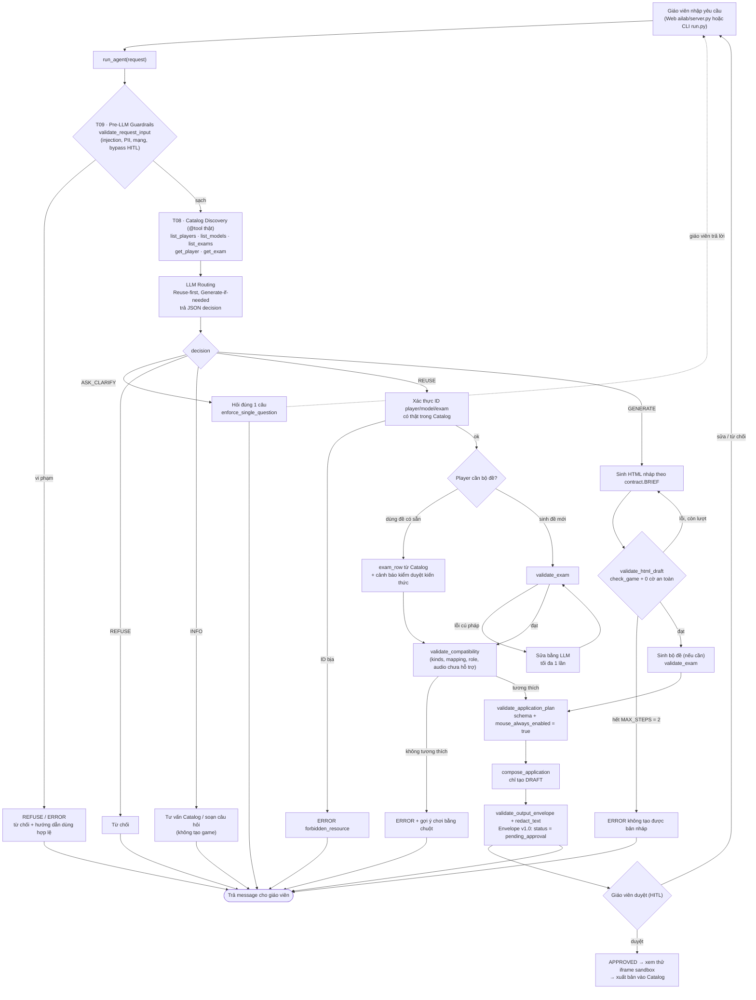

# Luồng hoạt động chatbot tạo game (AI Game Composer)

## Luồng Soạn trò chơi trên Web (mới, `ailab/game_flow.py` · `/api/flow`)

Chỉ hỏi **hai ý chính**, không hỏi môn học (trình chơi dùng lại được cho mọi môn):
1. Mỗi câu hỏi có mấy đáp án: 2 (Đúng/Sai), 3 hoặc 4 (A–D).
2. Học sinh điều khiển bằng gì: hình ảnh, tư thế, âm thanh hay chỉ chuột. **Không bắt buộc đã có model**: tạo sau ở "Mô hình tương tác", gắn khi tạo ứng dụng.

- Trạng thái (`brief`) do trình duyệt giữ; máy chủ tính lại kế hoạch từ brief, không tin kế hoạch từ máy khách.
- Chọn trình chơi có sẵn theo manifest (có bộ câu hỏi, đủ ô đáp án, hỗ trợ loại model đã chọn), không theo môn học.
- Luồng lõi cũ (`/api/agent`, `python run.py`, eval) giữ nguyên; bên dưới là sơ đồ của nó.

---

## Luồng lõi cũ (`codebase/agent.py`, dùng cho `python run.py`/eval và `/api/agent`)

Nguồn: `codebase/agent.py` (`run_agent`), `codebase/guardrails.py`, `codebase/tools.py`.

## Điểm chính
- **Bảo vệ 2 lớp:** guardrails trước LLM chặn tấn công; sau LLM kiểm bằng luật cứng (ID thật, tương thích, schema, `check_game`).
- **Ưu tiên REUSE:** chỉ `GENERATE` khi Catalog không có cơ chế phù hợp; tối đa 2 lượt (`MAX_STEPS`).
- **Giới hạn sửa lỗi:** sửa bộ đề tối đa 1 lần (`MAX_EXAM_RETRIES`).
- **AI không tự duyệt:** kết quả luôn là `DRAFT` / `pending_approval`; chỉ giáo viên chuyển sang `APPROVED`; Mouse Fallback luôn bật.

> Lưu ý: phần giữa `agent.py` (`_handle_reuse` → `run_agent`) dựng từ docstring và các hàm đã đọc; các nhánh lỗi chi tiết có thể lệch đôi chút.
