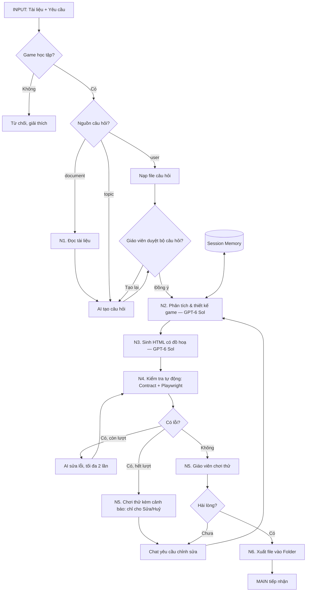

# Chatbot tạo game học tập

Chatbot web (FastAPI + JS thuần) giúp giáo viên tạo **game học tập HTML có chấm điểm** từ tài liệu hoặc chủ đề. Chỉ nhận yêu cầu game học tập; bộ câu hỏi được duyệt trước khi sinh game, và game chỉ được xuất khi qua kiểm tra tự động.

## Yêu cầu

- Python 3.11+
- Khóa API OpenAI (`OPENAI_API_KEY`)

## Cài đặt

```
pip install -e ".[dev]"
python -m playwright install chromium
cp .env.example .env
```

Sau đó mở `.env` và điền `OPENAI_API_KEY` (và `OPENAI_BASE_URL` nếu dùng endpoint khác).

## Chạy

```
uvicorn app.main:create_app --factory --reload
```

Mở http://127.0.0.1:8000

Lưu ý: server cần `OPENAI_API_KEY` trong `.env` mới khởi động được, vì `create_app()` khởi tạo `OpenAILLM`.

## Biến môi trường

Lấy từ `.env.example`:

| Nhóm | Biến | Ý nghĩa |
|---|---|---|
| LLM | `OPENAI_API_KEY`, `OPENAI_BASE_URL` | Khóa và endpoint OpenAI |
| LLM | `DESIGN_MODEL`, `CODEGEN_MODEL`, `FIX_MODEL`, `QUESTION_MODEL`, `INTAKE_MODEL` | Model cho từng bước (mặc định `gpt-6-sol`) |
| LLM | `LLM_TIMEOUT_S`, `LLM_MAX_RETRIES` | Timeout (giây) và số lần thử lại |
| Vòng lặp | `MAX_FIX_ATTEMPTS` | Số lần AI sửa lỗi tối đa (mặc định 2) |
| Vòng lặp | `MAX_REVISION_ROUNDS` | Số vòng chỉnh sửa tối đa mỗi phiên (mặc định 10) |
| Vòng lặp | `DEFAULT_NUM_QUESTIONS` | Số câu hỏi mặc định (mặc định 10) |
| Giới hạn | `MAX_DOC_CHARS`, `MAX_UPLOAD_MB`, `MAX_FILES_PER_SESSION` | Giới hạn đầu vào |
| Kiểm thử N4 | `PLAYWRIGHT_TIMEOUT_MS`, `HEADLESS` | Cấu hình Playwright |
| Thư mục | `SESSIONS_DIR`, `OUTPUT_DIR`, `MAIN_INBOX_DIR` | Thư mục lưu phiên, file xuất, bàn giao MAIN |
| Bàn giao | `MAIN_WEBHOOK_URL` | Webhook báo MAIN (có thể để trống) |

Không commit `.env` và không log API key.

## Cấu trúc thư mục

```
app/
  main.py              # FastAPI app factory, mount static, routers
  config.py            # Settings đọc từ .env
  api/                 # REST (sessions), SSE (events), preview (iframe)
  core/                # models, store (Session Memory), events, llm, prompts
  domain/              # questions (schema bộ câu hỏi), contract (contract game)
  nodes/               # intake, N1 đọc tài liệu, N1b câu hỏi, N2 thiết kế,
                       # N3 sinh HTML, N4 kiểm thử, fixer, N5 review, N6 xuất
  chatbot/             # engine (state machine), pipeline (N2→N3→N4↔FIX), replies (câu chữ tiếng Việt)
  prompts/*.md         # prompt LLM
web/                   # index.html, chat.js, chat.css
tests/
  unit/  integration/  e2e/
  fixtures/            # game mẫu đạt contract, bộ câu hỏi mẫu, tài liệu mẫu
scripts/
  smoke_real_llm.py    # smoke test LLM thật (không chạy trong pytest)
docs/                  # SPEC, ARCHITECTURE, GAME_CONTRACT, QUESTION_SCHEMA
sessions/ output/ main_inbox/   # dữ liệu runtime (không commit)
```

## Sơ đồ luồng

Theo `docs/SPEC.md` §2:



Quy tắc bổ sung: có cổng "Game học tập?"; thiếu nguồn câu hỏi thì phải hỏi; duyệt bộ câu hỏi trước N2; hết lượt FIX mà vẫn lỗi thì không cho xuất; tối đa 10 vòng chỉnh sửa mỗi phiên.

## Chạy test

```
ruff check . && ruff format --check .
python -m pytest -q -m "not browser"     # nhanh, không cần trình duyệt
python -m pytest -q -m browser           # Playwright, cần chromium
python -m pytest tests/unit/test_xxx.py -q -x   # một file test
```

Test không bao giờ gọi LLM thật: dùng `FakeLLM` trong `tests/conftest.py`.

## Smoke test LLM thật

```
python scripts/smoke_real_llm.py
```

Chạy pipeline không giao diện (intake → N1b → N2 → N3 → N4 ↔ FIX) với chủ đề mẫu. Thoát với mã `0` nếu N4 pass, `1` nếu fail, `2` nếu thiếu `OPENAI_API_KEY`. Lệnh này tốn token thật.

## Tài liệu

| File | Vai trò |
|---|---|
| `CLAUDE.md` | Quy tắc cho agent code |
| `TASKS.md` | Danh sách task T01–T23 |
| `docs/SPEC.md` | Hành vi chatbot, luồng, state machine |
| `docs/ARCHITECTURE.md` | Stack, cấu trúc, model dữ liệu, API |
| `docs/GAME_CONTRACT.md` | Contract game HTML và kịch bản Playwright |
| `docs/QUESTION_SCHEMA.md` | Định dạng bộ câu hỏi |
