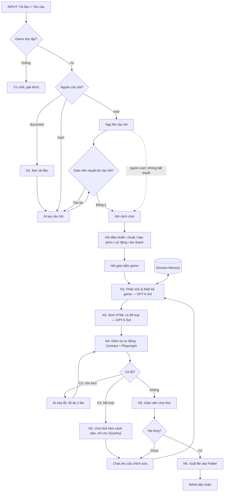

# SPEC — Chatbot tạo game học tập

> Tài liệu nguồn duy nhất về **hành vi sản phẩm**. Kiến trúc: `docs/ARCHITECTURE.md`.
> Contract game: `docs/GAME_CONTRACT.md`. Bộ câu hỏi: `docs/QUESTION_SCHEMA.md`.

## 1. Mục tiêu

Giáo viên trò chuyện với chatbot để tạo một **game học tập** dạng file HTML đơn. Game phải:
- dùng một **bộ câu hỏi** bắt buộc (giáo viên tự soạn, AI tạo từ tài liệu, hoặc AI tạo theo chủ đề);
- **chấm điểm** và có **màn hình kết quả cuối game**;
- qua kiểm thử tự động rồi mới đưa giáo viên chơi thử;
- được xuất ra thư mục và bàn giao cho hệ thống MAIN khi giáo viên hài lòng.

## 2. Luồng (theo sơ đồ gốc)



Bổ sung so với sơ đồ gốc (bắt buộc, đã chốt):
1. **Cổng "Game học tập?"** ở INPUT: yêu cầu không phải game học tập thì từ chối. Không chạy N1–N6.
2. **Nguồn câu hỏi bắt buộc.** Thiếu nguồn thì chatbot phải hỏi, không được đoán.
3. **Duyệt bộ câu hỏi** trước N2 (với nguồn `user` thì chỉ hiển thị, không bắt duyệt).
4. **Hết 2 lần sửa vẫn lỗi:** vẫn sang N5, nhưng **không cho xuất**. Chỉ có nút "Chỉnh sửa" và "Huỷ".
5. Chỉnh sửa ở N5 có thể đụng tới câu hỏi. Khi đó N2 trả `question_edit` và hệ thống sửa bộ câu hỏi trước khi sang N3.
6. Giới hạn **10 vòng chỉnh sửa** mỗi phiên. Quá giới hạn thì phiên chuyển sang `failed`.
7. **Thu thập đủ yêu cầu game trước N2** (mọi nguồn, kể cả `user`): sau khi có bộ câu hỏi hợp lệ,
   chatbot hỏi lần lượt 3 bước — **cách chơi** (`AWAIT_GAMEPLAY`), **điều khiển** bằng chuột/chạm,
   bàn phím, cử động cơ thể (camera) hay âm thanh/giọng nói (micro) (`AWAIT_CONTROLS`), và
   **giao diện** (`AWAIT_VISUAL`). Mỗi bước có nút gợi ý; gõ chữ khớp nhãn nút thì dùng nút, không
   khớp thì lấy nguyên văn làm mô tả tự do (không gọi LLM phân loại); chuỗi rỗng thì hỏi lại.
   Đủ 3 lựa chọn mới gửi tóm tắt và chạy N2. Ba lựa chọn lưu trong Session Memory
   (`gameplay`, `controls`, `controls_code`, `visual`) và là yêu cầu bắt buộc của N2 (chỉ sau yêu cầu chỉnh sửa).
8. **Gợi ý ý tưởng game có chiều sâu tương tác (F02):** ngay trước bước cách chơi, hệ thống chạy nền
   (`SUGGESTING_GAMES`, tiến độ "Đang gợi ý ý tưởng game…") node `game_ideas` (prompt `game_ideas`,
   model thiết kế) với yêu cầu gốc, môn, lớp, chủ đề, thống kê bộ câu hỏi + tối đa 3 câu mẫu.
   LLM trả **3 ý tưởng** khác nhau rõ rệt: câu hỏi gắn vào thế giới game (đáp án là cổng/làn/mục tiêu/
   vật phẩm/mảnh ghép…), ≥ 2 lớp tương tác ngoài chọn đáp án, hệ quả & tiến triển (mạng, combo,
   vật phẩm, màn khó dần), sai thì hiện giải thích. Bot liệt kê ý tưởng (tên, pitch, "Tương tác: …",
   "Tiến triển: …") với nút `idea_1..idea_3` ("💡 " + tên, ≤ 40 ký tự), `ideas_more` "🔄 Gợi ý khác"
   (gọi lại LLM kèm danh sách tên đã gợi ý để tránh lặp) và `gp_suggest` "Để trợ lý tự chọn".
   Các nút tĩnh F01 (`gp_*`) và mô tả tự do vẫn dùng được. Chọn ý tưởng thì lưu `game_concept`
   (đầy đủ) và `gameplay` = tên + pitch; ở bước điều khiển, các nút khớp `recommended_controls` lên đầu
   kèm "(gợi ý)" (id không đổi). Gợi ý lỗi (LLM lỗi/sai định dạng) **không FAILED**: bot báo nhẹ và
   hiện bộ nút tĩnh F01 (nếu đang "gợi ý khác" thì giữ các ý tưởng cũ).
   N2/N3/FIX luôn yêu cầu chiều sâu tương tác (kể cả khi không chọn ý tưởng AI) mà vẫn giữ contract.

## 3. Trạng thái hội thoại (state machine)

| State | Chatbot đang chờ | Thoát sang |
|---|---|---|
| `AWAIT_REQUEST` | Mô tả game | `AWAIT_SOURCE` / `REJECTED` |
| `AWAIT_SOURCE` | Chọn nguồn câu hỏi (3 nút) | `AWAIT_SOURCE_INPUT` |
| `AWAIT_SOURCE_INPUT` | Upload file câu hỏi / upload tài liệu / gõ chủ đề | `BUILDING_QUESTIONS` |
| `BUILDING_QUESTIONS` | (đang chạy N1/N1b) | `AWAIT_QUESTION_APPROVAL` / `SUGGESTING_GAMES` (nguồn user) / `AWAIT_SOURCE_INPUT` (nếu file lỗi) |
| `AWAIT_QUESTION_APPROVAL` | "Đồng ý" / "Tạo lại" + góp ý | `SUGGESTING_GAMES` / `BUILDING_QUESTIONS` |
| `SUGGESTING_GAMES` | (đang gợi ý 3 ý tưởng game; lỗi thì rơi về nút tĩnh) | `AWAIT_GAMEPLAY` |
| `AWAIT_GAMEPLAY` | Ý tưởng `idea_1..3` / `ideas_more` / `gp_suggest` (hoặc nút tĩnh `gp_*` khi gợi ý lỗi) / mô tả tự do | `AWAIT_CONTROLS` / `SUGGESTING_GAMES` (gợi ý khác) |
| `AWAIT_CONTROLS` | Điều khiển: chuột / bàn phím / camera / micro (4 nút hoặc mô tả tự do) | `AWAIT_VISUAL` |
| `AWAIT_VISUAL` | Giao diện (5 nút hoặc mô tả tự do) | `READY_TO_DESIGN` → `PIPELINE_RUNNING` |
| `PIPELINE_RUNNING` | (đang chạy N2→N3→N4↔FIX) | `AWAIT_REVIEW` |
| `AWAIT_REVIEW` | "Hài lòng" / "Chỉnh sửa" / "Huỷ" | `AWAIT_REVISION_TEXT` / `EXPORTING` / `CANCELLED` |
| `AWAIT_REVISION_TEXT` | Nội dung chỉnh sửa | `PIPELINE_RUNNING` |
| `EXPORTING` | (N6 + bàn giao MAIN) | `DONE` |
| `DONE` / `REJECTED` / `CANCELLED` / `FAILED` | Trạng thái kết thúc | — |

Quy tắc chung:
- Đang ở state "đang chạy" mà người dùng nhắn: trả lời "Đang xử lý bước X, vui lòng đợi". Không chạy song song.
- Người dùng gõ chữ khi đang có nút bấm: dùng LLM phân loại ý định thành một trong các nút. Không chắc thì hỏi lại.
  Ngoại lệ: 3 bước yêu cầu game (`AWAIT_GAMEPLAY/CONTROLS/VISUAL`) không gọi LLM phân loại; chữ không khớp nút là mô tả tự do
  (LLM chỉ được gọi để sinh ý tưởng ở `SUGGESTING_GAMES`).
- Mọi lỗi ngoài dự kiến: báo lỗi thân thiện, lưu vào memory. Phiên giữ nguyên state để thử lại (nút "Thử lại").

## 4. Kịch bản hội thoại mẫu (chuẩn để viết test e2e)

```
BOT : Xin chào! Thầy/cô muốn tạo game học tập về nội dung gì?
GV  : Tạo game ôn tập phân số cho lớp 4
BOT : Game học tập bắt buộc có bộ câu hỏi. Thầy/cô muốn lấy câu hỏi từ đâu?
      [Tôi có sẵn bộ câu hỏi] [Tạo từ tài liệu của tôi] [Tạo theo chủ đề]
GV  : (bấm) Tạo theo chủ đề
BOT : Thầy/cô nhập chủ đề và số câu (mặc định 10):
GV  : Phân số lớp 4, 8 câu
BOT : (tiến độ) Đang tạo bộ câu hỏi…
BOT : Bộ câu hỏi: 8 câu, tổng 80 điểm. [xem trước 5 câu] [Đồng ý] [Tạo lại]
GV  : Đồng ý
BOT : (tiến độ) Đang gợi ý ý tưởng game…
BOT : Bộ câu hỏi đã sẵn sàng. Mình gợi ý vài ý tưởng game có nhiều tương tác hơn là chỉ chọn đáp án:
      1. **Tiệm pizza phân số**
      Học sinh cắt và giao đúng phần pizza cho khách trước khi bánh nguội.
      Tương tác: kéo dao cắt pizza, kéo lát pizza vào đĩa khách, né ruồi bay
      Tiến triển: 3 trái tim, combo giao đúng liên tiếp, khách đến nhanh dần qua 3 màn
      2. … 3. …
      [💡 Tiệm pizza phân số] [💡 …] [💡 …] [🔄 Gợi ý khác] [Để trợ lý tự chọn]
      (gợi ý lỗi → "Mình chưa nghĩ ra ý tưởng mới lúc này…" + 6 nút cách chơi tĩnh của F01)
GV  : (bấm) 💡 Tiệm pizza phân số
BOT : Học sinh điều khiển game bằng gì?
      [Chuột / chạm màn hình (gợi ý)] [Bàn phím] [Cử động cơ thể (camera)] [Âm thanh / giọng nói (micro)]
GV  : dùng phím mũi tên và chuột
BOT : Thầy/cô muốn giao diện game trông thế nào? (gõ tự do màu sắc, nhân vật, bối cảnh)
      [Hoạt hình tươi sáng] [Vũ trụ / khoa học] [Thiên nhiên] [Tối giản, dễ đọc] [Pixel cổ điển]
GV  : nền xanh biển, nhân vật cá heo
BOT : Mình đã có đủ thông tin: 8 câu, 80 điểm; cách chơi …; điều khiển …; giao diện … Bắt đầu tạo game.
BOT : (tiến độ) Thiết kế game… → Sinh HTML… → Kiểm thử… (sửa lỗi 1/2)… → Đạt
BOT : Mời thầy/cô chơi thử: [iframe game] [Hài lòng — xuất file] [Chỉnh sửa] [Huỷ]
GV  : Chỉnh sửa → "Đổi màu nền sang xanh dương, thêm 2 câu về so sánh phân số"
BOT : (chạy lại N2 → sửa câu hỏi → N3 → N4) … Mời chơi thử phiên bản v2
GV  : Hài lòng — xuất file
BOT : Đã xuất game "…" (v2). MAIN đã tiếp nhận. [Tải về .zip]
```

Câu từ chối mẫu: *"Mình chỉ hỗ trợ tạo game học tập. Yêu cầu '…' không có mục tiêu học tập vì …
Thầy/cô có thể thử: 'Game ôn từ vựng tiếng Anh chủ đề động vật lớp 3'."*

## 5. Ràng buộc phi chức năng

- Tất cả chữ hiển thị cho người dùng bằng **tiếng Việt**.
- Model mặc định của N2/N3: `gpt-6-sol`. Cấu hình qua `.env`, không hard-code ở chỗ khác.
- Một bước LLM bị timeout (120 s) hoặc lỗi mạng thì retry tối đa 2 lần với backoff (2 s, 5 s).
- Tài liệu: `.pdf .docx .txt .md`, tối đa 10 MB/file, 5 file/phiên. Cắt còn `MAX_DOC_CHARS` ký tự.
- Bộ câu hỏi: 3–50 câu.
- Không log API key và nội dung `.env`.
- Mọi đường dẫn file từ người dùng phải nằm trong thư mục phiên (chống path traversal).
