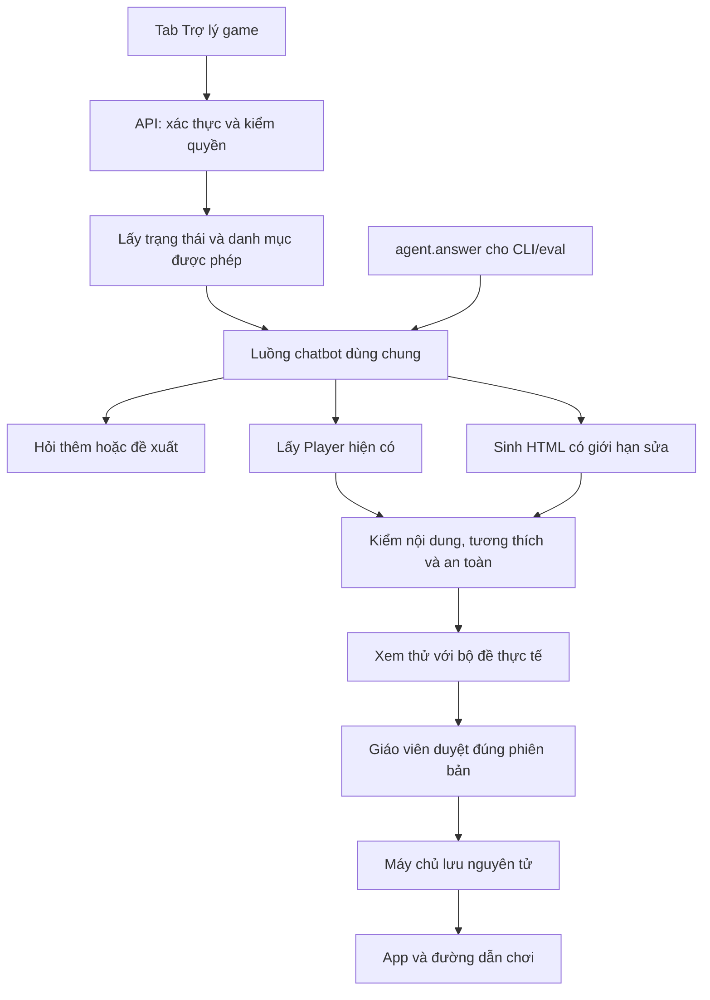

# Kiến trúc đề xuất cho Trợ lý game

## Lựa chọn

Dùng workflow (luồng có thứ tự và nhánh rõ ràng) trong Python hiện tại; không cần framework agent lớn. Agent coder là cách tổ chức phát triển, không đồng nghĩa sản phẩm cần nhiều agent AI chạy cùng lúc.



## Ranh giới trách nhiệm

| Lớp | Được làm | Không được làm |
|---|---|---|
| Giao diện | Hiển thị, gửi hành động rõ ràng, xem thử, xác nhận | Tự quyết quyền, tự gắn ready, nhúng key |
| API | Xác thực, lấy dữ liệu, kiểm quyền, lưu trạng thái, commit kết quả | Tin ID/approval do LLM hoặc trình duyệt tự khai |
| Workflow | Phân tích, lập phương án, sinh đề/game, trả đề xuất | Tự commit dữ liệu hay tự công khai |
| Repository adapter (lớp truy cập dữ liệu) | Gọi lại hàm store, lọc danh mục, lưu trong giao dịch | Bỏ kiểm quyền hoặc chép luật kiểm sang nơi khác |
| Validator (bộ kiểm tra) | Kiểm bằng code, ghi bằng chứng, yêu cầu người duyệt | Coi cờ regex hoặc LLM tự chấm là đủ kiểm chứng runtime |
| Runtime hiện có | Camera, model, thông điệp và iframe | Bị viết lại chỉ để hợp với chatbot |

## Cấu trúc dự kiến

```text
ailab/chatbot/
  __init__.py
  schemas.py          # cấu trúc dữ liệu và kiểm tra kiểu
  conversation.py     # ý định, yêu cầu nhiều lượt
  workflow.py         # điều phối nghiệp vụ
  catalog.py          # chọn Player và Model từ dữ liệu đã lọc quyền
  exams.py            # chuẩn bị câu hỏi, nguồn, chuyển định dạng
  production.py       # tái sử dụng hoặc gọi sinh HTML
  validation.py       # kết quả kiểm tra thống nhất
  documents.py        # tài liệu, giới hạn và nguồn
  repository.py       # tích hợp store; không giữ kết nối toàn cục
ailab/test_chatbot_*.py
```

Tên trên là đề xuất. G0 có thể thu gọn module, nhưng phải giữ một nơi duy nhất cho quy tắc hội thoại và kiểm tra, tránh các luồng web/eval lệch nhau.

## Tái sử dụng

- `codebase/ai.py: call_model`: tiếp tục là nơi gọi provider, giữ ghi token thực tế và decorator hiện có.
- `contract.parse/scan/secure`: tái sử dụng, không sao chép regex hay làm một hợp đồng HTML khác.
- `store.clean_exam/parse_questions/clean_app`: tái sử dụng sau khi có kiểm tra semantic (ý nghĩa nội dung) bổ sung.
- `store.get_*`, `player_usable`, `model_visible`: giữ kiểm quyền, đọc lại tại thời điểm xác nhận.
- `play.js`, `play.html`: dùng lại trang chơi. Chỉ đề xuất sửa tối thiểu nếu có bằng chứng lỗi chặn tích hợp.

## Hội thoại và lưu trữ

Lưu trạng thái yêu cầu riêng với chuỗi tin nhắn để không phụ thuộc 12 tin nhắn cuối hay HTML bị xóa sau accept. Trạng thái gồm version, requirements, plan, validation, confirmations, artifact IDs.

G0 cần chọn cách lưu: bảng/cột mở rộng có migration (nâng cấu trúc DB) không mất dữ liệu, hoặc metadata có phiên bản trong cấu trúc tương thích. Phải đọc được hội thoại cũ. Không tự triển khai migration chưa duyệt. Mỗi lần đổi yêu cầu tạo phiên bản mới và vô hiệu xác nhận cũ.

## Đồng thời và lỗi

- Không giữ giao dịch ghi SQLite trong lúc chờ LLM, tải tài liệu hoặc kiểm thử trình duyệt.
- Gọi AI xong phải so sánh version trước khi cập nhật; kết quả cũ không được ghi đè yêu cầu mới.
- Lưu Player mới, Exam mới, App và dấu xác nhận trong một giao dịch khi hoàn tất; rollback nếu lỗi. Cần tách hàm store hiện đang commit nội bộ nếu muốn dùng, trình thay đổi nhỏ trước khi sửa.
- Dùng idempotency (một hành động thử lại chỉ có một kết quả) cho xác nhận và tạo App; ràng buộc duy nhất phải được kiểm bằng DB/giao dịch, không chỉ khóa nút.
- Khi lỗi AI thật, báo lỗi có thể thử lại. Nếu có chế độ giả, đánh dấu rõ; không thay lặng lẽ game người dùng đã chọn.

## Kết nối đánh giá

`answer(text)->{"output":str}` là adapter (lớp chuyển đổi) gọi lõi dùng chung với danh mục kiểm thử được khai báo rõ; không tự lưu dữ liệu production. Bộ đánh giá từng câu không tự đại diện hội thoại nhiều lượt: cần thêm kịch bản session riêng. Giữ trace, token và không sửa file kết quả cũ.
